# How fragile are exactly-correct neural networks? A technical report on constructed, compiled, trained and LLM-written networks under parameter noise

*Technical report and lab notebook. Code, harness, data and every intermediate result are in the accompanying repository: GITHUB_REPO_URL*

## Summary

We asked a narrow question: **if a neural network computes a program exactly, how much random noise on its parameters can it take before it starts to make mistakes, and does that depend on how the network was built?** We studied it with a stack of experiments on small, fully specified computations (counting, histograms, sorting, reversing, parity, majority, bracket matching), on networks built five different ways: compiled from a program (Tracr), constructed by hand ("digital" restoring-state and bilinear designs), trained by gradient descent, composed from several programs, and written by a large language model (an LLM).

The main findings, with the strength of evidence stated up front:

1. **Compiled transformers are very fragile.** Transformers produced by the Tracr compiler stop being exact at noise levels of about 1e-4 to 1e-3 per parameter, 15 to 170 times lower (relative scale) than trained transformers of the same depth. The fragility sits in precise analog readouts from attention averages; counting is the extreme case and gets worse with sequence length (Part A, B). *Exploratory, many seeds, consistent across six programs.*
2. **Hand-built "restoring-state" designs are far more tolerant**, because each step snaps the state back to a valid value, and they come with provable guarantees: exactness for sequences of any length and a certified noise radius, which we also attacked to show it is within about 2 to 3 times of a real counterexample (Parts D, E, I). **This construction is not new**: second-order recurrent networks that encode automata with stability proofs were published by Omlin and Giles in 1996, and a related patent covers fault-tolerant variants (see Part M). We reproduce and extend it; we do not claim it.
3. **Several clever ideas did not work**: hardening compiled models by rescaling gives only a few times improvement and does not change the decay with length; certificate-driven and noise-injection training broke exactness; error-correcting sparse codes and a shared "universal interpreter" with programs stored in fast weights execute different programs exactly but save no memory or robustness over separate networks (Parts C, H, I). *These are negative results, reported in full.*
4. **LLM-written transformers are exactly correct surprisingly often and are about as fragile as compiled ones, with large variation between attempts.** In a fresh-session experiment 57 of 60 first answers were exactly correct on all 335,922 inputs of length up to 7; robustness spanned 6e-4 to 0.12, and attempts by the same LLM at the same task differed by up to 38 times, as much as the difference between LLM-built and compiled networks (Parts J, K). *Preliminary: one model family, one to three attempts per cell; one of the four experimental conditions was compromised by an operator error (Part K0).*
5. **A simple first-order model explains much of where failures happen.** A parameter-free predictor, written down before the held-out test, predicts noise failure levels of the LLM-built networks with a rank correlation of 0.93 and of bilinear networks to within a factor of 2, but fails for two compiled programs (Part L). *Pre-registered and held out within one family; not general.*
6. **Prior art**: much of the digital/bilinear and fast-weight material overlaps published work; the controlled cross-construction comparison appears to be new, but our literature search was limited (Part M).

## How to read this report

Every result carries one of three labels.

* **Confirmatory**: the protocol, hypotheses and success criteria were written down and frozen *before* the data were produced (LLM-synthesis protocol; predictor v3, v4; the cross-construction test; the cliff experiment). The pre-registration files are in the repository.
* **Exploratory**: the experiment was run to see what happens; hypotheses were formed after looking at earlier results. This is most of Parts A to I.
* **Negative / corrected**: an idea that failed, or an earlier statement we had to retract. These are collected in the correction log (Appendix A) and marked in the text.

Parts are in the order in which the work was done, because later parts depend on earlier ones. Each result block lists the code and result files that produced it, then the table or figure, then what it shows, then a short plain-language takeaway. Large raw tables are folded. Terms such as sigma50 and alpha50 are defined in the glossary and in Section 2.

## Contents

1. Background and related work
2. Methods common to all experiments
3. Part A: Audit, compiled programs are fragile
4. Part B: Mechanism and scaling with sequence length
5. Part C: Hardening Tracr-compiled models
6. Part D: Digital (restoring-state) designs
7. Part E: Compiler and certificates
8. Part F: Zeros, crosstalk and composition
9. Part G: Trained-transformer comparisons and hybrids
10. Part H: Wild ideas
11. Part I: Weight-tied attacks, error-correcting codes, fast-weight universal interpreter
12. Part J: LLM-synthesized transformers, protocol and contaminated run
13. Part K: LLM-synthesized transformers, fresh-session run
14. Part L: Theory exploration, a first-order predictor of failure levels
15. Part M: Prior-art audit
16. Synthesis: what we know, what we do not, and what is open
17. Limitations
18. Reproducibility and repository guide
19. Appendix A: correction and deviation log
20. Appendix B: glossary
21. References


## 1. Background and related work

### 1.1 Why parameter noise on exact networks

A neural network that is *exactly* correct on a finite computation is a different object from one that is *usually* correct on a data distribution. For such networks a natural question is how far the parameters can move before an output is wrong. Perturbation of the parameters is the physical situation in analog and in-memory hardware (programming errors, drift, noise), in quantization, and in model editing. It is also a clean mathematical stand-in for "how redundant, or how sharply tuned, is this realization of the computation". Two networks that compute the same function can differ completely in this respect, which is the central observation behind this report.

### 1.2 Compiled transformers

Tracr (Lindner et al., 2023) compiles programs written in RASP (Weiss et al., 2021) into transformer weights, with no training, as a laboratory for interpretability. Compiled weights are very sparse and use large values (1 to 100 in the models studied here), and the compiled models are exact by construction. We found no earlier study of how such compiled networks react to parameter noise (Part M). A hand-built-transformer write-up reports numerical instability of Tracr models beyond roughly 400 positions, which is consistent with our finding that the default compiler becomes inexact for counting at length 12 and above (Part B).

### 1.3 Finite-state automata in recurrent networks

Encoding a finite-state machine in a recurrent network is a classical topic. Giles et al. (1992) trained and extracted automata with second-order recurrent networks. Omlin and Giles (1996) gave a construction of deterministic finite-state automata in second-order recurrent networks with sigmoid units, using weights of plus or minus H, and proved that the encoding is stable for strings of arbitrary length, including conditions for networks whose non-programmed weights carry random noise. A US patent (5,706,400, NEC) describes fault-tolerant variants: relative perturbation of non-zero weights, stuck-at-zero faults, k-fold replication of weights or of the whole network with a majority vote, and distributed "n choose k" encodings. **The digital and bilinear designs, their any-length exactness argument, the zero-weight noise tolerance, replication and sparse-code variants in Parts D, E, F, H and I all overlap this prior work**, and we present them as reproductions and extensions with new measurements (certificates compared to attacks, comparison with compiled transformers and trained GRUs).

### 1.4 Fast weights and programmable transformers

Schmidhuber (1992) introduced fast-weight programmers: one network writes the weights of another. Schlag, Irie and Schmidhuber (2021) showed that linear transformers are fast weight programmers, derived a capacity limit for such memories and proposed a delta-rule write. Giannou et al. (2023) showed that a fixed, hand-programmed looped transformer can execute programs supplied as part of the input. Part I builds a "universal interpreter" that executes different programs from fast weights; its capacity limit, and the absence of a shared-capacity gain, are consistent with this literature.

### 1.5 Robustness certificates and sensitivity

Interval bound propagation (Gowal et al., 2018) is a standard tool for certifying robustness to *input* perturbations. Certification against *weight* perturbations also exists (Weng et al., 2020, AAAI), as does a body of work on noisy analog hardware (e.g. Zhou et al., 2020). Verification of recurrent networks mostly addresses input perturbations over finite unrolled sequences. For any-length parameter-perturbation certificates based on a restoring invariant we found no source other than the analytic conditions of Omlin and Giles.

### 1.6 Same function, different robustness

Dinh et al. (2017) showed that rectifier networks computing the same function can be made arbitrarily sharp by reparameterization, which motivated scale-invariant measures of flatness (e.g. Kwon et al., 2021; Andriushchenko et al., 2023; "minimum sharpness"). Our question is a discrete, exact-computation version of this: how much does robustness depend on the *construction method* and on *design choices* when the computation is identical.

### 1.7 LLMs writing network weights

Directly generating network parameters with a language model has appeared in early forms: NeuroGen trains an LLM to emit parameters; Drag-and-Drop LLMs map prompts to adapter weights; a recent blog-level "weight-space programming" claim has a general LLM read and write small-network weights from a plain-language goal; TracrBench has LLMs write RASP programs for Tracr (GPT-4-turbo was correct on 57 of 101 programs); torchwright is a compiler from a typed computation graph to transformer weights. We found no study comparing the parameter-noise robustness of such networks with other construction methods (Part M).

## 2. Methods common to all experiments

### 2.1 Computations and tasks

Programs are small and completely specified so that exactness can be verified.

* **Tracr programs** (Parts A to C): `reverse`, `sort_unique`, `hist` (count of each token), `length`, `frac_prevs` (fraction of previous tokens equal to the current), `sort_freq`; vocabulary of 6 tokens, a beginning-of-sequence token, and a maximum length N (default 8).
* **Digital / bilinear programs** (Parts D to I): counting, prefix histogram, majority-so-far (`majority(N)`: counter with saturation), bracket matching (`dyck(N)`: valid-prefix check), mod-counters, reset counters, parity, random finite-state machines.
* **LLM-synthesis tasks** (Parts J, K): `length`, `hist`, `reverse`, `parity`, `majority8`, `dyck8` with exact semantics given in the repository.

### 2.2 Exactness

An output sequence is correct only if *every* output position is correct (**exact-sequence accuracy**). Numeric outputs use an absolute tolerance of 0.5 (0.05 for `frac_prevs`). Clean exactness is verified exhaustively when the domain is small (all 335,922 sequences of length 1 to 7 over 6 tokens in Parts J, K) and by induction for the restoring-state designs (the one-hot invariant holds after every step).

### 2.3 Noise protocols

Noise is Gaussian and static unless stated: one draw is added to the parameters and held fixed through the whole sequence.

* **Absolute (`abs`)**: every parameter gets independent N(0, sigma^2) noise. **sigma50** is the sigma at which exact-sequence accuracy falls below 50%, interpolated on a log scale (grid 1e-5 to 1, 16 points, usually 5 seeds).
* **Relative / scale-free**: noise proportional to each tensor's root-mean-square (RMS) value (**alpha50**) or to each weight (`rel`, multiplicative).
* **Zero-only / non-zero-only**: noise only on entries that are exactly zero or non-zero in the clean network (separates "crosstalk" from "programmed weights").
* **Parameter groups**: embeddings, attention query/key, attention value/output, MLP input, MLP output (and unembedding for the Part J, K transformer family).
* **Fresh-per-step** and **activation** noise (Parts H, I): new noise at every step, or noise on the state, which are different mathematical problems from static parameter noise.

### 2.4 Certificates and attacks

* **Interval-bound certificate.** Given a tube around each valid state and a box of parameter perturbations, interval arithmetic proves that the next state stays in the tube. By induction this proves exactness for sequences of *any length*. The **certified radius** is the largest box for which the proof goes through.
* **Function-level attack.** A sign-gradient attack searches for one fixed parameter perturbation inside a box that produces a wrong output. The smallest box where it succeeds is an upper bound on the true robustness radius. The certified radius is a lower bound. Their ratio measures how tight the certificate is.
* For transformers (Parts J, K) the certificate is *sample-certified* (on the evaluation inputs), not a domain-wide proof.

### 2.5 Statistical practice

Most experiments use 3 to 5 noise seeds and one trained or constructed model per cell; differences below a factor of about 2 should not be over-interpreted, and in Part K we measured that identical constructions at different widths can differ by 2.3 times in sigma50. Pre-registered experiments are marked; everything else is exploratory.

## Part A. Audit: compiled programs are fragile

We start from the observation that motivated everything else: programs compiled into transformer weights by Tracr are exactly correct, but how much noise can their parameters tolerate? We measure six programs under several noise protocols, compare them with trained transformers of the same depth, and ask which programs are fragile and why.

### A1. Tracr programs under Gaussian weight noise (baseline fragility)

**Question.** How fragile are six compiled Tracr programs under Gaussian noise on their weights, and which parameter groups matter?

**Code:** `code/run_sweeps2.py`, `code/fragility.py`  
**Results:** `results/results2.json`


| program | baseline | layers | d_model | params | nonzero_frac | abs | rel | zero_only | nonzero_only | group / embeddings | group / attn_query/key | group / attn_value/out | group / mlp_in | group / mlp_out |
|---|---|---|---|---|---|---|---|---|---|---|---|---|---|---|
| reverse | 1 | 4 | 65 | 58289 | 0.008389 | 5.80e-04 | 0.001609 | 6.32e-04 | 0.001601 | 5.85e-04 | 0.002917 | 0.01564 | 0.08507 | 8.37e-04 |
| sort_unique | 1 | 2 | 33 | 5805 | 0.02567 | 0.001192 | 0.002804 | 0.001204 | 0.003698 | 0.001586 | 0.002745 | 0.01677 | inf | 0.001436 |
| hist | 1 | 1 | 27 | 2391 | 0.04559 | 0.001399 | 0.002931 | 0.00164 | 0.003385 | 0.001737 | 0.003946 | 0.03311 | inf | 0.003433 |
| length | 1 | 1 | 27 | 2391 | 0.05813 | 2.91e-04 | 0.001172 | 2.92e-04 | 0.001601 | 4.00e-04 | 0.002143 | 0.02119 | inf | 0.07743 |
| frac_prevs | 1 | 2 | 19 | 2057 | 0.03597 | 0.001271 | 0.003001 | 0.001364 | 0.003635 | 0.001994 | 0.002216 | 0.006016 | 0.02983 | 0.002711 |
| sort_freq | 1 | 5 | 124 | 277618 | 0.01134 | nan | nan | nan | 1.07e-04 | 7.01e-04 | 0.001505 | 6.52e-04 | 4.59e-04 | nan |


Six Tracr programs compiled at N=8. `abs` = accuracy-vs-noise curve with noise on every weight (sigma50 = noise level where exact-sequence accuracy falls below 50%); `zero_only` / `nonzero_only` add noise only to the entries that are zero / nonzero in the compiled weights. Compiled weights are very sparse (0.3-6% nonzero) with values from 1 to 100. Noise of ~1e-4 to 1e-3 already breaks most programs; noise on the zero entries alone gives almost the same failure as noise on everything.

> **Takeaway.** Noise of about 1e-4 to 1e-3 per parameter already breaks most programs, even though the compiled weights are exact and roughly 94 to 99 percent of them are zero. Noise on the MLP input weights almost never matters (sigma50 infinite for three programs), while embeddings and attention value/output limit the tolerance. `sort_freq` is already inexact at the smallest noise tested.

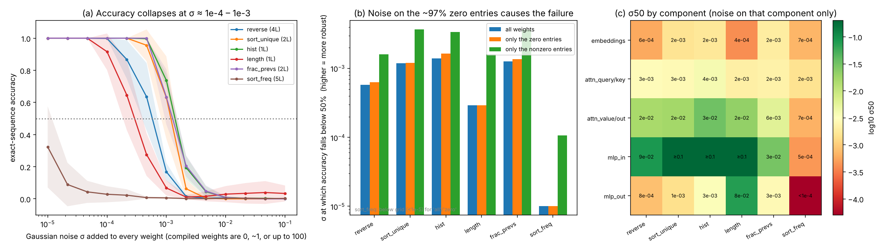

**Figure A1.** (a) Exact-sequence accuracy collapses at 1e-4 to 1e-3 for six compiled programs (bands show seeds). (b) sigma50 with noise on all weights, only zero entries, or only non-zero entries. (c) sigma50 per parameter group (noise on one group at a time; darker is more fragile).

### A2. Compiled vs trained transformers, scale-free noise

**Question.** Is the fragility a property of the transformer architecture, or of compilation?

**Code:** `code/trained_baseline.py`, `code/compare_noise.py`, `code/noln.py`  
**Results:** `results/compare.json`, `results/noln.json`

`compare.json`


| program | variant | s50(curve) | baseline | rms / s50(curve) | mult / s50(curve) |
|---|---|---|---|---|---|
| compiled | hist / rms | 0.00575 |  |  |  |
| compiled | hist / mult | 0.002931 |  |  |  |
| compiled | sort_unique / rms | 0.004213 |  |  |  |
| compiled | sort_unique / mult | 0.002804 |  |  |  |
| compiled | reverse / rms | 0.00332 |  |  |  |
| compiled | reverse / mult | 0.001609 |  |  |  |
| trained | hist / 0 |  | 1 | 0.09022 | 0.08783 |
| trained | hist / 1 |  | 1 | 0.1331 | 0.1332 |
| trained | hist / 2 |  | 1 | 0.1416 | 0.1408 |
| trained | sort_unique / 0 |  | 1 | 0.2738 | 0.2463 |
| trained | sort_unique / 1 |  | 1 | 0.2682 | 0.2803 |
| trained | sort_unique / 2 |  | 1 | 0.2658 | 0.2671 |
| trained | reverse / 0 |  | 1 | 0.2776 | 0.2858 |
| trained | reverse / 1 |  | 1 | 0.2788 | 0.2687 |
| trained | reverse / 2 |  | 1 | 0.2595 | 0.2705 |


`noln.json`


| item | 0 / baseline | 0 / rms / s50(curve) | 0 / mult / s50(curve) | 1 / baseline | 1 / rms / s50(curve) | 1 / mult / s50(curve) |
|---|---|---|---|---|---|---|
| hist | 1 | 0.1866 | 0.1631 | 1 | 0.1613 | 0.1521 |
| sort_unique | 1 | 0.3437 | 0.3432 | 1 | 0.2905 | 0.2619 |


alpha50 = relative noise (sigma = alpha x RMS of each tensor) at which accuracy falls below 50%. Compiled models fail at alpha around 3e-3 to 6e-3, trained transformers of the same depth at 0.09 to 0.28 (roughly 15-170x more tolerant). `noln.json` repeats the trained models without LayerNorm (not the explanation).

> **Takeaway.** Trained transformers of the same depth tolerate relative noise 15 to 170 times larger than compiled ones, and removing LayerNorm does not change that. The fragility belongs to this *realization* of the computation, not to the architecture.

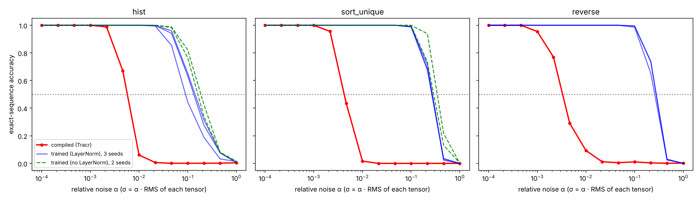

**Figure A2.** Exact-sequence accuracy against relative noise for compiled (red) and trained transformers (blue, with LayerNorm solid, without dashed) on `hist`, `sort_unique` and `reverse`. Compiled models fail one to two orders of magnitude earlier.

### A3. Which programs are fragile? static analysis + noise

**Question.** Which programs are fragile? A static analysis of what each program contains, plus noise.

**Code:** `code/audit_counting.py`  
**Results:** `results/audit_counting.json`


| item | clean | s50 | counting(SelectorWidth) | averaging(Aggregate) |
|---|---|---|---|---|
| map · 8 | 1 | 0.1416 | False | False |
| frac_prevs · 8 | 1 | 0.001805 | False | True |
| pair_balance · 8 | 1 | 8.34e-04 | False | True |
| length · 8 | 1 | 2.89e-04 | True | False |
| hist · 8 | 1 | 0.001511 | True | False |
| reverse · 8 | 1 | 7.19e-04 | True | True |
| sort_unique · 8 | 1 | 0.001299 | True | True |
| sort · 8 | 1 | 4.29e-04 | True | True |
| sort_freq · 8 | 1 | nan | True | True |
| map · 16 | 1 | 0.1083 | False | False |
| frac_prevs · 16 | 1 | 0.001489 | False | True |
| pair_balance · 16 | 1 | 8.76e-04 | False | True |
| length · 16 | 1 | 1.89e-04 | True | False |
| hist · 16 | 1 | 7.90e-04 | True | False |
| reverse · 16 | 1 | 2.01e-04 | True | True |
| sort · 16 | 1 | 1.37e-04 | True | True |
| sort_freq · 16 | 1 | nan | True | True |


Every fragile program contains an attention readout (counting via SelectorWidth, or plain numerical averaging). The program without attention (`map`) is robust. Averaging-only programs (frac_prevs, pair_balance) are about as fragile as hist, so the accurate label is 'precise analog readout from attention averages', with counting the extreme case. Correlational evidence; `mean_token` failed to compile.

> **Takeaway.** Every fragile program contains an attention readout: counting through `SelectorWidth`, or plain numerical averaging. The one program with no attention (`map`) is 100 to 500 times more tolerant. Averaging-only programs are as fragile as histograms, so the accurate description is *precise analog readout from attention averages*, with counting as the extreme case. This is correlational evidence across programs.

### A4. Control: programs with and without counting

**Question.** A control: do programs with and without counting differ?

**Code:** `code/control.py`  
**Results:** `results/control.json`


| item | map | 8 | length | 8 | hist | 8 | reverse | 8 | map | 16 | length | 16 | hist | 16 | reverse | 16 |
|---|---|---|---|---|---|---|---|---|---|---|---|---|---|---|---|---|
| value | 0.1449 | 3.02e-04 | 0.001519 | 7.15e-04 | 0.1086 | 1.88e-04 | 7.80e-04 | 1.98e-04 |  |  |  |  |  |  |  |  |


The per-token lookup program (no attention) has sigma50 around 0.11-0.15, 100-500x higher than the counting programs, and barely decays with N. The attention-without-counting control (shift by one) did not compile in Tracr.

> **Takeaway.** The per-token lookup has sigma50 around 0.11 to 0.15 and barely decays with length, against 1e-4 to 1e-3 for counting programs. The matching attention-without-counting control (shift by one) did not compile in Tracr, so the causal claim rests on the across-program comparison.

## Part B. Mechanism and scaling with sequence length

Part A showed fragility; Part B asks how it depends on the maximum sequence length N and which weights are responsible. Counting (storing the count as 1/(n+1) in an attention average) is the extreme case, so most experiments use the `length` program.

### B1. Counting robustness vs max sequence length N (length program)

**Question.** How does counting robustness depend on the maximum length N?

**Code:** `code/scaling.py`  
**Results:** `results/scaling.json`


| item | 1.0 / clean | 1.0 / abs / s50(curve) | 1.0 / s50 | 0.25 / clean | 0.25 / abs / s50(curve) | 0.25 / s50 |
|---|---|---|---|---|---|---|
| 4 | 1 | 0.001417 | 0.001417 | 1 | 0.004789 | 0.004789 |
| 6 | 1 | 5.53e-04 | 5.53e-04 | 1 | 0.002365 | 0.002365 |
| 8 | 1 | 4.39e-04 | 4.39e-04 | 1 | 0.001602 | 0.001602 |
| 12 | 0.8182 |  |  | 0.8182 |  |  |
| 16 | 0.6 |  |  | 0.6 |  |  |
| 24 | 0.3913 |  |  | 0.3913 |  |  |


sigma50 falls from 1.4e-3 (N=4) to 4.4e-4 (N=8). For N>=12 the default compiler is not even exact at zero noise (clean accuracy 0.82, 0.60, 0.39 at N=12, 16, 24), caused by the fixed discretizer sharpness (mlp_exactness=100). Attention-scale c=0.25 gives a roughly constant 3x.

> **Takeaway.** Tolerance falls from 1.4e-3 at N=4 to 4.4e-4 at N=8, and for N of 12 and above the default compiler is not even exact at zero noise because the discretizer sharpness is fixed. This silent loss of exactness is a compiler limitation we report; it matches an independent anecdotal report of Tracr instability for long sequences. Lowering the attention scale gives a roughly constant 3 times.

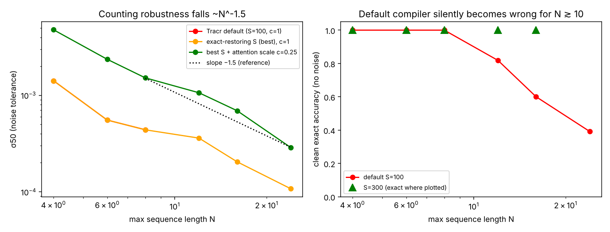

**Figure B1.** Left: tolerance of Tracr's attention counter falls roughly as N to the minus 1.5 (default sharpness, best exact sharpness, and with attention scale 0.25). Right: the default compiler silently becomes inexact for N of 10 and above; raising the sharpness restores exactness.

### B2. mlp_exactness (S) needed vs N

**Question.** How sharp must the compiler's discretizer be to stay exact at large N?

**Code:** `code/scaling2.py`  
**Results:** `results/scaling2.json`


| program | variant | 1.0 / clean | 1.0 / abs / s50(curve) | 1.0 / s50 | 0.25 / clean | 0.25 / abs / s50(curve) | 0.25 / s50 |
|---|---|---|---|---|---|---|---|
| 8 | 100 | 1 | 3.78e-04 | 3.78e-04 | 1 | 0.001491 | 0.001491 |
| 8 | 300 | 1 | 4.39e-04 | 4.39e-04 | 1 | 0.001517 | 0.001517 |
| 8 | 1000 | 1 | 3.80e-04 | 3.80e-04 | 1 | 0.001293 | 0.001293 |
| 8 | 3000 | 1 | 3.20e-04 | 3.20e-04 | 1 | 9.04e-04 | 9.04e-04 |
| 12 | 100 | 0.8182 |  |  | 0.8182 |  |  |
| 12 | 300 | 1 | 3.60e-04 | 3.60e-04 | 1 | 0.001063 | 0.001063 |
| 12 | 1000 | 1 | 3.11e-04 | 3.11e-04 | 1 | 7.59e-04 | 7.59e-04 |
| 12 | 3000 | 1 | 2.37e-04 | 2.37e-04 | 1 | 6.16e-04 | 6.16e-04 |
| 16 | 100 | 0.6 |  |  | 0.6 |  |  |
| 16 | 300 | 1 | 2.04e-04 | 2.04e-04 | 1 | 6.92e-04 | 6.92e-04 |
| 16 | 1000 | 1 | 1.87e-04 | 1.87e-04 | 1 | 5.20e-04 | 5.20e-04 |
| 16 | 3000 | 1 | 1.53e-04 | 1.53e-04 | 1 | 3.85e-04 | 3.85e-04 |
| 24 | 100 | 0.3913 |  |  | 0.3913 |  |  |
| 24 | 300 | 0.6957 |  |  | 0.6957 |  |  |
| 24 | 1000 | 1 | 1.07e-04 | 1.07e-04 | 1 | 2.87e-04 | 2.87e-04 |
| 24 | 3000 | 1 | 9.83e-05 | 9.83e-05 | 1 | 2.52e-04 | 2.52e-04 |


Exactness is restored by raising S to roughly N^2 (S=300 works to N=16, S=1000 at N=24). Even then sigma50 keeps falling (about N^-1.5); over-sharp S slightly reduces tolerance.

> **Takeaway.** Raising the sharpness S to about N squared restores exactness (S=300 up to N=16, S=1000 at N=24). Even then tolerance keeps falling, roughly as N to the minus 1.5, and over-sharp settings slightly reduce it.

### B3. Scaling for reverse / hist / sort_unique / frac_prevs

**Question.** Is the length decay specific to the counting program?

**Code:** `code/scaling3.py`  
**Results:** `results/scaling3.json`


| program | variant | 1.0 / clean | 1.0 / S | 1.0 / abs / s50(curve) | 1.0 / s50 | 0.25 / clean | 0.25 / S | 0.25 / abs / s50(curve) | 0.25 / s50 |
|---|---|---|---|---|---|---|---|---|---|
| reverse | 6 | 1 | 100 | 5.76e-04 | 5.76e-04 | 1 | 100 | 0.001933 | 0.001933 |
| reverse | 8 | 1 | 100 | 6.93e-04 | 6.93e-04 | 1 | 100 | 0.001847 | 0.001847 |
| reverse | 12 | 1 | 216 | 3.49e-04 | 3.49e-04 | 1 | 216 | 4.32e-04 | 4.32e-04 |
| reverse | 16 | 1 | 384 | 1.91e-04 | 1.91e-04 | 1 | 384 | 3.13e-04 | 3.13e-04 |
| hist | 6 | 1 | 100 | 0.001474 | 0.001474 | 1 | 100 | 0.003564 | 0.003564 |
| hist | 8 | 1 | 100 | 0.001474 | 0.001474 | 1 | 100 | 0.005219 | 0.005219 |
| hist | 12 | 1 | 216 | 0.001407 | 0.001407 | 1 | 216 | 0.002862 | 0.002862 |
| hist | 16 | 1 | 384 | 7.16e-04 | 7.16e-04 | 1 | 384 | 8.31e-04 | 8.31e-04 |
| sort_unique | 6 | 1 | 100 | 9.20e-04 | 9.20e-04 | 1 | 100 | 0.001712 | 0.001712 |
| sort_unique | 8 | 1 | 100 | 0.00138 | 0.00138 | 1 | 100 | 0.001455 | 0.001455 |
| frac_prevs | 6 | 1 | 100 | 0.002187 | 0.002187 | 1 | 100 | 0.005188 | 0.005188 |
| frac_prevs | 8 | 1 | 100 | 0.001841 | 0.001841 | 1 | 100 | 0.004699 | 0.004699 |
| frac_prevs | 12 | 1 | 216 | 0.001413 | 0.001413 | 1 | 216 | 0.003505 | 0.003505 |
| frac_prevs | 16 | 1 | 384 | 0.001498 | 0.001498 | 0.6262 | 384 |  |  |


Tolerance falls with N for all programs at different rates (log-log slopes about -0.4 to -1.2 at default attention). The attention-scale gain shrinks with N (reverse: 3.4x at N=8, 1.6x at N=16) and frac_prevs loses exactness at c=0.25, N=16.

> **Takeaway.** No. Tolerance falls with N for `reverse`, `hist`, `sort_unique` and `frac_prevs` too, with log-log slopes between about -0.4 and -1.2 at the default attention scale. The benefit of a smaller attention scale shrinks with N, and `frac_prevs` loses exactness at scale 0.25 and N=16.

### B4. Component diagnosis: which weights limit the length program

**Question.** Which weights limit the `length` program?

**Code:** `code/diagnose.py`  
**Results:** `results/diagnose.json`


| item | d | embeddings | attn_query | attn_key | attn_value | attn_out | mlp_in | mlp_out | ALL |
|---|---|---|---|---|---|---|---|---|---|
| 8 | 27 | 5.65e-04 | 0.1313 | 0.003962 | 0.02333 | 0.05056 | 0.127 | 0.04311 | 3.86e-04 |
| 16 | 43 | 2.20e-04 | 0.04109 | 4.26e-04 | 0.00748 | 0.01879 | 0.0929 | 0.02371 | 1.81e-04 |
| 32 | 75 | 1.26e-04 | 0.01632 | 3.79e-04 | 0.003088 | 0.02113 | 0.09315 | 0.003946 | 1.02e-04 |
| 48 | 107 | 6.92e-05 | 0.01453 | 3.51e-04 | 0.001579 | 0.001654 | 0.08703 | 0.002487 | 4.68e-05 |


sigma50 with noise on one tensor group at a time. Embeddings alone nearly equal the all-weights tolerance; attention key and value paths are next; MLP input weights barely matter. Embedding slope about -1.1 and value path about -1.5 match a simple analysis of the count being stored as 1/(n+1).

> **Takeaway.** Embeddings alone nearly equal the all-weights tolerance, followed by the attention key and value paths; MLP input weights barely matter. The measured slopes (about -1.1 for embeddings, -1.5 for the value path) match a simple analysis in which the count is stored as 1/(n+1) and must be resolved to better than the gap between adjacent counts.

### B5. Chunked counting vs plain counting

**Question.** Can counting inside short windows, then adding exact integers, remove the length dependence?

**Code:** `code/chunk_count.py`, `code/chunk_big.py`, `code/diagnose_chunk.py`  
**Results:** `results/chunk_count.json`, `results/chunk_big.json`, `results/diagnose_chunk.json`

`chunk_count.json`


| program | variant | layers | d | 1.0 / clean | 1.0 / abs / s50(curve) | 1.0 / s50 | 0.25 / clean | 0.25 / abs / s50(curve) | 0.25 / s50 |
|---|---|---|---|---|---|---|---|---|---|
| 8 | chunk4 | 2 | 22 | 1 | 7.31e-04 | 7.31e-04 | 1 | 0.001633 | 0.001633 |
| 12 | chunk4 | 3 | 29 | 1 | 4.55e-04 | 4.55e-04 | 1 | 7.12e-04 | 7.12e-04 |
| 12 | chunk8 | 2 | 26 | 1 | 3.93e-04 | 3.93e-04 | 1 | 0.001292 | 0.001292 |
| 16 | chunk4 | 3 | 36 | 1 | 3.24e-04 | 3.24e-04 | 1 | 4.32e-04 | 4.32e-04 |
| 16 | chunk8 | 2 | 30 | 1 | 2.89e-04 | 2.89e-04 | 1 | 6.35e-04 | 6.35e-04 |
| 24 | chunk4 | 4 | 50 | 1 | 3.59e-04 | 3.59e-04 | 1 | 3.99e-04 | 3.99e-04 |
| 24 | chunk8 | 3 | 41 | 0.6522 |  |  | 1 | 1.84e-04 | 1.84e-04 |


`chunk_big.json`


| item | layers | d | 1.0 / clean | 1.0 / abs / s50(curve) | 1.0 / s50 | 0.25 / clean | 0.25 / abs / s50(curve) | 0.25 / s50 |
|---|---|---|---|---|---|---|---|---|
| 32 / plain | 1 | 75 | 1 | 1.02e-04 | 1.02e-04 | 1 | 2.07e-04 | 2.07e-04 |
| 32 / chunk4 | 4 | 64 | 1 | 1.18e-04 | 1.18e-04 | 0.9355 |  |  |
| 48 / plain | 1 | 107 | 1 | 4.55e-05 | 4.55e-05 | 1 | 1.10e-04 | 1.10e-04 |
| 48 / chunk4 | 5 | 92 | 1 | 5.62e-05 | 5.62e-05 | 0.234 |  |  |


`diagnose_chunk.json`


| item | d | embeddings | attn_query | attn_key | attn_value | attn_out | mlp_in | mlp_out | ALL |
|---|---|---|---|---|---|---|---|---|---|
| 16 | 36 | 9.60e-04 | 0.1086 | 0.001572 | 0.0219 | 0.01056 | 0.004454 | 4.26e-04 | 3.24e-04 |
| 32 | 64 | 7.93e-04 | 0.1678 | 0.002531 | 0.0108 | 0.004965 | 0.001076 | 1.57e-04 | 1.34e-04 |


Counting inside windows of 4 positions then adding exact integers improves the attention-path components 4-7x but the extra MLP layers become the new bottleneck (mlp_out), so overall tolerance gains only ~1.2x at large N and the trend with N is unchanged. `diagnose_chunk.json` holds the component breakdown (N=16 and 32 complete).

> **Takeaway.** It improves the attention-path components 4 to 7 times, but the extra MLP layers become the new bottleneck, so overall tolerance gains only about 1.2 times at large N and the trend with N is unchanged. The N=48 chunked runs did not finish.

## Part C. Hardening Tracr-compiled models

If compiled networks are fragile, can they be made tolerant without losing exactness? We try exact rescalings that leave the function unchanged, lowering the attention scale, adding snapping layers, noise-aware fine-tuning, sensitivity-balanced rescaling, and training against a certificate. The honest summary is a few-fold gain at best, and no change in the decay with length.

### C1. Hand-hardening stack on Tracr models

**Question.** How much can exact, function-preserving rewrites of the compiled weights help?

**Code:** `code/hardening.py`, `code/run_hardening2.py`  
**Results:** `results/hardening2.json`


<details><summary>Full table (50 rows)</summary>

| program | variant | clean | abs / s50(curve) | nz / s50(curve) |
|---|---|---|---|---|
| hist | base | 1 | 0.001381 | 0.003121 |
| hist | balance | 1 | 0.001527 | 0.003523 |
| hist | c=0.25 | 1 | 0.00476 | 0.0115 |
| hist | balance+c=0.5 | 1 | 0.003151 | 0.007276 |
| hist | balance+c=0.25 | 1 | 0.006156 | 0.01412 |
| hist | balance+c=0.1 | 1 | 0.008346 | 0.02029 |
| hist | snap_all | 1 | 7.69e-04 | 0.001389 |
| hist | balance+snap | 1 | 8.12e-04 | 0.001305 |
| hist | ideal_clip | 1 | 0.001878 | 0.004151 |
| hist | balance+ideal_clip | 1 | 0.002626 | 0.006355 |
| sort_unique | base | 1 | 0.001141 | 0.003272 |
| sort_unique | balance | 1 | 0.001476 | 0.002832 |
| sort_unique | c=0.25 | 1 | 0.001329 | 0.007252 |
| sort_unique | balance+c=0.5 | 1 | 0.003144 | 0.005865 |
| sort_unique | balance+c=0.25 | 1 | 0.006048 | 0.01211 |
| sort_unique | balance+c=0.1 | 1 | 0.007788 | 0.03058 |
| sort_unique | snap_all | 1 | 5.38e-04 | 9.00e-04 |
| sort_unique | balance+snap | 1 | 5.45e-04 | 9.33e-04 |
| sort_unique | ideal_clip | 1 | 0.001141 | 0.003272 |
| sort_unique | balance+ideal_clip | 1 | 0.001476 | 0.002832 |
| reverse | base | 1 | 6.10e-04 | 0.001658 |
| reverse | balance | 1 | 6.65e-04 | 0.001853 |
| reverse | c=0.25 | 1 | 0.001578 | 0.007433 |
| reverse | balance+c=0.5 | 1 | 0.001355 | 0.003738 |
| reverse | balance+c=0.25 | 1 | 0.002603 | 0.0076 |
| reverse | balance+c=0.1 | 1 | 0.004359 | 0.01689 |
| reverse | snap_all | 1 | 2.56e-04 | 7.51e-04 |
| reverse | balance+snap | 1 | 2.52e-04 | 6.89e-04 |
| reverse | ideal_clip | 1 | 6.10e-04 | 0.001658 |
| reverse | balance+ideal_clip | 1 | 6.65e-04 | 0.001853 |
| length | base | 1 | 2.69e-04 | 0.001411 |
| length | balance | 1 | 3.50e-04 | 0.001376 |
| length | c=0.25 | 1 | 9.73e-04 | 0.005702 |
| length | balance+c=0.5 | 1 | 6.73e-04 | 0.002704 |
| length | balance+c=0.25 | 1 | 0.001236 | 0.004819 |
| length | balance+c=0.1 | 1 | 0.002297 | 0.01083 |
| length | snap_all | 1 | 1.05e-04 | 3.76e-04 |
| length | balance+snap | 1 | 1.20e-04 | 3.71e-04 |
| length | ideal_clip | 1 | 2.69e-04 | 0.001411 |
| length | balance+ideal_clip | 1 | 3.50e-04 | 0.001376 |
| frac_prevs | base | 1 | 0.001295 | 0.003856 |
| frac_prevs | balance | 1 | 0.001697 | 0.005559 |
| frac_prevs | c=0.25 | 1 | 0.004109 | 0.01499 |
| frac_prevs | balance+c=0.5 | 1 | 0.003358 | 0.01078 |
| frac_prevs | balance+c=0.25 | 1 | 0.005398 | 0.02083 |
| frac_prevs | balance+c=0.1 | 0.08 |  |  |
| frac_prevs | snap_all | 1 | 7.38e-04 | 0.001973 |
| frac_prevs | balance+snap | 1 | 7.93e-04 | 0.002247 |
| frac_prevs | ideal_clip | 1 | 0.001295 | 0.003856 |
| frac_prevs | balance+ideal_clip | 1 | 0.001697 | 0.005559 |

</details>


Variants applied to compiled weights: exact q/k + MLP rescaling (`balance`), attention scale `c`, snap layers, idealized weight-free clip. Rescaling alone gives only 1.1-1.3x; dense snap layers HURT (0.4-0.6x) because they add noisy parameters; lowering the attention scale gives 3-4x; combined 4-8x. `abs` = dense noise, `nz` = noise on nonzero entries only.

> **Takeaway.** Rescaling alone gives 1.1 to 1.3 times; adding dense snap layers hurts (0.4 to 0.6 times) because they add noisy parameters; lowering the attention scale gives 3 to 4 times and the combination 4 to 8 times. One variant (`frac_prevs`, scale 0.1) is not exact and is excluded.

### C2. Noise-aware fine-tuning from the compiled initialization

**Question.** Can noise-aware fine-tuning starting from the compiled weights fix it?

**Code:** `code/run_noise_train.py`  
**Results:** `results/noise_train.json`


| program | variant | exhaustive_ok | exhaustive_total | nonzero_frac | abs / s50(curve) | rms / s50(curve) |
|---|---|---|---|---|---|---|
| hist | from_base | 303708 | 335922 | 0.8361 | 0.001369 | 0.005187 |
| hist | from_balance+c=0.25 | 335916 | 335922 | 0.8361 | 0.005625 | 0.01423 |
| sort_unique | from_base | 1946 | 1956 | 0.8953 | 0.01937 | 0.01302 |
| sort_unique | from_balance+c=0.25 | 1956 | 1956 | 0.8953 | 0.01014 | 0.009431 |
| reverse | from_base | 23185 | 335922 | 0.9239 | 0.01574 | 0.02389 |
| reverse | from_balance+c=0.25 | 335922 | 335922 | 0.9239 | 0.01149 | 0.04778 |


Fine-tuning compiled weights with injected noise. From the raw compiled weights it destroys exactness (e.g. reverse N=8 only 23,185 of 335,922 sequences correct); from the rescaled c=0.25 initialization it keeps exactness (exhaustively verified at N=8) and gives 4-19x. Densifies the weights (84-92% nonzero).

> **Takeaway.** From the raw compiled weights, fine-tuning destroys exactness (for example `reverse`: only 23,185 of 335,922 sequences correct); from the rescaled, lowered-attention-scale initialization it keeps exactness (verified exhaustively at N=8) and gives 4 to 19 times, at the price of densifying the weights to 84 to 92 percent non-zero.

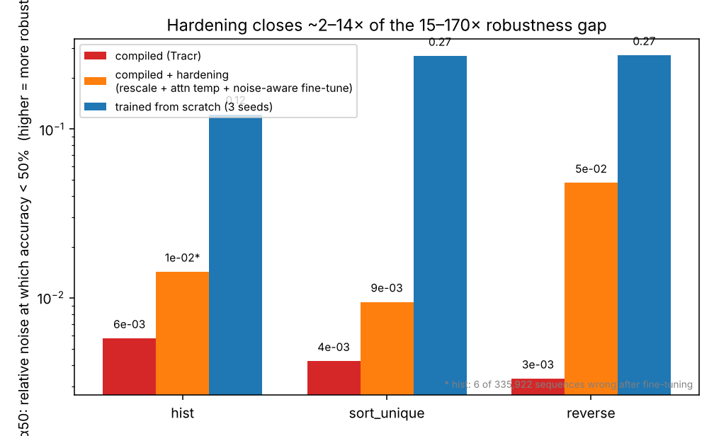

**Figure C.** Hardening closes about 2 to 14 times of the 15 to 170 times gap: compiled (red), compiled plus hardening (orange: rescale, attention temperature, noise-aware fine-tune; the asterisk marks a case with 6 of 335,922 sequences wrong after fine-tuning) and trained from scratch (blue, 3 seeds).

### C3. Sensitivity-balanced compilation (symmetry rescaling under noise)

**Question.** Can an optimizer find the best exact rescaling under noise (sensitivity balancing)?

**Code:** `code/balance.py`, `code/balance_scaling.py`  
**Results:** `results/balance_scaling.json`, `results/balance_32_plain.json`

`balance_scaling.json`


| case | tag | N | S | clean_before | clean_after | max_output_diff | s50_before | s50_after | gain | theta | log_scale_range |
|---|---|---|---|---|---|---|---|---|---|---|---|
| plain c=0.25 · 16 | plain c=0.25 N=16 | 16 | 307 | 1 | 1 | 4.68e-05 | 6.49e-04 | 0.002026 | 3.122 | [6 values, mean 0.7204] | -2.016, 1.962 |
| plain c=0.25 · 32 | plain c=0.25 N=32 | 32 | 1228 | 1 | 1 | 2.20e-04 | 2.04e-04 | 7.66e-04 | 3.754 | [6 values, mean 0.8069] | -2.438, 2.105 |
| plain c=0.25 · 48 | plain c=0.25 N=48 | 48 | 2764 | 1 | 1 | 5.03e-04 | 1.11e-04 | 4.23e-04 | 3.802 | [6 values, mean 0.8176] | -2.546, 2.364 |
| chunk g=4 c=1 · 16 | chunk g=4 c=1 N=16 | 16 | 100 | 1 | 1 | 3.17e-04 | 3.31e-04 | 9.27e-04 | 2.796 | [16 values, mean 0.3307] | -0.6803, 2.078 |


`balance_32_plain.json`


| case | tag | N | S | clean_before | clean_after | max_output_diff | s50_before | s50_after | gain | theta | log_scale_range |
|---|---|---|---|---|---|---|---|---|---|---|---|
| plain | plain | 32 | 1228 | 1 | 1 | 1.49e-04 | 1.01e-04 | 2.98e-04 | 2.961 | [6 values, mean 0.8144] | -2.24, 2.479 |


Optimizes only exact symmetries (residual-dimension scales, q/k, v/out, MLP hidden scale) under injected noise, so the function is unchanged (clean accuracy stays 1.00, max output change ~5e-4). Gain is a constant 2.8-3.8x across N=16-48; the log-log slope moves only from -1.6 to -1.4. The chunked N=48 run did not finish.

> **Takeaway.** Optimizing only exact symmetries gives a constant 2.8 to 3.8 times gain at N=16 to 48 with no change in function (max output change about 5e-4), and the slope with N moves only from -1.6 to -1.4.

### C4. Balancing generalized to other programs

**Question.** Does balancing carry over to other programs?

**Code:** `code/balance2.py`  
**Results:** `results/balance2.json`


| case | tag | name | N | c | S | clean_after | s50_before | s50_after | gain | clean_before | skipped |
|---|---|---|---|---|---|---|---|---|---|---|---|
| reverse · 12 · 1.0 | reverse N=12 c=1.0 | reverse | 12 | 1 | 216 | 1 | 3.47e-04 | 0.001593 | 4.588 |  |  |
| reverse · 12 · 0.25 | reverse N=12 c=0.25 | reverse | 12 | 0.25 | 216 | 1 | 4.91e-04 | 0.003865 | 7.876 |  |  |
| reverse · 16 · 1.0 | reverse N=16 c=1.0 | reverse | 16 | 1 | 384 | 1 | 2.05e-04 | 0.001299 | 6.335 |  |  |
| reverse · 16 · 0.25 | reverse N=16 c=0.25 | reverse | 16 | 0.25 | 384 | 1 | 3.26e-04 | 0.002585 | 7.92 |  |  |
| hist · 16 · 1.0 | hist N=16 c=1.0 | hist | 16 | 1 | 384 | 1 | 6.33e-04 | 0.002421 | 3.824 |  |  |
| hist · 16 · 0.25 | hist N=16 c=0.25 | hist | 16 | 0.25 | 384 | 1 | 8.49e-04 | 0.004704 | 5.538 |  |  |
| hist · 24 · 1.0 | hist N=24 c=1.0 | hist | 24 | 1 | 864 | 1 | 3.62e-04 | 0.001491 | 4.118 |  |  |
| hist · 24 · 0.25 | hist N=24 c=0.25 | hist | 24 | 0.25 | 864 | 1 | 4.53e-04 | 0.002456 | 5.419 |  |  |
| frac_prevs · 16 · 1.0 | frac_prevs N=16 c=1.0 | frac_prevs | 16 | 1 | 384 | 1 | 0.001406 | 0.003762 | 2.677 |  |  |
| frac_prevs · 16 · 0.25 | frac_prevs N=16 c=0.25 |  |  |  |  |  |  |  |  | 0.5952 | True |
| sort_unique · 8 · 1.0 | sort_unique N=8 c=1.0 | sort_unique | 8 | 1 | 100 | 1 | 0.001221 | 0.00475 | 3.889 |  |  |
| sort_unique · 8 · 0.25 | sort_unique N=8 c=0.25 | sort_unique | 8 | 0.25 | 100 | 1 | 0.001287 | 0.008146 | 6.331 |  |  |


reverse, hist, sort_unique, frac_prevs at N=8-24. Balancing alone 2.7-6.3x; with attention scale c=0.25 the stack reaches 7-13x over default on five of six settings (frac_prevs 2.7x). The decay with N is unchanged.

> **Takeaway.** Balancing alone gives 2.7 to 6.3 times and, with attention scale 0.25, 7 to 13 times on five of six settings. The decay with N is unchanged.

### C5. Certificate-driven training with a general interval bound (negative result)

**Question.** Can a network be trained to maximize a provable radius under a general interval bound?

**Code:** `code/ibp_train.py`  
**Results:** `results/ibp_train.json`


| item | cert_compiled | cert_trained | tube_trained | clean | clean_len400 | sigma50_compiled | sigma50_trained | alpha50_compiled | alpha50_trained |
|---|---|---|---|---|---|---|---|---|---|
| maj(0>1) | 0 | 0 | None | 1 | 0.5312 | 0.03648 | 0.03108 | 0.09292 | 0.07851 |
| dyck(0,1) | 0 | 0 | None | 1 | 0.8125 | 0.0519 | 0.02621 | 0.1236 | 0.07571 |


Training the digital network's weights to maximize a provable radius under a general (loose) interval bound. The bound certifies radius 0 for the compiled weights and training never reached a certified radius; trained weights lost exactness on long sequences (length-400 accuracy 0.53 and 0.81) and tolerance got worse. NEGATIVE.

> **Takeaway.** No. The general bound certifies radius 0 for the compiled weights, training never reached a certified radius, trained weights lost exactness on long sequences (length-400 accuracy 0.53 and 0.81) and tolerance got worse. A negative result.

## Part D. Digital (restoring-state) designs

Instead of repairing analog readouts, we replace them: the state is a one-hot vector that is snapped back to a valid value at every step, so errors cannot accumulate. We compare designs on the same tasks, add a bilinear (second-order) form with no extra parameters and weight-tied composition of many programs, and compare with trained GRUs. **This family of constructions follows Omlin and Giles (1996); see Part M.**

### D1. Same task, different designs: scaling of noise tolerance

**Question.** Same task, different designs: how does noise tolerance scale?

**Code:** `code/digital_counter.py`, `code/lsrl_counter.py`  
**Results:** `results/digital_counter.json`, `results/lsrl_counter.json`

`digital_counter.json`


| item | digital_snap | analog_nosnap |
|---|---|---|
| 8 | 0.1471 | 0.5116 |
| 16 | 0.09758 | 0.267 |
| 32 | 0.0801 | 0.144 |
| 64 | 0.07246 | 0.07493 |
| 128 | 0.04972 | 0.03906 |


`lsrl_counter.json`


| item | s50(curve) |
|---|---|
| value | nan |


Counting tokens: hand-built digital one-hot counter with per-step snapping (slope ~-0.36) vs no snapping (~-0.93) vs LSRL linear-state accumulator (~-1.96, 1/N^2) vs the Tracr attention counter (~-1.3 to -1.6). Toy designs; not directly comparable tasks.

> **Takeaway.** A hand-built digital one-hot counter with per-step snapping has a slope of about -0.36; without snapping about -0.93; a linear-state accumulator decays as 1/N squared; the Tracr attention counter about -1.3 to -1.6. These are toy designs on slightly different tasks, so they show tendencies, not a ranking.

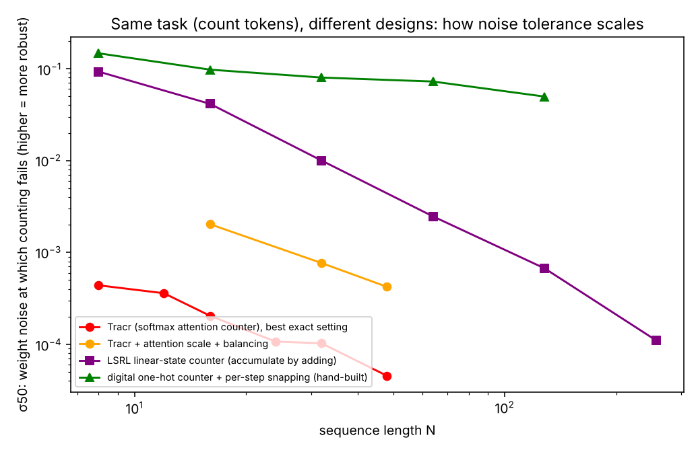

**Figure D1.** Same task (counting tokens), different designs: digital one-hot counter with per-step snapping stays high; a linear-state accumulator decays as 1/N squared; Tracr decays roughly as N to the minus 1.5.

### D2. Prefix-histogram: digital vs Tracr (causal)

**Question.** Does the advantage hold on a richer causal program, the prefix histogram?

**Code:** `code/digital_prefix_hist.py`  
**Results:** `results/digital_prefix_hist.json`


| item | clean | s50 | params |
|---|---|---|---|
| digital_snap · 8 | 1 | 0.02736 | 28026 |
| digital_nosnap · 8 | 1 | 0.01765 | 28026 |
| digital_snap · 16 | 1 | 0.01579 | 97818 |
| digital_nosnap · 16 | 1 | 0.006228 | 97818 |
| digital_snap · 32 | 1 | 0.0154 | 364122 |
| digital_nosnap · 32 | 1 | 0.00235 | 364122 |
| digital_snap · 64 | 1 | 0.01493 | 1403610 |
| digital_nosnap · 64 | 1 | 6.46e-04 | 1403610 |
| digital_snap · 128 | 1 | 0.01308 | 5510106 |
| digital_nosnap · 128 | 1 | 1.52e-04 | 5510106 |
| tracr_c1.0 · 8 | 1 | 0.00107 | 2391 |
| tracr_c0.25 · 8 | 1 | 0.003841 | 2391 |
| tracr_c1.0 · 16 | 1 | 6.07e-04 | 5519 |
| tracr_c0.25 · 16 | 1 | 7.93e-04 | 5519 |
| tracr_c1.0 · 32 | 1 | 1.02e-04 | 15615 |
| tracr_c0.25 · 32 | 1 | 1.02e-04 | 15615 |


Hand-built digital design with snapping is nearly flat in N (about 1.3-1.6e-2 from N=16 to 128); removing snapping gives about N^-1.7; Tracr causal is ~1e-4 at N=32. The digital design is larger (parameters grow as N^2).

> **Takeaway.** The digital design with snapping is nearly flat in N (1.3 to 1.6e-2 from N=16 to 128); removing snapping gives about N to the minus 1.7; Tracr causal is about 1e-4 at N=32. The price: parameters grow as N squared.

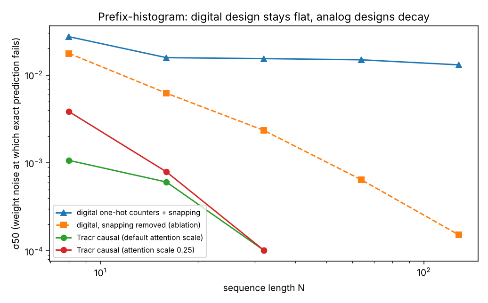

**Figure D2.** Prefix histogram: the digital design with snapping is nearly flat in N; removing the snapping makes it decay; Tracr causal models are about 1e-4 at N=32.

### D3. Second program: majority-so-far

**Question.** A second program: majority-so-far.

**Code:** `code/second_program.py`  
**Results:** `results/second_program.json`


| item | clean | s50 | params |
|---|---|---|---|
| digital_snap · 8 | 1 | 0.0653 | 3334 |
| digital_nosnap · 8 | 1 | 0.01546 | 3334 |
| digital_snap · 16 | 1 | 0.03521 | 11750 |
| digital_nosnap · 16 | 1 | 0.006315 | 11750 |
| digital_snap · 32 | 1 | 0.03392 | 43942 |
| digital_nosnap · 32 | 1 | 0.001656 | 43942 |
| digital_snap · 64 | 1 | 0.02089 | 169766 |
| digital_nosnap · 64 | 1 | 4.25e-04 | 169766 |
| tracr_c1.0 · 8 | 1 | 0.001033 | 18705 |
| tracr_c0.25 · 8 | 1 | 0.002897 | 18705 |
| tracr_c1.0 · 16 | 1 | 1.90e-04 | 83393 |
| tracr_c0.25 · 16 | 1 | 1.93e-04 | 83393 |
| tracr_c1.0 · 32 | 1 | nan | 504993 |
| tracr_c0.25 · 32 | 1 | nan | 504993 |


Signed one-hot counter with comparison readout. Digital with snapping decays slowly (6.5e-2 to 2.1e-2, N=8-64) and is exact on all 7,776 length-5 sequences; Tracr causal is 1.0e-3 at N=8 and below the smallest tested noise at N=32. Here digital is also smaller (about 44k vs 505k parameters at N=32).

> **Takeaway.** The signed one-hot counter with snapping decays slowly (6.5e-2 to 2.1e-2 over N=8 to 64) and is exact on all 7,776 length-5 sequences; Tracr causal is 1.0e-3 at N=8 and below the smallest noise tested at N=32. Here the digital design is also smaller (about 44k against 505k parameters at N=32).

### D4. Width-matched redundancy baseline for Tracr

**Question.** Is the digital advantage just redundancy? Compare with r copies of the Tracr model at equal parameter count.

**Code:** `code/width_matched.py`  
**Results:** `results/width_matched.json`


| item | s50 | params | clean |
|---|---|---|---|
| N16 · r1 | 6.62e-04 | 5519 | 1 |
| N16 · r4 | 8.35e-04 | 22076 | 1 |
| N16 · r18 | 0.001391 | 99342 | 1 |
| N32 · r1 | 8.23e-05 | 15615 | 1 |
| N32 · r4 | 1.70e-04 | 62460 | 1 |
| N32 · r23 | 5.39e-04 | 359145 | 1 |


r independent compiled Tracr copies with majority-style output summing, sized to match the digital design's parameter count. Redundancy helps (2x at N=16, 6.6x at N=32) but the digital design remains 11-28x better at equal parameters.

> **Takeaway.** Redundancy helps Tracr (2 times at N=16, 6.6 times at N=32) but the digital design remains 11 to 28 times better at equal parameters.

### D5. Digital design under the relative (RMS) noise protocol

**Question.** Does the conclusion survive the relative (scale-free) noise protocol?

**Code:** `code/digital_rel.py`  
**Results:** `results/digital_rel.json`


| item | 8 | 16 | 32 | 64 |
|---|---|---|---|---|
| value | 0.107 | 0.0809 | 0.07228 | 0.06114 |


alpha50 of the digital prefix-histogram: 0.107, 0.081, 0.072, 0.061 for N=8, 16, 32, 64, comparable to trained transformers (0.16-0.20 at N=8, 0.034-0.037 at N=32 in the early under-trained runs).

> **Takeaway.** Yes. alpha50 of the digital prefix histogram is 0.107, 0.081, 0.072, 0.061 at N=8, 16, 32, 64, comparable to early under-trained transformers.

### D6. Margin tuning of the digital designs (negative)

**Question.** Can snap thresholds and a global scale be tuned to improve the digital designs?

**Code:** `code/digital_tune.py`  
**Results:** `results/digital_tune.json`


<details><summary>Full table (66 rows)</summary>

| case | value |
|---|---|
| hist · lo0.25 · hi0.75 · k1.0 | 0.01785 |
| hist · lo0.25 · hi0.75 · k2.0 | 0.01772 |
| hist · lo0.25 · hi0.75 · k4.0 | 0.01778 |
| hist · lo0.1 · hi0.5 · k1.0 | 0.005875 |
| hist · lo0.1 · hi0.5 · k2.0 | 0.005891 |
| hist · lo0.1 · hi0.5 · k4.0 | 0.00594 |
| hist · lo0.5 · hi0.9 · k1.0 | 0.01189 |
| hist · lo0.5 · hi0.9 · k2.0 | 0.01265 |
| hist · lo0.5 · hi0.9 · k4.0 | 0.01291 |
| hist · lo0.4 · hi0.6 · k1.0 | 0.01447 |
| hist · lo0.4 · hi0.6 · k2.0 | 0.01436 |
| hist · lo0.4 · hi0.6 · k4.0 | 0.01424 |
| hist · lo0.3 · hi0.7 · k1.0 | 0.01766 |
| hist · lo0.3 · hi0.7 · k2.0 | 0.01778 |
| hist · lo0.3 · hi0.7 · k4.0 | 0.01767 |
| hist · lo0.2 · hi0.8 · k1.0 | 0.01695 |
| hist · lo0.2 · hi0.8 · k2.0 | 0.01728 |
| hist · lo0.2 · hi0.8 · k4.0 | 0.01728 |
| hist · lo0.1 · hi0.9 · k1.0 | 0.01209 |
| hist · lo0.1 · hi0.9 · k2.0 | 0.01319 |
| hist · lo0.1 · hi0.9 · k4.0 | 0.01319 |
| hist · lo0.45 · hi0.55 · k1.0 | 0.007614 |
| hist · lo0.45 · hi0.55 · k2.0 | 0.00769 |
| hist · lo0.45 · hi0.55 · k4.0 | 0.007943 |
| hist · N8 · default | 0.02617 |
| hist · N8 · tuned | 0.02617 |
| hist · N8 · tuned_alpha | 0.09877 |
| hist · N32 · default | 0.01545 |
| hist · N32 · tuned | 0.01545 |
| hist · N32 · tuned_alpha | 0.07128 |
| hist · N64 · default | 0.01127 |
| hist · N64 · tuned | 0.01127 |
| hist · N64 · tuned_alpha | 0.05859 |
| majority · lo0.25 · hi0.75 · k1.0 | 0.0434 |
| majority · lo0.25 · hi0.75 · k2.0 | 0.04677 |
| majority · lo0.25 · hi0.75 · k4.0 | 0.04693 |
| majority · lo0.1 · hi0.5 · k1.0 | 0.01531 |
| majority · lo0.1 · hi0.5 · k2.0 | 0.01698 |
| majority · lo0.1 · hi0.5 · k4.0 | 0.01698 |
| majority · lo0.5 · hi0.9 · k1.0 | 0.04249 |
| majority · lo0.5 · hi0.9 · k2.0 | 0.04529 |
| majority · lo0.5 · hi0.9 · k4.0 | 0.04587 |
| majority · lo0.4 · hi0.6 · k1.0 | 0.02366 |
| majority · lo0.4 · hi0.6 · k2.0 | 0.02399 |
| majority · lo0.4 · hi0.6 · k4.0 | 0.02399 |
| majority · lo0.3 · hi0.7 · k1.0 | 0.03897 |
| majority · lo0.3 · hi0.7 · k2.0 | 0.0406 |
| majority · lo0.3 · hi0.7 · k4.0 | 0.0409 |
| majority · lo0.2 · hi0.8 · k1.0 | 0.04126 |
| majority · lo0.2 · hi0.8 · k2.0 | 0.04646 |
| majority · lo0.2 · hi0.8 · k4.0 | 0.04624 |
| majority · lo0.1 · hi0.9 · k1.0 | 0.03023 |
| majority · lo0.1 · hi0.9 · k2.0 | 0.03194 |
| majority · lo0.1 · hi0.9 · k4.0 | 0.03263 |
| majority · lo0.45 · hi0.55 · k1.0 | 0.01317 |
| majority · lo0.45 · hi0.55 · k2.0 | 0.01334 |
| majority · lo0.45 · hi0.55 · k4.0 | 0.0135 |
| majority · N8 · default | 0.05369 |
| majority · N8 · tuned | 0.06243 |
| majority · N8 · tuned_alpha | 0.149 |
| majority · N32 · default | 0.03365 |
| majority · N32 · tuned | 0.04213 |
| majority · N32 · tuned_alpha | 0.08982 |
| majority · N64 · default | 0.02113 |
| majority · N64 · tuned | 0.02215 |
| majority · N64 · tuned_alpha | 0.08156 |

</details>


Snap thresholds and a global state scale, all exact-preserving. Best gain 1.0x (prefix-hist) and 1.1x (majority): the defaults are already near-optimal for these knobs. NEGATIVE.

> **Takeaway.** No: the best gains are 1.0 times and 1.1 times; the defaults are already near-optimal for these knobs. A negative result.

### D7. Weight-free clip activation instead of four dense snap matrices

**Question.** Replace four dense snap matrices by a weight-free clip activation.

**Code:** `code/clip_activation.py`  
**Results:** `results/clip_activation.json`


| item | clean_new | params_old | params_new | abs / snap_matrices | abs / clip_activation | abs / gain | rel / snap_matrices | rel / clip_activation | rel / gain |
|---|---|---|---|---|---|---|---|---|---|
| maj(0>1) · N16 | 1 | 18975 | 14553 | 0.03676 | 0.07045 | 1.916 | 0.09301 | 0.1434 | 1.542 |
| dyck(0,1) · N16 | 1 | 6030 | 4698 | 0.04848 | 0.08364 | 1.725 | 0.1037 | 0.1417 | 1.366 |
| maj(0>1) · N32 | 1 | 70655 | 53625 | 0.02724 | 0.05298 | 1.945 | 0.0804 | 0.09671 | 1.203 |
| dyck(0,1) · N32 | 1 | 20094 | 15402 | 0.03142 | 0.05859 | 1.865 | 0.08053 | 0.09892 | 1.228 |


Restoring step s' = clip(2z - 0.5, 0, 1) as an activation (no noisy parameters). 20-25% fewer parameters, still exact, and 1.7-1.9x higher sigma50 (1.2-1.5x in relative alpha50).

> **Takeaway.** 20 to 25 percent fewer parameters, still exact, and 1.7 to 1.9 times higher sigma50 (1.2 to 1.5 times in relative alpha50). Removing noisy parameters from the restoring step helps.

### D8. Bilinear (second-order) design and weight-tied composition

**Question.** A bilinear (second-order) form, and weight-tied composition of many programs.

**Code:** `code/ideas_round.py`, `code/bilinear_lib.py`  
**Results:** `results/ideas_round.json`


| item | clean | sigma50 | alpha50 | params | per_head_s50 | joint_s50 |
|---|---|---|---|---|---|---|
| bilinear · maj(0>1) · N16 | 1 | 0.1299 | 0.6149 | 6633 |  |  |
| bilinear · maj(0>1) · N32 | 1 | 0.1003 | 0.6336 | 25545 |  |  |
| bilinear · maj(0>1) · N64 | 1 | 0.09034 | 0.7274 | 100233 |  |  |
| bilinear · dyck(0,1) · N16 | 1 | 0.1691 | 0.6557 | 1998 |  |  |
| bilinear · dyck(0,1) · N32 | 1 | 0.1373 | 0.6732 | 7038 |  |  |
| bilinear · dyck(0,1) · N64 | 1 | 0.1117 | 1.01 | 26334 |  |  |
| tied · k1 | 1 |  |  | 3483 | 0.08439 | 0.08439 |
| tied · k2 | 1 |  |  | 3501 | 0.08245 | 0.06807 |
| tied · k4 | 1 |  |  | 3537 | 0.08063 | 0.05953 |
| tied · k8 | 1 |  |  | 3609 | 0.0792 | 0.05507 |
| tied · k15 | 1 |  |  | 3735 | 0.07956 | 0.05311 |
| tied · k30 | 1 |  |  | 4005 | 0.08054 | 0.05283 |


Bilinear: z = sum_v x_v W_v s with no hidden gates, biases or snap matrices; relative tolerance alpha50 rises from about 0.1 to 0.6-1.0 and stays nearly flat to N=64. Tied: k template programs share one set of transition matrices plus a tiny role table; 30 exact programs fit in about 4,000 parameters with flat per-head tolerance (joint tolerance levels off at about 5e-2).

> **Takeaway.** The bilinear form z = sum over tokens of W_v s has no gates, biases or snap matrices; relative tolerance rises from about 0.1 to 0.6 to 1.0 and stays flat to N=64. The tied variant shares transition matrices between template programs: 30 exact programs fit in about 4,000 parameters with flat per-head tolerance. Note the bilinear form is the second-order recurrent network of Omlin and Giles; the tied design only works for programs that are instances of one template.

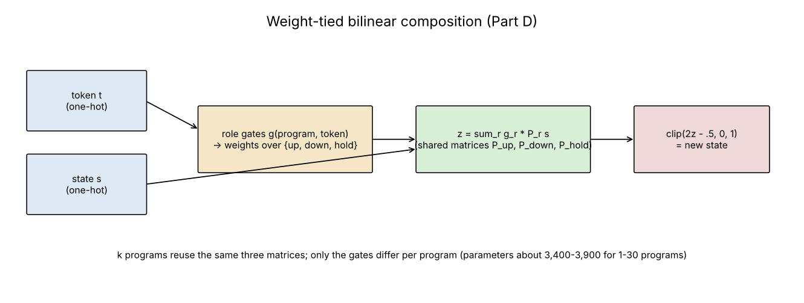

**Figure D8.** Weight-tied design: the transition matrices (up, down, hold) are shared; each program only selects which role each token uses.

### D9. Tied + bilinear combined

**Question.** Combine tied and bilinear.

**Code:** `code/tied_bilinear.py`  
**Results:** `results/tied_bilinear.json`


| item | clean | params | abs / per_head | abs / joint | rel / per_head | rel / joint |
|---|---|---|---|---|---|---|
| k1 | 1 | 3384 | 0.1229 | 0.1229 | 0.4277 | 0.4277 |
| k4 | 1 | 3438 | 0.1206 | 0.09495 | 0.4516 | 0.3464 |
| k15 | 1 | 3636 | 0.1165 | 0.08996 | 0.4538 | 0.2418 |
| k30 | 1 | 3906 | 0.1195 | 0.08917 | 0.4638 | 0.227 |


Role-gated multiplicative update, no hidden gates and no biases. About 3,400-3,900 parameters for k=1-30 exact programs; per-head sigma50 about 0.12 regardless of k.

> **Takeaway.** A role-gated multiplicative update with no hidden gates or biases: about 3,400 to 3,900 parameters for 1 to 30 exact programs, per-head sigma50 about 0.12 regardless of k.

### D10. Matched comparison: bilinear designs vs trained GRUs

**Question.** Matched comparison with trained GRUs: same programs, distribution, evaluation sequences and noise protocols.

**Code:** `code/matched_gru.py`  
**Results:** `results/matched_gru.json`


| item | clean | sigma50 | alpha50 | params |
|---|---|---|---|---|
| majority · N16 · bilinear (compiled) | 1 | 0.1216 | 0.5987 | 6633 |
| majority · N16 · GRU32 seed0 | 1 | 0.175 | 0.6113 | 3810 |
| majority · N16 · GRU32 seed1 | 1 | 0.1512 | 0.5529 | 3810 |
| majority · N16 · GRU64 seed0 | 1 | 0.1908 | 0.8588 | 13762 |
| majority · N16 · GRU64 seed1 | 1 | 0.1987 | 0.8769 | 13762 |
| majority · N32 · bilinear (compiled) | 1 | 0.1147 | 0.6936 | 25545 |
| majority · N32 · GRU32 seed0 | 0.995 | 0.08171 | 0.3253 | 3810 |
| majority · N32 · GRU32 seed1 | 0.995 | 0.07107 | 0.336 | 3810 |
| majority · N32 · GRU64 seed0 | 1 | 0.1053 | 0.5098 | 13762 |
| majority · N32 · GRU64 seed1 | 0.995 | 0.1095 | 0.487 | 13762 |
| dyck · N16 · bilinear (compiled) | 1 | 0.2409 | 0.6551 | 1998 |
| dyck · N16 · GRU32 seed0 | 1 | 0.378 | 1.131 | 3810 |
| dyck · N16 · GRU32 seed1 | 1 | 0.3052 | 1.059 | 3810 |
| dyck · N16 · GRU64 seed0 | 1 | 0.3437 | 1.474 | 13762 |
| dyck · N16 · GRU64 seed1 | 1 | 0.2874 | 1.338 | 13762 |
| dyck · N32 · bilinear (compiled) | 1 | 0.1429 | 0.8983 | 7038 |
| dyck · N32 · GRU32 seed0 | 1 | 0.2441 | 0.8614 | 3810 |
| dyck · N32 · GRU32 seed1 | 1 | 0.2354 | 0.8394 | 3810 |
| dyck · N32 · GRU64 seed0 | 1 | 0.2628 | 1.132 | 13762 |
| dyck · N32 · GRU64 seed1 | 1 | 0.2281 | 1.008 | 13762 |


Same programs, token distribution, eval sequences and noise protocols (sigma50 absolute, alpha50 relative); GRUs have 32 or 64 hidden units, 2 seeds each, 2,500 training steps. Majority: bilinear is below the GRUs at N=16 (sigma50 0.12 vs 0.15-0.20) but above them at N=32 (0.115 vs 0.07-0.11, where the GRUs decay and are 99.5% accurate). Dyck: GRUs are 1.2-1.9x higher in sigma50 (N=16: 0.29-0.38 vs 0.24; N=32: 0.23-0.26 vs 0.14) and similar or higher in alpha50. So the bilinear compiled design is competitive with small trained GRUs, not uniformly better. Single token distribution per task; 6 noise draws.

> **Takeaway.** The bilinear design is competitive with small trained GRUs but not uniformly better: on majority it is below them at N=16 and above them at N=32 (where the GRUs decay); on dyck the GRUs are 1.2 to 1.9 times higher in sigma50. One token distribution per task and six noise draws.

### D11. Trained GRU baselines

**Question.** Trained GRU baselines.

**Code:** `code/trained_gru.py`, `code/gru_long.py`  
**Results:** `results/trained_gru_128.json`, `results/trained_gru_long_256.json`

`trained_gru_128.json`


| item | clean | params | abs | rel |
|---|---|---|---|---|
| prefix_hist · 8 · 0 | 0.995 | 53001 | 0.1167 | 0.5471 |
| prefix_hist · 8 · 1 | 0.99 | 53001 | 0.1095 | 0.5511 |
| prefix_hist · 16 · 0 | 0.945 | 54033 | 0.03725 | 0.2067 |
| prefix_hist · 16 · 1 | 0.965 | 54033 | 0.0377 | 0.1996 |
| prefix_hist · 32 · 0 | 0.705 | 56097 | 0.01163 | 0.04997 |
| prefix_hist · 32 · 1 | 0.575 | 56097 | 0.007904 | 0.03773 |
| majority · 8 · 0 | 1 | 52098 | 0.3725 | inf |
| majority · 8 · 1 | 1 | 52098 | 0.3799 | 1.88 |
| majority · 16 · 0 | 1 | 52098 | 0.1659 | 0.9449 |
| majority · 16 · 1 | 1 | 52098 | 0.223 | 1.089 |
| majority · 32 · 0 | 1 | 52098 | 0.08344 | 0.519 |
| majority · 32 · 1 | 1 | 52098 | 0.126 | 0.7725 |


`trained_gru_long_256.json`


| item | clean | params | abs | rel |
|---|---|---|---|---|
| prefix_hist · 16 · 0 | 0.995 | 206353 | 0.06578 | 0.4258 |
| prefix_hist · 32 · 0 | 0.98 | 210465 | 0.03145 | 0.1979 |


GRU(128) trained 3,000 steps on prefix-hist and majority; prefix-hist is not learned exactly at N=32 (clean 0.58-0.71) in that budget, majority is exact at all N and more tolerant than the early digital designs. `trained_gru_long_256.json`: GRU(256), 7,000 steps, prefix-hist N=16 and 32 reach 0.995 and 0.98 accuracy with alpha50 0.43 and 0.20.

> **Takeaway.** GRU(128) does not learn the prefix histogram exactly at N=32 in 3,000 steps (clean 0.58 to 0.71) but learns majority exactly at all N; GRU(256), 7,000 steps, reaches 0.995 and 0.98 accuracy at N=16 and 32 with alpha50 of 0.43 and 0.20.

## Part E. Compiler and certificates

A restoring-state network can be accompanied by proofs. We build a small compiler from finite-state specifications, prove exactness for sequences of any length, certify a noise radius with interval bounds, and then attack the certificate to see how tight it is.

### E1. Compiler prototype: exactness certificates and empirical tolerance

**Question.** A compiler from finite-state specifications to a restoring-state network, with exactness and noise certificates.

**Code:** `code/digital_compiler.py`, `code/run_compiler_tests.py`, `code/exhaustive.py`  
**Results:** `results/compiler_tests.json`


| item | exact_cert | random_agree | params | certified_radius | tube | clean | s50 |
|---|---|---|---|---|---|---|---|
| prefix_hist(N=4) | 180, 180 | 1 | 17010 | 3.16e-04 | 0.04 |  |  |
| prefix_hist(N=8) | 324, 324 | 1 | 52866 |  |  |  |  |
| prefix_hist(N=16) | 612, 612 | 1 | 183906 |  |  |  |  |
| majority(N=4) | 54, 54 | 1 | 1719 | 0.001 | 0.04 |  |  |
| majority(N=8) | 102, 102 | 1 | 5423 | 0.001 | 0.04 |  |  |
| majority(N=16) | 198, 198 | 1 | 18975 | 5.62e-04 | 0.04 |  |  |
| majority(N=32) | 390, 390 | 1 | 70655 |  |  |  |  |
| dyck_valid_prefix(N=4) | 36, 36 | 1 | 858 | 0.001 | 0.04 |  |  |
| dyck_valid_prefix(N=8) | 60, 60 | 1 | 2070 | 0.001 | 0.04 |  |  |
| dyck_valid_prefix(N=16) | 108, 108 | 1 | 6030 | 0.001 | 0.04 |  |  |
| dyck_valid_prefix(N=32) | 204, 204 | 1 | 20094 | 5.62e-04 | 0.04 |  |  |
| parity_of_token0 | 12, 12 | 1 | 158 | 0.001 | 0.04 |  |  |
| count_mod3 | 18, 18 | 1 | 288 | 0.001 | 0.04 |  |  |
| emp · prefix_hist · 8 |  |  |  |  |  | 1 | 0.0158 |
| emp · prefix_hist · 16 |  |  |  |  |  | 1 | 0.009608 |
| emp · prefix_hist · 32 |  |  |  |  |  | 1 | 0.008194 |
| emp · prefix_hist · 64 |  |  |  |  |  | 1 | 0.006003 |
| emp · majority · 8 |  |  |  |  |  | 1 | 0.05949 |
| emp · majority · 16 |  |  |  |  |  | 1 | 0.03667 |
| emp · majority · 32 |  |  |  |  |  | 1 | 0.02833 |
| emp · majority · 64 |  |  |  |  |  | 1 | 0.02332 |
| emp · dyck_valid_prefix · 8 |  |  |  |  |  | 1 | 0.07276 |
| emp · dyck_valid_prefix · 16 |  |  |  |  |  | 1 | 0.04467 |
| emp · dyck_valid_prefix · 32 |  |  |  |  |  | 1 | 0.03187 |
| emp · dyck_valid_prefix · 64 |  |  |  |  |  | 1 | 0.02864 |


FSM-bundle specs compiled to the original ReLU-snap digital network. `exact_cert` = verified (state, token) transitions out of total; valid for sequences of any length by induction. `certified_radius` = interval-bound certified worst-case parameter perturbation (any length). Empirical tolerance (rows starting `emp|`) decays about N^-0.45. Prior art: Omlin and Giles (1996) compile automata into recurrent nets with stability proofs, so this is not a new compiler concept.

> **Takeaway.** Every transition is verified exactly (valid for any length by induction) and a certified radius is computed by interval bounds; empirical tolerance decays about N to the minus 0.45. Omlin and Giles (1996) compile automata into recurrent networks with stability proofs, so this is not a new compiler concept; the contribution here is measurement.

### E2. Attacking the noise certificate

**Question.** Attack the certificate: is it tight?

**Code:** `code/cert_attack.py`, `code/cert_attack2.py`, `code/cert_attack3.py`  
**Results:** `results/cert_attack.json`, `results/cert_attack2.json`, `results/cert_attack3.json`

`cert_attack.json`


| item | eps_cert | first_break_multiple |
|---|---|---|
| majority(N=8) | 0.001 | 2 |
| majority(N=16) | 5.62e-04 | 2 |
| dyck_valid_prefix(N=16) | 0.001 | 2 |
| dyck_valid_prefix(N=32) | 5.62e-04 | 2 |
| parity_of_token0 | 0.001 | 2 |
| count_mod3 | 0.001 | 2 |


`cert_attack2.json`


| item | eps | tube | status / 1 | status / 1.5 | status / 2 | status / 3 | status / 5 | status / 8 |
|---|---|---|---|---|---|---|---|---|
| majority(N=8) | 0.003278 | 0.03 | mixed | BREAKS(all tubes) | BREAKS(all tubes) | BREAKS(all tubes) | BREAKS(all tubes) | BREAKS(all tubes) |
| majority(N=16) | 0.002788 | 0.03 | mixed | BREAKS(all tubes) | BREAKS(all tubes) | BREAKS(all tubes) | BREAKS(all tubes) | BREAKS(all tubes) |
| dyck_valid_prefix(N=16) | 0.003191 | 0.03 | mixed | BREAKS(all tubes) | BREAKS(all tubes) | BREAKS(all tubes) | BREAKS(all tubes) | BREAKS(all tubes) |
| dyck_valid_prefix(N=32) | 0.002738 | 0.03 | mixed | BREAKS(all tubes) | BREAKS(all tubes) | BREAKS(all tubes) | BREAKS(all tubes) | BREAKS(all tubes) |
| parity_of_token0 | 0.003854 | 0.03 | mixed | BREAKS(all tubes) | BREAKS(all tubes) | BREAKS(all tubes) | BREAKS(all tubes) | BREAKS(all tubes) |
| count_mod3 | 0.00382 | 0.03 | mixed | BREAKS(all tubes) | BREAKS(all tubes) | BREAKS(all tubes) | BREAKS(all tubes) | BREAKS(all tubes) |


`cert_attack3.json`


| item | 1.0 | 1.1 | 1.25 | 1.5 | 2.0 |
|---|---|---|---|---|---|
| majority(N=8) | -2.57e-04 | 0.01535 | 0.04134 | 0.08504 | 0.1739 |
| majority(N=16) | -3.51e-04 | 0.0119 | 0.03757 | 0.08096 | 0.1701 |
| dyck_valid_prefix(N=16) | -2.60e-04 | 0.01208 | 0.03761 | 0.08041 | 0.1679 |
| dyck_valid_prefix(N=32) | -2.02e-04 | 0.01003 | 0.03551 | 0.07852 | 0.1659 |
| parity_of_token0 | -0.001126 | 0.01597 | 0.04179 | 0.08488 | 0.1718 |
| count_mod3 | -7.60e-04 | 0.01639 | 0.04219 | 0.08554 | 0.1728 |


Gradient (PGD) attack on parameters and tube states against the certified (eps, tube) pairs. `cert_attack3.json` rows: attack violation at multiples of the certified radius (negative = guarantee holds). All programs hold at 1x and break at 1.1x, so the ReLU-snap certificate is tight. (An earlier attack with a mismatched tube width suggested the opposite; superseded.)

> **Takeaway.** All programs hold at 1 times the certified radius and break at 1.1 times, so the ReLU-snap certificate is tight. An earlier attack with a mismatched tube width suggested the opposite and is superseded.

### E3. Certified radius vs number of states (ReLU-snap design)

**Question.** How does the certified radius scale with the number of states?

**Code:** `code/cert_scaling.py`  
**Results:** `results/cert_scaling.json`


| item | D | eps | tube |
|---|---|---|---|
| majority · 2 | 5 | 0.003718 | 0.03 |
| majority · 4 | 9 | 0.003587 | 0.03 |
| majority · 8 | 17 | 0.003278 | 0.03 |
| majority · 16 | 33 | 0.002788 | 0.03 |
| majority · 32 | 65 | 0.002148 | 0.03 |
| majority · 64 | 129 | 0.001472 | 0.03 |
| dyck · 2 | 4 | 0.003718 | 0.03 |
| dyck · 4 | 6 | 0.003619 | 0.03 |
| dyck · 8 | 10 | 0.00346 | 0.03 |
| dyck · 16 | 18 | 0.003191 | 0.03 |
| dyck · 32 | 34 | 0.002738 | 0.03 |
| dyck · 64 | 66 | 0.00211 | 0.03 |


Refined radius (tube 0.03): majority 3.28e-3 -> 1.47e-3 and dyck 3.46e-3 -> 2.11e-3 for N=8 -> 64; scales roughly D^-0.4 when all entries may be perturbed.

> **Takeaway.** When all entries may be perturbed, the radius falls roughly as D to the minus 0.4 (majority 3.3e-3 to 1.5e-3 and dyck 3.5e-3 to 2.1e-3 from N=8 to 64).

### E4. Zero-protected certificate (ReLU-snap design)

**Question.** What if exactly-zero weights are protected from noise?

**Code:** `code/zeros_cert.py`  
**Results:** `results/zeros_cert.json`


| item | D | dense_eps | dense_tube | protected_eps | protected_tube | 1.0 | 1.1 | 1.25 | 1.5 |
|---|---|---|---|---|---|---|---|---|---|
| majority · 8 | 17 | 0.003278 | 0.03 | 0.004032 | 0.03 |  |  |  |  |
| majority · 16 | 33 | 0.002788 | 0.03 | 0.004032 | 0.03 |  |  |  |  |
| majority · 32 | 65 | 0.002148 | 0.03 | 0.004032 | 0.03 |  |  |  |  |
| majority · 64 | 129 | 0.001472 | 0.03 | 0.004032 | 0.03 |  |  |  |  |
| dyck · 8 | 10 | 0.00346 | 0.03 | 0.003924 | 0.03 |  |  |  |  |
| dyck · 16 | 18 | 0.003191 | 0.03 | 0.003924 | 0.03 |  |  |  |  |
| dyck · 32 | 34 | 0.002738 | 0.03 | 0.003924 | 0.03 |  |  |  |  |
| dyck · 64 | 66 | 0.00211 | 0.03 | 0.003924 | 0.03 |  |  |  |  |
| attack · majority(N=16) |  |  |  |  |  | -2.47e-04 | 0.002862 | 0.007571 | 0.01554 |
| attack · dyck(N=16) |  |  |  |  |  | -1.74e-04 | 0.002957 | 0.007703 | 0.01575 |
| attack · majority(N=32) |  |  |  |  |  | -2.47e-04 | 0.002862 | 0.007571 | 0.01554 |


If exactly-zero weights stay zero, the certified radius is constant in network size (4.03e-3 majority, 3.92e-3 dyck, N=8-64) while the all-entries-noisy radius falls. Attack check: holds at 1x, breaks at 1.1x.

> **Takeaway.** The certified radius is then constant in network size (4.03e-3 majority, 3.92e-3 dyck, N=8 to 64): the size dependence of the dense case is entirely crosstalk through the zero entries. The attack again holds at 1 times and breaks at 1.1 times.

### E5. Certificates for the bilinear and weight-tied designs

**Question.** Certificates for the bilinear and weight-tied designs.

**Code:** `code/cert_bilinear.py`, `code/bilinear_lib.py`  
**Results:** `results/cert_bilinear.json`


| case | D | dense_eps | dense_tube | protected_eps | protected_tube | n | 1.0 | 1.1 | 1.25 | 1.5 |
|---|---|---|---|---|---|---|---|---|---|---|
| bilinear · majority · 8 | 17 | 0.06043 | 0.075 | 0.1 | 0.1 |  |  |  |  |  |
| bilinear · majority · 16 | 33 | 0.05 | 0.05 | 0.1 | 0.1 |  |  |  |  |  |
| bilinear · majority · 32 | 65 | 0.04117 | 0.05 | 0.1 | 0.1 |  |  |  |  |  |
| bilinear · majority · 64 | 129 | 0.03 | 0.03 | 0.1 | 0.1 |  |  |  |  |  |
| bilinear · dyck · 8 | 10 | 0.075 | 0.075 | 0.1 | 0.1 |  |  |  |  |  |
| bilinear · dyck · 16 | 18 | 0.05851 | 0.075 | 0.1 | 0.1 |  |  |  |  |  |
| bilinear · dyck · 32 | 34 | 0.05 | 0.05 | 0.1 | 0.1 |  |  |  |  |  |
| bilinear · dyck · 64 | 66 | 0.0407 | 0.05 | 0.1 | 0.1 |  |  |  |  |  |
| tied · N16 |  | 0.038 | 0.05 | 0.075 | 0.075 | 33 |  |  |  |  |
| tied · N32 |  | 0.03 | 0.03 | 0.075 | 0.075 | 65 |  |  |  |  |
| tied · N64 |  | 0.0296 | 0.03 | 0.075 | 0.075 | 129 |  |  |  |  |
| attack · bilinear majority N=16 · dense |  |  |  |  |  |  | -0.05 | -0.05 | -0.05 | -0.05 |
| attack · bilinear majority N=16 · protected |  |  |  |  |  |  | -0.1 | -0.1 | -0.1 | -0.1 |
| attack · bilinear dyck N=16 · dense |  |  |  |  |  |  | -2.24e-05 | 0.02748 | 0.06872 | 0.09797 |
| attack · bilinear dyck N=16 · protected |  |  |  |  |  |  | 1.42e-07 | 0.02 | 0.05 | 0.1 |
| attack · tied N=16 · dense |  |  |  |  |  |  | -0.05 | -0.05 | -0.05 | 0.07179 |
| attack · tied N=16 · protected |  |  |  |  |  |  | -0.00875 | 0.01664 | 0.0543 | 0.1159 |


Interval-bound certificates (exact for any length; the tied certificate is valid for any number of instances k) plus PGD attacks. Radii are 15-40x larger than the ReLU-snap design. Caveats: the zero-protected value 0.1 may be limited by the tube grid and the bilinear-majority certificate could not be broken by the attack even at 1.5x (conservative there); dyck N=16 and tied N=16 are close to tight.

> **Takeaway.** Radii are 15 to 40 times larger than the ReLU-snap design; the tied certificate is valid for any number of instances. Caveats: the zero-protected value may be limited by the tube grid, and the bilinear majority certificate could not be broken by the attack even at 1.5 times (conservative there). Superseded in value by E6.

### E6. Tightened bilinear/tied certificates and function-level adversarial attack

**Question.** Tighten the certificates and attack with a function-level adversary.

**Code:** `code/cert_bilinear2.py`, `code/cert_bilinear.py`, `code/bilinear_lib.py`  
**Results:** `results/cert_bilinear2.json`


| item | fine_eps | tube | certified_eps | min_margin_found / 1 | min_margin_found / 2 | first_break_multiple | min_margin_found / 3 |
|---|---|---|---|---|---|---|---|
| bilinear · majority · 8 · dense | 0.06827 | 0.06827 |  |  |  |  |  |
| bilinear · majority · 8 · protected | 0.09998 | 0.09998 |  |  |  |  |  |
| bilinear · majority · 16 · dense | 0.05704 | 0.05704 |  |  |  |  |  |
| bilinear · majority · 16 · protected | 0.09998 | 0.09998 |  |  |  |  |  |
| bilinear · majority · 32 · dense | 0.04569 | 0.04569 |  |  |  |  |  |
| bilinear · majority · 32 · protected | 0.09998 | 0.09998 |  |  |  |  |  |
| bilinear · dyck · 8 · dense | 0.07655 | 0.07655 |  |  |  |  |  |
| bilinear · dyck · 8 · protected | 0.09998 | 0.09998 |  |  |  |  |  |
| bilinear · dyck · 16 · dense | 0.06733 | 0.06733 |  |  |  |  |  |
| bilinear · dyck · 16 · protected | 0.09998 | 0.09998 |  |  |  |  |  |
| bilinear · dyck · 32 · dense | 0.05652 | 0.05652 |  |  |  |  |  |
| bilinear · dyck · 32 · protected | 0.09998 | 0.09998 |  |  |  |  |  |
| tied · N16 · dense | 0.0425 | 0.0425 |  |  |  |  |  |
| tied · N16 · protected | 0.07643 | 0.07643 |  |  |  |  |  |
| tied · N32 · dense | 0.03634 | 0.03634 |  |  |  |  |  |
| tied · N32 · protected | 0.07643 | 0.07643 |  |  |  |  |  |
| funcattack · majority · 8 · dense |  |  | 0.06827 | 0.8635 | -11.46 | 2 |  |
| funcattack · majority · 8 · protected |  |  | 0.09998 | 0.9 | 0 | 2 |  |
| funcattack · majority · 16 · dense |  |  | 0.05704 | 0.8859 | -20.88 | 2 |  |
| funcattack · majority · 16 · protected |  |  | 0.09998 | 0.9 | 0 | 2 |  |
| funcattack · dyck · 16 · dense |  |  | 0.06733 | 0.8653 | -21.58 | 2 |  |
| funcattack · dyck · 16 · protected |  |  | 0.09998 | 0.9 | 0.8 | 3 | 0 |


`fine_eps` = largest certified per-parameter radius when the tube width is searched finely (supersedes the coarse values in E5). Bilinear dense: majority 0.068/0.057/0.046 and dyck 0.077/0.067/0.057 for N=8/16/32; zeros-protected: exactly 0.100 for every size (an analytic limit from the saturating rows of the shift matrices, not a grid artifact); tied: dense 0.043/0.036 and protected 0.076 (valid for any k). `funcattack` rows: gradient attack on a single fixed perturbation (same at every time step) over length-4N sequences; `min_margin_found` is the smallest correct-minus-best-other output margin found (about 0.86-0.90 at the certified radius means the network is still correct; 0 or negative means a real wrong output). A real wrong output is found at 2x the certified radius for all dense cases and at 2x-3x for zeros-protected ones, so the certificate is within about 2-3x of a demonstrated counterexample (the true radius lies between the certificate and that point). Attack search is limited, so these are upper bounds on the true radius.

> **Takeaway.** Searching the tube width finely gives bilinear dense radii of 0.068, 0.057, 0.046 (majority) and 0.077, 0.067, 0.057 (dyck) for N=8, 16, 32, and exactly 0.100 when zeros are protected (an analytic limit from the saturating rows of the shift matrices). A real wrong output is found at 2 times the certified radius for every dense case and at 2 to 3 times for zero-protected cases, so the certificates are within about 2 to 3 times of a demonstrated counterexample.

### E7. Function-level attack: bilinear N=32 and weight-tied design with k = 1, 4, 15

**Question.** Extend the function-level attack to N=32 and to the tied design with k=1, 4, 15.

**Code:** `code/func_attack_round2.py`, `code/cert_bilinear2.py`  
**Results:** `results/func_attack_round2.json`


| item | certified_eps | min_margin_found / 1 | min_margin_found / 2 | first_break_multiple | min_margin_found / 3 |
|---|---|---|---|---|---|
| bilinear · majority · 32 · dense | 0.04569 | 0.9086 | -39.03 | 2 |  |
| bilinear · majority · 32 · protected | 0.09998 | 0.9 | 0.8 | 3 | 0 |
| bilinear · dyck · 32 · dense | 0.05652 | 0.887 | -40.46 | 2 |  |
| bilinear · dyck · 32 · protected | 0.09998 | 0.9 | 0 | 2 |  |
| tied · N16 · k1 · dense | 0.0425 | 0.915 | -18.72 | 2 |  |
| tied · N16 · k1 · protected | 0.07643 | 0.9236 | 0 | 2 |  |
| tied · N16 · k4 · dense | 0.0425 | 0.915 | -18.72 | 2 |  |
| tied · N16 · k4 · protected | 0.07643 | 0.9236 | 0 | 2 |  |
| tied · N16 · k15 · dense | 0.0425 | 0.915 | -18.72 | 2 |  |
| tied · N16 · k15 · protected | 0.07643 | 0.9236 | 0 | 2 |  |


Same single-fixed-perturbation attack as E6 on length-4N sequences, extended to N=32 and to the tied design (one shared perturbation of the shared matrices and role tables, k instances at once). `min_margin_found` at 1x the certified radius is 0.89-0.92 in all ten cases (network still correct). Real wrong outputs are found at 2x the certified radius for every dense case (margins -19 to -40) and at 2x (tie, margin 0.000) or 3x for the zeros-protected cases; results for k=1, 4 and 15 are identical, so the tied certificate and its tightness do not depend on k. Upper bounds only: the attack search is limited, ties count as failures. (The first run of the k=15 cases died and was resumed with the same script.)

> **Takeaway.** At 1 times the certified radius the network is still correct (margin 0.89 to 0.92) in all ten cases; wrong outputs appear at 2 times (dense) and 2 to 3 times (protected). Results are identical for k=1, 4 and 15, so the tied certificate and its tightness do not depend on k. The k=15 run died once and was resumed with the same script.

## Part F. Zeros, crosstalk and composition

Two structural questions about the digital designs: how much of the fragility comes from noise on the (exactly zero) unused weights, and what happens when several programs are combined in one network or when trained networks are merged.

### F1. How much fragility comes from the zero entries?

**Question.** How much fragility comes from the exactly-zero entries?

**Code:** `code/zeros_empirical.py`  
**Results:** `results/zeros_empirical.json`


| item | all | zero | nonzero |
|---|---|---|---|
| digital · majority · 16 | 0.03989 | 0.04527 | 0.08326 |
| digital · majority · 32 | 0.02851 | 0.04161 | 0.06617 |
| digital · majority · 64 | 0.02189 | 0.03236 | 0.03946 |
| digital · dyck · 16 | 0.04455 | 0.06032 | 0.1042 |
| digital · dyck · 32 | 0.0367 | 0.04299 | 0.07223 |
| digital · dyck · 64 | 0.02692 | 0.04189 | 0.07838 |
| composition · k1 | 0.0387 | 0.04667 | 0.07099 |
| composition · k2 | 0.02231 | 0.02603 | 0.06124 |
| composition · k4 | 0.01417 | 0.01799 | 0.04467 |
| composition · k8 | 0.009101 | 0.01122 | 0.02328 |
| tracr · hist · 8 | 0.001408 | 0.001746 | 0.002733 |
| tracr · hist · 16 | 7.42e-04 | 8.37e-04 | 0.001475 |
| tracr · hist · 32 | 1.45e-04 | 1.38e-04 | 3.33e-04 |


sigma50 with noise on all / only zero / only nonzero entries for digital designs, composites, and Tracr hist. Protecting zeros gives about 1.5-2.9x (digital) and 1.9-2.3x (Tracr, roughly constant in N): zeros are not what drives Tracr's decay with length.

> **Takeaway.** Protecting zeros gains about 1.5 to 2.9 times for digital designs and 1.9 to 2.3 times for Tracr, roughly constant in N: zeros are not what drives Tracr's decay with length.

### F2. Parallel composition of k compiled programs (ReLU-snap design)

**Question.** Parallel composition of k compiled programs in one dense network.

**Code:** `code/composition_exp.py`  
**Results:** `results/composition_exp.json`


| item | k | D | params | exact_cert | clean | s50 | certified_radius |
|---|---|---|---|---|---|---|---|
| k=1 | 1 | 33 | 18975 | 198, 198 | 1 | 0.03631 | 5.62e-04 |
| k=2 | 2 | 51 | 44115 | 306, 306 | 1 | 0.01995 | 5.62e-04 |
| k=4 | 4 | 102 | 171870 | 612, 612 | 1 | 0.01531 | 3.16e-04 |
| k=8 | 8 | 204 | 678300 | 1224, 1224 | 1 | 0.009533 |  |


k programs in one dense network: all composites exact (certificate 1224/1224 at k=8), parameters grow roughly as k^2, joint tolerance falls about k^-0.65.

> **Takeaway.** All composites are exact (certificate 1224/1224 at k=8), parameters grow roughly as k squared and joint tolerance falls about k to the minus 0.65.

### F3. Composition: per-head tolerance and composite certificates

**Question.** Composition: per-head tolerance and composite certificates.

**Code:** `code/comp_perhead.py`, `code/comp_cert.py`  
**Results:** `results/comp_perhead.json`, `results/comp_cert.json`

`comp_perhead.json`


| item | per_head_s50 | joint_s50 |
|---|---|---|
| k1 · all | 0.03872 | 0.03872 |
| k1 · nonzero | 0.07564 | 0.07564 |
| k2 · all | 0.02502 | 0.02298 |
| k2 · nonzero | 0.08711 | 0.05653 |
| k4 · all | 0.01729 | 0.01496 |
| k4 · nonzero | 0.08579 | 0.04569 |
| k8 · all | 0.01355 | 0.009503 |
| k8 · nonzero | 0.07739 | 0.02675 |


`comp_cert.json`


| item | D | dense | protected |
|---|---|---|---|
| k1 | 33 | 0.002788 | 0.003995 |
| k2 | 51 | 0.001685 | 0.003924 |
| k4 | 102 | 9.14e-04 | 0.003924 |


With zeros protected, per-head sigma50 is flat in k (7.6e-2 to 8.7e-2) and the certified radius is the same for k=1, 2, 4 (about 3.9e-3 to 4.0e-3); with dense noise both fall. The decay of the joint (all-heads-exact) number is largely the statistical cost of requiring every head to be right.

> **Takeaway.** With zeros protected, per-head sigma50 is flat in k (7.6e-2 to 8.7e-2) and the certified radius is the same for k=1, 2, 4 (about 3.9e-3 to 4.0e-3); with dense noise both fall. The decay of the joint number is largely the statistical cost of requiring every head to be right.

### F4. Composing trained GRUs: merging vs stacking

**Question.** Composing trained GRUs: merging weights vs stacking blocks.

**Code:** `code/gru_merge.py`  
**Results:** `results/gru_merge.json`


| item | majority alone | dyck alone | composite (both heads exact) |
|---|---|---|---|
| value | 1.023 | 1.234 | 0.9512 |


Weight averaging destroys both trained programs (accuracy 0.04 and 0.15, printed in the log). Block-diagonal stacking is exact with no tolerance cost (alpha50 about 1). Block-diagonal composition is easy in any architecture; the open problem is shared-capacity composition.

> **Takeaway.** Averaging weights destroys both programs (accuracy 0.04 and 0.15). Block-diagonal stacking is exact with no tolerance cost (alpha50 about 1). Block-diagonal composition is easy in any architecture; the open problem is shared-capacity composition (see Part I).

## Part G. Trained-transformer comparisons and hybrids

Trained transformers are the natural comparison for compiled ones. Here we ask whether noise-aware training can make them tolerant, how their tolerance decays with length when properly trained, and whether a frozen digital counter bolted onto a transformer helps.

### G1. Noise-aware training of a trained transformer (hist)

**Question.** Can noise-aware training make a trained transformer tolerant?

**Code:** `code/noise_aware_hist.py`  
**Results:** `results/noise_aware_hist.json`


| item | clean | alpha50 |
|---|---|---|
| 16 | 0.9667 | 0.1964 |
| 32 | 0.68 | 0.05583 |


N=16: alpha50 0.196 at clean accuracy 0.967 (baseline about 0.075 at 0.993); N=32: clean accuracy only 0.68. It trades exactness for tolerance and does not fix the scaling. One seed.

> **Takeaway.** At N=16 it raises relative tolerance to alpha50 0.196 at clean accuracy 0.967 (baseline about 0.075 at 0.993); at N=32 clean accuracy is only 0.68. It trades exactness for tolerance and does not fix the scaling. One seed.

### G2. Hybrid transformer + frozen digital counters

**Question.** A hybrid: transformer plus frozen digital counters.

**Code:** `code/hybrid_transformer.py`, `code/hybrid2.py`, `code/retrain_baselines.py`  
**Results:** `results/hybrid_transformer.json`, `results/hybrid2.json`, `results/retrain_baselines.json`

`hybrid_transformer.json`


| item | clean | alpha50 | params_trainable |
|---|---|---|---|
| N16 · baseline | 0.9929 | 0.07912 | 35968 |
| N16 · hybrid | 1 | 0.06826 | 42496 |
| N32 · baseline | 0.86 | 0.03433 | 38016 |
| N32 · hybrid | 1 | 0.04559 | 50688 |
| N64 · baseline | 0.625 | 0.01821 | 42112 |
| N64 · hybrid | 1 | 0.03355 | 67072 |


`hybrid2.json`


| item | clean | alpha50 | params_trainable |
|---|---|---|---|
| hist · baseline · steps8000 · seed0 | 0.9933 | 0.04606 | 38016 |
| hist · hybrid · steps3000 · seed1 | 1 | 0.04261 | 50688 |
| hist · hybrid · steps3000 · seed2 | 1 | 0.04229 | 50688 |
| reverse · baseline · steps3000 · seed0 | 0.1933 | nan | 38016 |
| reverse · hybrid · steps3000 · seed0 | 0.4 | nan | 40128 |


`retrain_baselines.json`


| item | clean | alpha50 | params_trainable |
|---|---|---|---|
| N16 · seed0 | 0.9952 | 0.08556 | 35968 |
| N16 · seed1 | 0.9952 | 0.08041 | 35968 |
| N32 · seed1 | 0.9933 | 0.04749 | 38016 |
| N64 · seed0 | 0.875 | 0.03568 | 42112 |


hist task. Hybrid reaches clean accuracy 1.000 at N=16, 32, 64 with alpha50 0.068, 0.046, 0.034; the transformer alone, properly trained (8,000 steps), reaches 0.995 / 0.993 / 0.875 with alpha50 0.08-0.086 / 0.046-0.048 / 0.036. So the hybrid's lasting benefit is exactness at long lengths, not tolerance. `hybrid2.json`: reverse at N=32 not learned by either model in 3,000 steps (inconclusive).

> **Takeaway.** The hybrid reaches clean accuracy 1.000 at N=16, 32 and 64 with alpha50 0.068, 0.046, 0.034; the transformer alone, properly trained for 8,000 steps, reaches 0.995, 0.993, 0.875 with alpha50 0.08 to 0.086, 0.046 to 0.048, 0.036. The hybrid's lasting benefit is exactness at long lengths, not tolerance. An earlier claim that trained transformers lose tolerance strongly with length is weaker once they are trained properly (about N to the minus 0.6 to minus 0.8). The `reverse` experiment at N=32 is inconclusive.

## Part H. Wild ideas

Three out-of-the-box ideas were tried at small scale before the systematic study of Part I: replicate state units, superpose codes to compress the state, and store several programs in one associative memory with sparse error-correcting codes. All three are negative at the sizes tested, and the third was redone properly in Part I (where one error of the first attempt is corrected).

### H1. Wild ideas: replication, superposition, noise-trained bilinear

**Question.** Replication, superposition, and noise-trained bilinear weights.

**Code:** `code/wild_round.py`  
**Results:** `results/wild_round.json`


| case | clean | sigma50 | params | exact_decode_fraction | loss | all_configs_exact | length400_acc | sigma50_before | sigma50_after | alpha50_before | alpha50_after |
|---|---|---|---|---|---|---|---|---|---|---|---|
| replication · r1 | 1 | 0.1202 | 6633 |  |  |  |  |  |  |  |  |
| replication · r2 | 1 | 0.1931 | 26334 |  |  |  |  |  |  |  |  |
| replication · r4 | 1 | 0.3149 | 104940 |  |  |  |  |  |  |  |  |
| replication · r8 | 1 | 0.3561 | 418968 |  |  |  |  |  |  |  |  |
| superposition · d24 |  |  |  | 0.1751 |  |  |  |  |  |  |  |
| superposition · d48 |  |  |  | 0.7497 |  |  |  |  |  |  |  |
| superposition · d96 |  |  |  | 0.9905 |  |  |  |  |  |  |  |
| superposition · d192 |  |  |  | 0.9994 |  |  |  |  |  |  |  |
| superposition · d384 |  |  |  | 1 |  |  |  |  |  |  |  |
| superposition · d768 |  |  |  | 1 |  |  |  |  |  |  |  |
| superposition · d1536 |  |  |  | 1 |  |  |  |  |  |  |  |
| noise_trained_bilinear | 0.9167 |  |  |  | 0.001032 | 0.6465 | 0.2344 | 0.1202 | 0.1059 | 0.607 | 0.4457 |


Replication of every state unit with unscaled weights gives about sqrt(r) tolerance gain at r^2 parameters (inefficient). Superposition codes need d of about 96-192 dimensions to decode 51 one-hot states exactly: no compression (negative). Noise-injection training of the bilinear weights broke exactness (65% of one-step transitions correct, length-400 accuracy 0.23) and did not raise tolerance (negative).

> **Takeaway.** Replicating every state unit with unscaled weights gives only about sqrt(r) tolerance gain at r squared parameters. Superposition codes need 96 to 192 dimensions to decode 51 one-hot states exactly (no compression). Noise-injection training of the bilinear weights broke exactness (65 percent of one-step transitions correct; length-400 accuracy 0.23) and did not raise tolerance. All negative.

### H2. Error-correcting sparse state codes (Willshaw transitions) and a shared-memory universal interpreter

**Question.** Error-correcting sparse state codes (Willshaw transitions), and one memory for several programs.

**Code:** `code/willshaw_fsm.py`  
**Results:** `results/willshaw_fsm.json`


| case | states_n | code_len_m | code_weight_w | params_willshaw | params_onehot_bilinear | param_ratio | clean | sigma50_willshaw | alpha50_willshaw | sigma50_onehot | alpha50_onehot |
|---|---|---|---|---|---|---|---|---|---|---|---|
| single · majority · N16 | 33 | 128 | 3 | 98688 | 6633 | 0.06721 | 1 | 0.1113 | 0.783 | 0.1176 | 0.6079 |
| single · dyck · N16 | 18 | 28 | 3 | 4788 | 1998 | 0.4173 | 1 | 0.1041 | 0.252 | 0.196 | 0.6218 |
| single · dyck · N32 | 34 | 64 | 3 | 24768 | 7038 | 0.2842 | 1 | 0.1042 | 0.3342 | 0.1135 | 0.6591 |
| single · dyck · N64 | 66 | 96 | 3 | 55584 | 26334 | 0.4738 | 1 | 0.08414 | 0.3236 | 0.1187 | 0.884 |


(A) Each state is a sparse constant-weight codeword (pairwise overlap <= 1), transitions are binary Willshaw associations recalled by thresholding; every transition was verified exactly. It needs MORE parameters than the one-hot bilinear design (2-15x more: e.g. dyck N=64, n=66 states: 55.6k vs 26.3k), found no exact code for majority at N=32 and 64 within code length 128, and gives similar sigma50 (0.08-0.11 vs 0.11-0.20) with lower relative alpha50. (B) Several DIFFERENT programs (majority, dyck, mod counters, random FSMs with 48 states) stored in ONE associative memory with a program code in the key: no exact shared memory was found up to 256 state units for P = 2, 4, 8 programs, and a memory of that size would exceed the separate one-hot tables (27k, 42k, 83k parameters). NEGATIVE at these sizes. Caveats: random codes, weight 3, 4-5 seeds, strict exactness requirement; theory suggests some compression is possible only for much larger state spaces or with optimized codes.

> **Takeaway.** (A) Sparse constant-weight codes with binary Willshaw associations were verified exact but needed 2 to 15 times more parameters than the one-hot design and gave similar sigma50. The statement that no exact code exists for majority at N=32 and 64 was later shown to be an artifact of the readout used (see Part I, I2). (B) Storing several different programs in one associative memory found no exact shared memory up to 256 state units for 2, 4, 8 programs. Negative at these sizes.

## Part I. Weight-tied attacks, error-correcting codes and a fast-weight universal interpreter

The completion of a plan with three goals: (1) attack the weight-tied composition designs per head and jointly, (2) test error-correcting state codes under a full matrix of noise conditions, (3) build a *universal interpreter* whose slow weights are shared by all programs while each program lives only in fast weights written from a program tape. The central question of (3): does one shared interpreter give shared *capacity*, or only shared *execution*?

Code: `code/fw_lib.py` (interpreter, program tape, write rule, runner), `code/fw_cert.py` (interval certificate + attack), `code/baselines.py`, `code/cert_tied.py`, `code/exp_A_tied.py`, `code/exp_B_codes.py`, `code/exp_C1_scaling.py`, `code/exp_C2_robust.py`, `code/exp_C4_cert.py`, `code/exp_C5_comp.py`; tables/figures regenerated by `code/build_new_results.py` and `code/splice_results.py`. Results: `results/A_tied.json`, `B_codes.json`, `C1_scaling.json`, `C2_robust.json`, `C4_cert.json`, `C5_comp.json` (+ `.log` files).

### I0. Audit closure

**Question.** Audit closure: which gaps in the plan were closed.

| Plan item | Status now |
|---|---|
| 1.1 tied designs, k = 1,2,4,8,15,30, per-head vs joint, ReLU-gated design | **done** (I1): both designs certified and attacked; ANY-head, single-head and all-heads-broken measured. Exception: N=32 only for k = 1,4,15,30, N=32 with k>=15 used a reduced-strength attack |
| 1.2 certificate-to-first-failure by bisection | **done** (I1): interval now 1-3% wide |
| 1.3 tied at N=32 | **done** for dense perturbations (bilinear and ReLU); zeros-protected at N=32 not run |
| 2 error-correcting codes: activation noise, fixed vs fresh, once vs repeated, scaling, certificate/mechanism | **done** for 5 constructions x 6 programs (I2) |
| 3 universal interpreter with fast weights, slow/fast split, scaling with diversity, composition | **done at small scale** (I3-I6): n <= 21 states for the scaling study, P <= 16, some attack/robustness runs reduced (see caveats) |

> **Takeaway.** A checklist mapping each requirement to what was done and what was not (for example, zero-protected attacks at N=32 were not run).

### I1. Weight-tied composition: certificates, bisection, per-head vs joint (A)

**Question.** Weight-tied composition: certificates, bisection, per-head versus joint attacks.

Designs: `bil` = tied-bilinear (z_i = sum_r g_r (P_r s)_i); `relu` = original ReLU-gated tied design (bias -1). Certificates are interval-bound tube certificates valid for every k and every length. Attacks: sign-gradient function-level attacks, doubling ladder then 5 bisection steps. *ANY* = smallest budget that breaks at least one head (joint exactness lost); *HEAD* = smallest budget that breaks one designated head (k-1). Figure: `figures/I3_tied_attack.png`.


| design | N | perturbed entries | certified eps | first failure / cert, ANY head (range over k) | HEAD k-1 (range) | k values |
|---|---|---|---|---|---|---|
| bil | 16 | all | 0.0425 | 1.56-1.91x | 1.72-1.96x | 1,2,4,8,15,30 |
| bil | 16 | non-zeros only | 0.0764 | 1.54-1.68x | 1.54-1.68x | 1,2,4,8,15,30 |
| bil | 32 | all | 0.0363 | 1.81-2.28x | 1.96-2.06x | 1,4,15,30 |
| relu | 16 | all | 0.0187 | 2.14-2.79x | 2.37-2.94x | 1,2,4,8,15,30 |
| relu | 16 | non-zeros only | 0.0291 | 2.17-2.28x | 2.19-2.34x | 1,2,4,8,15,30 |
| relu | 32 | all | 0.0169 | 2.22-3.38x | 2.22-4.40x | 1,4,15,30 |


Heads broken simultaneously by ONE shared perturbation (attack maximising summed per-head violation), bilinear N=16 dense: 0 heads at 1x and 1.5x the certified radius, **all k heads at 2x** for every k >= 2 (and k=1 at 3x). ReLU N=16: 0 heads at <=2x, all k heads at 3x. So the perturbation budget needed to take down every program does not grow with k: shared role matrices are a shared failure mode.

Findings: (i) the certificates are tight (first failure at 1.5-2.3x for bilinear, 2.1-3.4x for ReLU) and k-independent; (ii) the ReLU-gated design has a smaller certified radius (0.017-0.029 vs 0.036-0.076) but a larger certificate-to-failure gap; (iii) the weakest head breaks at essentially the same budget as a designated head (differences < 1.5x, mostly within attack noise). Caveat: N=32 with k >= 15 used 30 steps, 1 restart, 20 sequences, so those multiples are upper bounds on the true first failure.

> **Takeaway.** Certificates for the tied-bilinear and the original ReLU-gated tied design are tight (first failure at 1.5 to 2.3 times the certified radius for bilinear and 2.1 to 3.4 times for ReLU) and independent of the number of heads k. The weakest head breaks at about the same budget as any chosen head, and one shared perturbation breaks all k heads at once: shared role matrices are a shared failure mode. N=32 attacks with k of 15 and 30 used a reduced-strength attack.

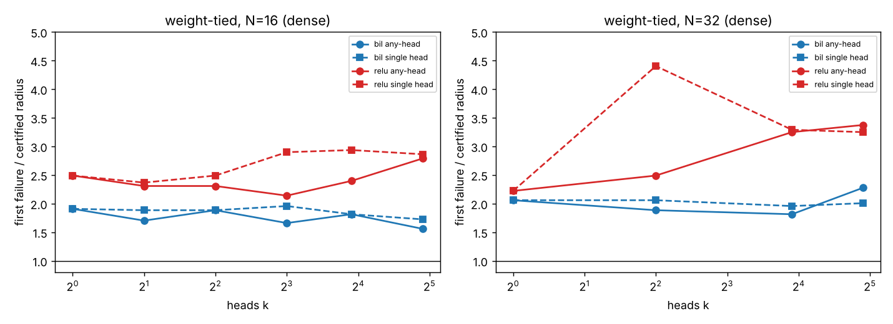

**Figure I1.** First failure found by the attack, as a multiple of the certified radius, against the number of heads k, for the tied-bilinear and the ReLU-gated tied design (N=16 and 32, dense noise). 'Any head' and 'single head' budgets are nearly equal.

### I2. Error-correcting state codes under a full noise matrix (B)

**Question.** Error-correcting state codes under a full noise matrix.

Constructions (all: linear transition memory M_v, restoring unit clip(g(z - tau) + .5), linear readout): `onehot`; `rep3`/`rep5` (each state replicated r times); `willshaw` (random constant-weight-3 sparse codes, binary OR memory, least-squares readout); `grid2` (two-hot product code). Programs: majority and Dyck, N = 8, 16, 32. Noise conditions: static parameter noise (absolute, relative), fresh-per-step parameter noise, fresh activation noise, fixed activation offset, a single burst at a random time vs the same noise repeated every step, failure rate vs sequence length (16/64/256), interval certificates (activation tube / parameter box), and a mechanism number (switching slack / row norm). Figure `figures/I5_codes.png`.

Majority program, sigma50 (absolute):


| N | code | m | params | static par. | fresh par. | fresh act. | fixed act. | single burst | cert act. tube | cert par. eps |
|---|---|---|---|---|---|---|---|---|---|---|
| 8 | onehot | 17 | 1785 | 0.152 | 0.175 | 0.181 | 0.195 | 0.45 | 0.167 | 0.050 |
| 8 | rep3 | 51 | 15759 | 0.105 | 0.105 | 0.311 | 0.357 | 0.87 | 0.167 | 0.032 |
| 8 | rep5 | 85 | 43605 | 0.100 | 0.104 | 0.394 | 0.415 | 1.26 | 0.167 | 0.019 |
| 8 | willshaw | 48 | 13968 | 0.037 | 0.030 | 0.085 | 0.150 | 0.65 | 0.033 | 0.000 |
| 8 | grid2 | - | no exact code found |  |  |  |  |  |  |  |
| 16 | onehot | 33 | 6633 | 0.107 | 0.112 | 0.140 | 0.157 | 0.43 | 0.167 | 0.050 |
| 16 | rep3 | 99 | 59103 | 0.093 | 0.105 | 0.228 | 0.243 | 0.71 | 0.167 | 0.022 |
| 16 | rep5 | 165 | 163845 | 0.062 | 0.072 | 0.364 | 0.358 | 0.86 | 0.167 | 0.013 |
| 16 | willshaw | 64 | 24768 | 0.035 | 0.029 | 0.067 | 0.092 | 0.46 | 0.020 | 0.000 |
| 16 | grid2 | - | no exact code found |  |  |  |  |  |  |  |
| 32 | onehot | 65 | 25545 | 0.104 | 0.105 | 0.115 | 0.120 | 0.32 | 0.167 | 0.042 |
| 32 | rep3 | 195 | 228735 | 0.086 | 0.104 | 0.208 | 0.214 | 0.48 | 0.167 | 0.014 |
| 32 | rep5 | 325 | 634725 | 0.056 | 0.056 | 0.333 | 0.295 | 0.76 | 0.167 | 0.008 |
| 32 | willshaw | 96 | 55584 | 0.033 | 0.029 | 0.059 | 0.068 | 0.35 | 0.019 | 0.000 |
| 32 | grid2 | - | no exact code found |  |  |  |  |  |  |  |


Dyck results are in `B_codes.json` and follow the same pattern.

Findings. (1) **Replication buys activation-noise tolerance and nothing else**: rep3/rep5 raise fresh-activation sigma50 by 1.5-3.3x over one-hot (all six programs) but *lower* static and fresh parameter-noise tolerance (e.g. majority N=32: 0.104 -> 0.086 -> 0.056) and the certified parameter radius (0.042 -> 0.014 -> 0.008), at 9-25x the parameters. The certified activation tube (0.167) is identical for one-hot and replication, i.e. the worst-case guarantee does not see the gain that Gaussian noise does. (2) **Willshaw sparse codes are exact but worse**: 2-4x lower static, fresh-parameter and fresh-activation tolerance, 2-8x more parameters than one-hot, certified parameter radius ~0 (a binary OR memory has no weight margin); single-burst tolerance is comparable to or higher than one-hot only at N=8. (3) Two-hot grid codes never gave an exact FSM. (4) **Once vs repeated**: a single burst is survived at 1.8-10.5x (typically 2-3x for one-hot and replication) higher magnitude than the same noise applied every step; a burst that lands on a wrong-but-valid codeword is never corrected (no code corrects a transition to a different valid state). (5) **Fixed vs fresh**: a fixed activation offset is tolerated slightly more than fresh noise for replication codes (e.g. rep3 N=8: 0.357 vs 0.311), and about equally for one-hot. (6) **Length scaling**: at 0.6 x sigma50(fresh act.) the per-step failure rate is mostly <= 1e-3 (worst case 7e-3) at L = 16, 64, 256 and does not grow with L; Willshaw codes sit at about 1e-3 to 7e-3. (7) **Mechanism**: the switching slack divided by the row norm of M (`slack/row`) predicts fresh-activation sigma50 across the 24 exact cells with Spearman rho = 0.96; the certified parameter radius predicts static sigma50 with rho = 0.93 (cells share constructions, so the effective sample size is much smaller than 24; treat as a consistency check, not a test).

Correction to H2: the earlier statement that Willshaw codes could not be made exact for majority N >= 32 was largely an artifact of an OR-superposition readout. With a least-squares readout exact codes exist for all tested programs (m = 24-96), but they still lose to one-hot on static, fresh-parameter and fresh-activation tolerance and on parameters.

> **Takeaway.** Replication buys tolerance to activation noise (1.5 to 3.3 times) at the price of tolerance to parameter noise and 9 to 25 times the parameters; the certified activation tube is unchanged. Willshaw-type codes are exact but worse on most axes and 2 to 8 times larger than one-hot; two-hot grid codes never gave an exact automaton. A single noise burst is survived at 1.8 to 10 times (typically 2 to 3 times) the magnitude that the same noise repeated every step can be; a burst that lands on a wrong-but-valid state is never corrected. The switching slack divided by the row norm predicts activation sigma50 (Spearman 0.96 across clustered cells, so a consistency check, not a test).

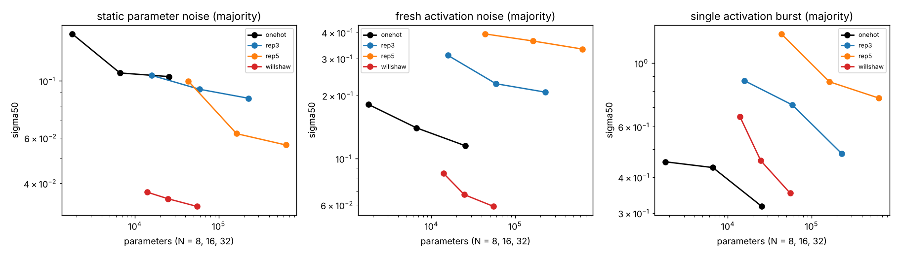

**Figure I2.** Noise tolerance against parameter count for one-hot, replication and Willshaw codes on the majority program (N=8, 16, 32): static parameter noise, fresh activation noise and a single activation burst.

### I3. A fast-weight universal interpreter: construction and exactness (C1)

**Question.** A fast-weight universal interpreter: construction and exactness.

**Construction.** One interpreter with slow weights theta = {A, B, C, gain, threshold} executes any finite-state program whose transition table lives only in fast weights phi = {F, R, S0}:
```
key    k(x,s,g) = (A x) o (B s) o (C g) / sqrt(dk)      A,B,C random +-1 binding codes (token, state, program address); o = Hadamard
step   s'  = clip(2 F k - .5, 0, 1)                      F: fast transition memory (n x dk), clip = restoring snap
read   y   = R [(B s') o (C g)]/sqrt(dk)                 R: fast readout memory
init   s0  = clip(2 S0 (C g)/sqrt(dk) - .5, 0, 1)         S0: fast initial-state memory
```
The program is *written* into F, R, S0 from a program tape of (program, token, state, successor) entries by a clipped delta rule (error-driven outer-product update, positives to >= .85, negatives to <= .15; mini-batched with Adam step sizes for speed, started from a ridge solution; plain SGD reproduces the semantics for the online-addition test). Exactness is certified by an exhaustive one-step check of every (program, token, state) transition, readout and initial state with a safety band >= 0.08; because the snap returns exact 0/1 vectors this proves exact execution for sequences of any length, and long-run checks (L = 60, 32 random sequences) agree in every row. Programs: majority, Dyck, mod-counter, reset-counter, parity, random automata, V = 6 tokens, n <= 21 states. Diversity sets: `template` (same structure, different token roles), `family` (two families, varied sizes), `mixed` (six families), `random` (unstructured automata). Figures `figures/I1_fwi_scaling.png`, `I2_nscale.png`.


| set | P | tape entries M | distinct token maps | dk_min | dk/M | fast params | slow params (explicit / hashed codes) | independent dense | block-diag | role-dict tied | private fast mem. | MACs/step (FWI / indep / block-diag) |
|---|---|---|---|---|---|---|---|---|---|---|---|---|
| template | 1 | 126 | 3/6 | 64 | 0.51 | 1544 | 1794 / 1730 | 2709 | 2709 | 1404 | 1544 | 4672 / 483 / 483 |
| template | 4 | 504 | 3/24 | 288 | 0.57 | 6344 | 8930 / 7778 | 10836 | 43092 | 1647 | 6544 | 21024 / 483 / 7728 |
| template | 16 | 2016 | 3/96 | 992 | 0.49 | 21680 | 42658 / 26786 | 43344 | 688464 | 2619 | - | 72416 / 483 / 123648 |
| family | 1 | 126 | 3/6 | 64 | 0.51 | 1544 | 1794 / 1730 | 2709 | 2709 | 1404 | 1544 | 4672 / 483 / 483 |
| family | 4 | 462 | 11/24 | 272 | 0.59 | 6008 | 8434 / 7346 | 9201 | 36267 | 5367 | 5672 | 19856 / 412 / 6545 |
| family | 16 | 1476 | 23/96 | 848 | 0.57 | 18992 | 36466 / 22898 | 25230 | 371214 | 13359 | - | 61904 / 285 / 68388 |
| mixed | 1 | 126 | 3/6 | 80 | 0.63 | 1912 | 2242 / 2162 | 2709 | 2709 | 1404 | 1912 | 5840 / 483 / 483 |
| mixed | 4 | 408 | 8/24 | 240 | 0.59 | 5528 | 7442 / 6482 | 8307 | 28560 | 3972 | 5576 | 18240 / 374 / 5372 |
| mixed | 16 | 1458 | 41/96 | 848 | 0.58 | 20960 | 36466 / 22898 | 27631 | 367659 | 23025 | - | 69536 / 323 / 72171 |
| random | 1 | 126 | 6/6 | 64 | 0.51 | 1576 | 1794 / 1730 | 2751 | 2751 | 2745 | 1576 | 4800 / 525 / 525 |
| random | 4 | 504 | 24/24 | 288 | 0.57 | 6472 | 8930 / 7778 | 11004 | 43764 | 11412 | 7104 | 21600 / 525 / 8400 |
| random | 12 | 1512 | 72/72 | 880 | 0.58 | 19840 | 34322 / 23762 | 33012 | 393372 | 37692 | - | 66000 / 525 / 75600 |


Scaling with the number of states n (random automata, one shared memory; `figures/I2_nscale.png`):


| P | n | M | dk_min | dk/M | fast params | independent dense | independent non-zeros |
|---|---|---|---|---|---|---|---|
| 1 | 8 | 48 | 48 | 1.00 | 512 | 424 | 57 |
| 1 | 16 | 96 | 48 | 0.50 | 960 | 1616 | 113 |
| 1 | 32 | 192 | 112 | 0.58 | 3968 | 6304 | 225 |
| 1 | 64 | 384 | 176 | 0.46 | 12032 | 24896 | 449 |
| 1 | 96 | 576 | 272 | 0.47 | 27136 | 55776 | 673 |
| 4 | 8 | 192 | 112 | 0.58 | 1088 | 1696 | 228 |
| 4 | 16 | 384 | 208 | 0.54 | 3712 | 6464 | 452 |
| 4 | 32 | 768 | 432 | 0.56 | 14592 | 25216 | 900 |
| 4 | 64 | 1536 | 704 | 0.46 | 46592 | 99584 | 1796 |
| 4 | 96 | 2304 | 880 | 0.38 | 86272 | 223104 | 2692 |


Findings. (1) **Yes, one shared interpreter executes genuinely different programs exactly** (arbitrary transition structure, up to 16 programs in one memory, certified). (2) **The shared memory is not smaller than separate memories**: the key width needed grows linearly with the number of stored transitions (dk/M = 0.49-0.63 in every set and every P), and the fast parameters of one shared memory are within about 10% of the sum of private per-program memories (e.g. mixed P=8: 10,384 shared vs 10,016 private). There is no superposition gain. (3) **No gain with n**: dk/M stays 0.38-0.58 for n = 8..96, so the compression factor against dense independent tables is a constant ~2x, not the n/log n that a sparse-target capacity argument suggested; against the independent networks' non-zero count the fast memory is 20-40x larger. (4) **Structure is not exploited**: for `template` programs (3 distinct token maps shared by all P) the role-dictionary tied design needs 1.4k-2.6k parameters at P = 1..16 against 21.7k fast parameters (64k with explicit slow weights) for the interpreter. The interpreter buys generality (it handles the `random` set, where the dictionary design needs one matrix per token map and loses all sharing), not sharing. (5) **Slow weights are not free**: explicit random binding codes cost dk(V + n + P) parameters, as much as the fast memory; hashed/PRNG-generated codes would cost ~0 but then they are not weights that can be perturbed. (6) **Execution cost is 10-150x higher** than one independent bilinear step (MACs/step 4.7k-72k vs 0.3-0.5k), cheaper than block-diagonal stacking only for P >= 16 (72k vs 124k at P = 16 in the template set). (7) Within the program set the fast memory is a dense distributed code (rms ~ 1/sqrt(dk), no sparse structure): the program is not localised to a region of F.

> **Takeaway.** One shared set of slow weights executes arbitrary different programs exactly, with up to 16 programs in a single memory. But the memory needed grows linearly with the number of stored transitions (key width about half the number of transitions, for every set of programs and every number of states), the shared memory is within about 10 percent of the sum of separate memories, and the interpreter does not exploit structure shared between programs: for template programs a role-dictionary tied design needs 1.4k to 2.6k parameters against 21.7k fast parameters for the interpreter. Execution costs 10 to 150 times more multiply-accumulates than an independent network. This is shared execution, not shared capacity.

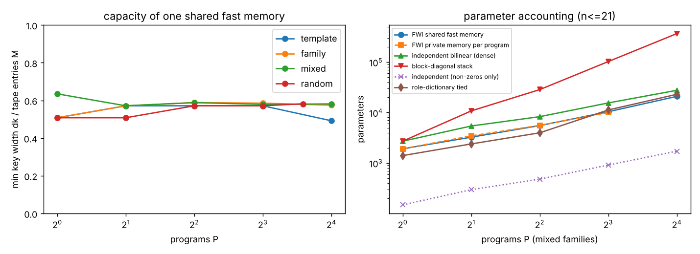

**Figure I3.** Left: the minimum key width of one shared fast memory divided by the number of stored transitions, against the number of programs, for four sets of increasing diversity. Right: parameter accounting against the number of programs (mixed families).

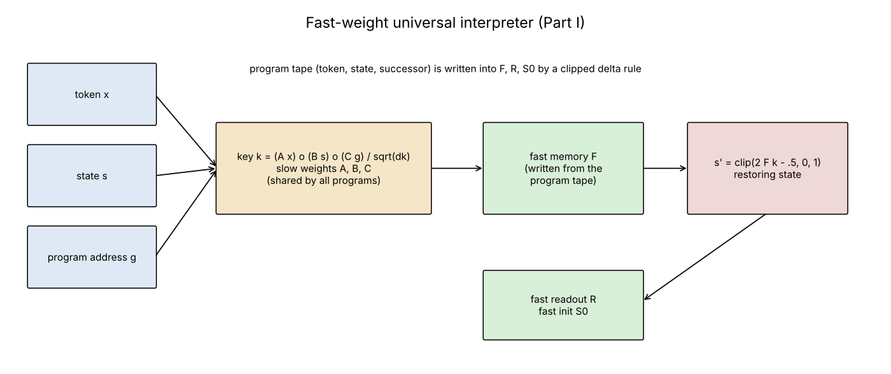

**Figure I3b.** The fast-weight interpreter: a key built from token, state and program address (Hadamard product of random codes) reads the fast transition memory F; the clip restores the state; readout and initial state are also fast memories.

### I4. Robustness vs number of programs and separated perturbation targets (C2)

**Question.** Robustness against the number of programs, and separated perturbation targets.

Noise is i.i.d. Gaussian per entry; *slow* = A, B, C, gain, threshold; *fast* = F, R, S0; *static* = one draw held for the whole run; *fresh* = new draw at every step (sampled in key-component space, exactly equivalent in law); mean = mean per-program exact-sequence accuracy reaching 50%, joint = all programs exact. Mixed-family programs, dk = 1.3 x minimal. Figure `figures/I6_targets.png`.


| P | target | static sigma50 mean / joint | relative alpha50 mean / joint | fresh sigma50 mean / joint |
|---|---|---|---|---|
| 1 | slow only | 0.105 / 0.105 | 0.098 / 0.098 | 0.133 / 0.133 |
| 1 | fast only | 0.099 / 0.099 | 0.188 / 0.188 | 0.105 / 0.105 |
| 1 | both | 0.075 / 0.075 | 0.090 / 0.090 | 0.080 / 0.080 |
| 1 | activation noise (fresh) |  |  | 0.083 / 0.083 |
| 1 | snap gain/threshold only | 0.404 / 0.404 |  |  |
| 1 | slow weights perturbed BEFORE writing | sigma50 = inf (no failure up to sigma = 0.3, 2 seeds) |  |  |
| 4 | slow only | 0.117 / 0.077 | 0.115 / 0.077 | 0.134 / 0.089 |
| 4 | fast only | 0.093 / 0.075 | 0.203 / 0.147 | 0.102 / 0.081 |
| 4 | both | 0.078 / 0.057 | 0.104 / 0.074 | 0.079 / 0.071 |
| 4 | activation noise (fresh) |  |  | 0.072 / 0.044 |
| 4 | snap gain/threshold only | 0.389 / 0.269 |  |  |
| 4 | slow weights perturbed BEFORE writing | sigma50 = inf (no failure up to sigma = 0.3, 2 seeds) |  |  |
| 16 | slow only | 0.144 / 0.060 | 0.129 / 0.060 | 0.171 / 0.061 |
| 16 | fast only | 0.093 / 0.060 | 0.196 / 0.183 | 0.093 / 0.060 |
| 16 | both | 0.065 / 0.059 | 0.096 / 0.060 | 0.062 / 0.060 |
| 16 | activation noise (fresh) |  |  | 0.061 / 0.046 |
| 16 | snap gain/threshold only | 0.557 / 0.346 |  |  |


P=16 used half the sigma grid and 2 seeds.

Adding programs (program 0 identical for every P; static noise):


| P | width | prog 0: fast only | slow only | both | all programs exact: fast | slow | both | independent nets (per-prog / joint) | block-diag (per-prog / joint) |
|---|---|---|---|---|---|---|---|---|---|
| 1 | prop dk=96 | 0.099 | 0.105 | 0.075 | 0.099 | 0.105 | 0.075 | 0.132 / 0.132 | 0.132 / 0.132 |
| 1 | fixeddk dk=1104 | 0.139 | 0.171 | 0.127 | 0.139 | 0.171 | 0.127 | 0.132 / 0.132 | 0.132 / 0.132 |
| 2 | prop dk=192 | 0.084 | 0.056 | 0.052 | 0.080 | 0.056 | 0.051 | 0.133 / 0.117 | 0.083 / 0.080 |
| 2 | fixeddk dk=1104 | 0.139 | 0.131 | 0.106 | 0.138 | 0.131 | 0.103 | 0.133 / 0.117 | 0.083 / 0.080 |
| 4 | prop dk=320 | 0.109 | 0.135 | 0.080 | 0.075 | 0.077 | 0.057 | 0.141 / 0.112 | 0.068 / 0.051 |
| 4 | fixeddk dk=1104 | 0.137 | 0.357 | 0.140 | 0.122 | 0.159 | 0.103 | 0.141 / 0.112 | 0.068 / 0.051 |
| 8 | prop dk=576 | 0.091 | 0.139 | 0.081 | 0.078 | 0.083 | 0.063 | 0.146 / 0.094 | 0.045 / 0.043 |
| 8 | fixeddk dk=1104 | 0.138 | 0.182 | 0.112 | 0.122 | 0.098 | 0.081 | 0.146 / 0.094 | 0.045 / 0.043 |
| 16 | prop dk=1104 | 0.087 | 0.143 | 0.080 | 0.069 | 0.077 | 0.047 | 0.145 / 0.084 | 0.030 / 0.025 |
| 16 | fixeddk dk=1104 | 0.087 | 0.143 | 0.080 | 0.069 | 0.077 | 0.047 | 0.145 / 0.084 | 0.030 / 0.025 |


(`prop`: dk = 1.3 x the minimal width for that P; `fixeddk`: dk held at the P = 16 width.)

Findings. (1) **The three targets fail at different levels** and are not interchangeable: slow-only tolerance grows with P at fixed relative scale (0.105 -> 0.144 mean) because more of the key components are redundant, fast-only drops slightly (0.099 -> 0.093), and applying both is worse than either (0.075 -> 0.065). Snap gain/threshold alone are far less sensitive (0.39-0.56) - they are 2 scalars, not high-dimensional. (2) **Fresh noise is not worse than static noise** for the slow weights (0.133 vs 0.105 at P=1) and about equal for the fast weights: the failures are driven by the margin of single steps, not by accumulation. (3) **Self-calibration**: when the slow weights are perturbed *before* the programs are written, the fast memories are written through the defective interpreter and execution stays exact for every perturbation tested (P = 1, 4; sigma <= 0.3); the same perturbation applied *after* writing breaks execution at sigma ~ 0.1. Slow-weight drift is dangerous; slow-weight imperfection that is present at write time is not. (4) **Adding programs lowers per-program fast-weight robustness only mildly** at proportional width (0.109 -> 0.087 for program 0 from P = 4 to 16) and joint exactness falls with the weakest program (0.075 -> 0.069 fast-only; 0.057 -> 0.047 both). Spare width helps (fixed dk = 1104: 0.137 at P = 4, 0.138 at P = 8). (5) **Against baselines**: independent networks stay near 0.14 per program with joint 0.112 -> 0.084 (P = 4 -> 16); the interpreter's joint tolerance is lower (0.047 at P = 16); block-diagonal stacking is worst and degrades fastest (per program 0.068 -> 0.030) because its zero off-block entries are real noisy parameters.

> **Takeaway.** Slow-weight, fast-weight and joint perturbations fail at different levels, and joint noise is worse than either. Fresh noise is not worse than static noise for slow weights. Perturbing the slow weights *before* the programs are written is fully absorbed (the programs are written through the defective interpreter), whereas the same perturbation after writing breaks execution at about 0.1. Adding programs lowers per-program fast-weight tolerance only mildly (about 20 percent from 4 to 16 programs), and independent networks are more robust than the interpreter in the joint metric.

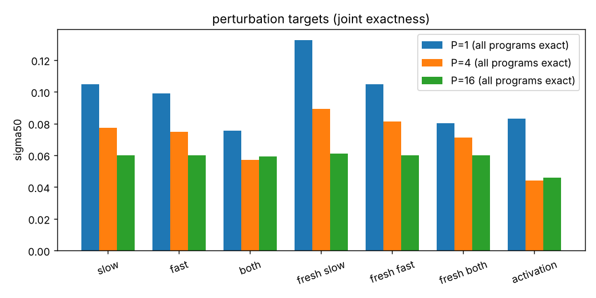

**Figure I4.** Noise tolerance for each perturbation target (slow, fast, both, fresh versions, activation) at 1, 4 and 16 programs, in the joint metric where every program must be exact.

### I5. Certificates and attacks for the interpreter (C4)

**Question.** Certificates and attacks for the interpreter.

Interval-bound certificate over every (program, token, state) with a state tube of width delta; fast weights perturbed entrywise by eps_F, slow weights by eps_theta, independently at every step. Figure `figures/I4_cert_vs_P.png`.


| P | dk | certified eps fast | certified eps slow | joint ray t | attack: first failure / cert (fast, slow, joint) |
|---|---|---|---|---|---|
| 1 | 96 | 8.91e-03 | 6.18e-03 | 0.51 | 6.7x / 6.7x / 4.0x |
| 2 | 192 | 5.50e-03 | 4.56e-03 | 0.52 | not run |
| 4 | 320 | 4.29e-03 | 2.48e-03 | 0.50 | 10.4x / 8.7x / 6.7x |
| 8 | 576 | 2.50e-03 | 1.89e-03 | 0.50 | not run |
| 16 | 1104 | 1.85e-03 | 1.16e-03 | 0.50 | not run |


Findings. (1) The certified radius shrinks as programs are added (fast 8.9e-3 -> 1.9e-3, slow 6.2e-3 -> 1.2e-3, P = 1 -> 16, about P^-0.6): worst-case robustness *does* degrade with load even where Gaussian tolerance degrades only mildly. (2) The worst-case radii are ~50x smaller than Gaussian sigma50 (e.g. 0.002 vs 0.09): the L-infinity worst case sees ||k||_1 = sqrt(dk) where Gaussian noise sees ||k||_2 = 1. (3) The certificate is much looser than for the tied designs: the first failure found by the attack is 4-10x the certified radius (vs 1.5-3x for tied designs). The attack here is weak (40 steps, 1 restart) so the reported multiples are upper bounds on the true first failure; the true gap is between 1x and these values. (4) The joint ray is certified at t ~ 0.5 for every P: fast and slow perturbations add about linearly.

> **Takeaway.** The certified radius shrinks about five times as programs are added from 1 to 16 (fast 8.9e-3 to 1.9e-3; slow 6.2e-3 to 1.2e-3), roughly like P to the minus 0.6. Worst-case radii are about 50 times below Gaussian tolerance (the L-infinity worst case sees the L1 norm of the key where Gaussian noise sees the L2 norm). The attack-found failure is 4 to 10 times the certified radius, so this certificate is looser than for the tied designs (the attack is weak, so these are upper bounds).

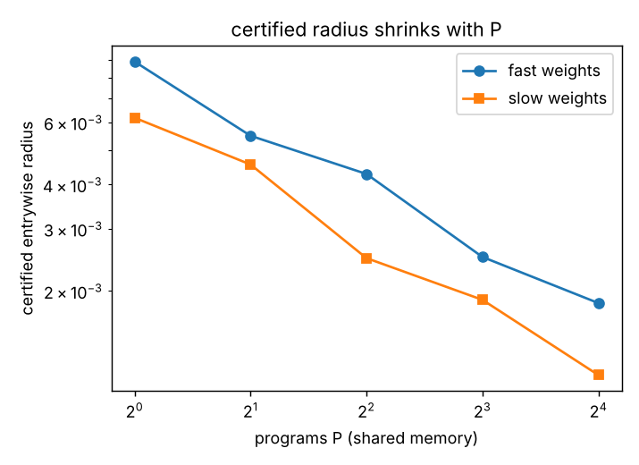

**Figure I5.** Certified entrywise radius of the interpreter shrinks as programs are added.

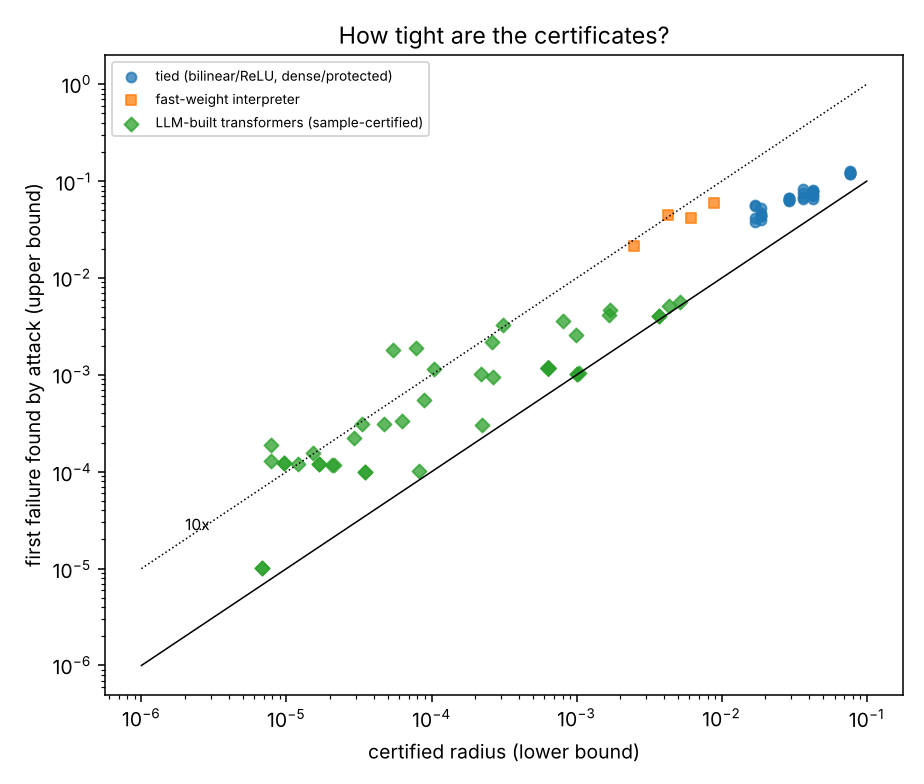

**Figure I5b.** Certified radius against first failure found by the attack, for the tied designs, the interpreter and the LLM-built transformers. Every point lies on or above the diagonal; the vertical distance to it is the looseness of the certificate.

### I6. Composition and sequential execution (C5)

**Question.** Composition and sequential execution on one shared memory.

**Pipelines on one shared memory.** The readout symbol of program A (one micro-step) is the input token of program B (second micro-step); separate state registers; same slow weights and the same fast memory F holding all five programs. Seven pipelines (majority>mod-counter, majority>reset-counter, Dyck>mod, Dyck>reset, majority>random, mod>reset, reset>random): all exact on 32 random sequences of length 40. Robustness (static noise, mean over pipelines): fast-only 0.078, slow-only 0.094, both 0.065; the same programs run alone: 0.088 / 0.095 / 0.068. Pipelined independent bilinear networks (discrete hand-off, noise on all their tensors): 0.117. So composition costs almost nothing in tolerance, and independent networks remain ~1.8x more tolerant than the interpreter under joint noise.

**Online program addition** (programs written one after another into the same F, 12 programs). Plain delta rule (SGD) on the new program's tape only: at dk = 1104 the first addition keeps all 4 earlier programs exact, the second keeps 2 of 5, and from the third on **no earlier program survives**; at dk = 672 none survives even the first addition. With rehearsal (re-presenting the old tapes) every earlier program stays exact up to 12 programs (20-100 steps per addition). An Adam-based write gave 0 survivors from the first addition on; that is largely an artifact of Adam's per-weight step normalisation and is reported only as the worse case. Conclusion: programs can be added to a shared fast memory only by re-writing (rehearsing) the old programs; there is no interference-free incremental loading with the delta rule at these widths. Mid-stream switching between programs by changing the program address needs no experiment: the state registers are separate and the memory is read-only during execution.

> **Takeaway.** Seven pipelines (the readout of one program is the input of another) on one memory are all exact and lose almost no tolerance relative to the programs run alone. Programs can be added online only with rehearsal of the old ones: with a plain delta rule on the new tape only, earlier programs do not survive beyond the first additions. An Adam-based write gave zero survivors from the first addition (a worse case caused by Adam's per-weight step normalization).

### I7. Answers to the ten questions (small-scale; n <= 21 for the interpreter)

**Question.** Answers to the ten questions of the plan.

1. **Exact execution by one shared interpreter?** Yes, certified (I3), up to 16 different programs in one memory.
2. **Representation?** Dense distributed fast memories F (n x dk), R, S0 addressed by Hadamard-bound random codes of (token, state, program); programs are written from a tape by a clipped delta rule. Nothing is localised per program.
3. **Genuinely different transition structures?** Yes: majority, Dyck, mod-counters, reset-counters, parity and unstructured random automata, in one memory.
4. **Separate parameter allocation per program?** The slow weights are shared (constant in P apart from the explicit address codes, dk x P), but the fast memory needed grows linearly with the number of stored transitions and equals, within ~10%, the sum of private memories. So there is no allocation per program in the architecture, yet no capacity saving either.
5. **Scaling with number and diversity?** dk_min/M = 0.49-0.63 for every set and every P; diversity (template to random) changes nothing for the interpreter, but changes everything for the role-dictionary tied design (its parameters grow with the number of distinct token maps). No gain with n.
6. **Does adding programs reduce robustness of existing programs?** Yes, mildly under Gaussian noise (-20% per-program fast-weight tolerance for program 0 from P = 4 to 16, recoverable with spare width) and clearly in the certified worst case (about 5x smaller radius from P = 1 to 16).
7. **Exact execution under parameter perturbations?** Certified up to entrywise 1.9e-3 (fast) / 1.2e-3 (slow) at P = 16, 8.9e-3 / 6.2e-3 at P = 1; Gaussian tolerance ~0.06-0.14.
8. **Interpreter-only perturbation?** sigma50 0.105-0.144 (static), 0.133-0.171 (fresh); perturbations present at write time are fully absorbed (self-calibration), perturbations after writing are not.
9. **Program-only perturbation?** sigma50 0.093-0.099; relative alpha50 0.19-0.20, the largest relative tolerance of any target.
10. **Composition?** Yes: A->B pipelines on one memory are exact and lose almost no tolerance; incremental addition of programs needs rehearsal.

Comparison summary (mixed programs, P = 16, n <= 21): independent networks - 27.6k dense parameters (1.7k non-zeros), 0.3k MACs/step, per-program sigma50 0.145, joint 0.084; block-diagonal stack - 368k parameters, 72k MACs/step, 0.030 / 0.025; role-dictionary tied design - 23k parameters, applicable only to template programs where it needs 2.6k; fast-weight interpreter - 21k fast + 36k slow (explicit) parameters, 70k MACs/step, 0.087 per program (fast only), 0.047 joint, exact for all families. **Verdict on the exit condition**: the interpreter provides genuine shared *execution* of different programs (one set of slow weights, programs as data) but not shared *capacity*: memory, execution cost and worst-case robustness all scale at least linearly with the number of stored programs, and none of them beats independent networks at the sizes tested.

> **Takeaway.** A compact answer sheet; see the table in this section.

### I8. Caveats

**Question.** Caveats for Part I.

- Interpreter scaling used n <= 21 (n <= 96 for the width study, single seed per size); widths are an upper bound on true capacity because the write rule is an optimiser, not an optimal solver. Key widths were searched on a geometric grid by bisection with one key seed; self-calibration used 2 seeds.
- The attacks (C4, and the N = 32, k >= 15 tied attacks) are reduced-strength; reported first-failure multiples are upper bounds. P = 16 target runs used half the noise grid and 2 seeds.
- Joint (all-programs-exact) sigma50 values are limited by the weakest program and by the 14-point sigma grid; differences below ~20% are not significant.
- The mechanism correlations in I2 are across cells that share constructions; treat as consistency checks.
- Online-addition result is for the plain delta rule on random binding codes; orthogonalised or structured codes were not tried.
- Nothing here tests trained (learned) interpreters; slow weights are hand-set random codes.

> **Takeaway.** Small scale (n up to 21 states for the scaling study), reduced-strength attacks in places, coarse grids, one key seed.

## Part J. LLM-synthesized transformers: protocol, harness and first (contaminated) run

From here the question changes from *how do we build a robust network* to *how robust are networks built by a language model, compared with other construction methods*. Part J describes the frozen protocol, the shared evaluation harness and a first run by the same Claude instance that wrote the harness (therefore *contaminated*). It is a pointer, not a result.

**Status: preliminary pointer data, one LLM, one attempt per cell, CONTAMINATED context. Not for general claims; reserved as held-out data for the theory stage.**
Code and protocol: `llm_synthesis/` (`PROTOCOL.md` frozen before any attempt, package sha256 `a528b01d96fb9158dbd42af1ca260c1336866e7f191d0f5be1ebc42866fdc8e1`; harness files `tasks.py`, `family.py`, `evaluate.py`, `run_eval.py`, `feedback.py`, `tracr_baseline.py`; prompts `prompts/rendered/*.md` (32), run sheet `prompts/run_sheet.csv` (60 chats for the fresh session)); results `llm_synthesis/results/contam__*.json`, `contaminated_summary.json`, `contaminated_tables.md`, `tracr_baseline_same_harness.json`; records `llm_synthesis/records/`. Prior-art notes: `PRIOR_ART_NOTES.md`; theory inputs: `THEORY_CANDIDATES.md`.

### J0. Prior-art check (3 queries, not an audit)

**Question.** What prior work exists on LLMs synthesizing network weights?

Direct LLM synthesis of network weights without gradient descent exists in early form (blog-level "weight-space programming"; trained generators NeuroGen and Drag-and-Drop LLMs); LLM-written RASP compiled by Tracr exists (TracrBench: 57/101 programs correct for GPT-4-turbo); weight-from-graph compilers exist (torchwright). I found no study comparing parameter-perturbation robustness across compiler-built, analytic, LLM-synthesized and trained networks (weak evidence of absence). Two earlier claims overlap known work and go on the audit list: Tracr numerical instability at long lengths (B1/B2) and noise-aware training / error accumulation with depth in analog transformers (C2, G1).

> **Takeaway.** A three-query check (not an audit). Direct LLM weight synthesis exists in early forms; we found no robustness comparison.

### J1. What was built

**Question.** What was built?

Six tasks with the project's semantics (Tracr `length`, `hist`, `reverse`; digital `parity`, `majority(N=8)`, `dyck_valid_prefix(N=8)`), one transformer family (no LayerNorm, ReLU MLP, softmax attention) with every parameter a named perturbable tensor, and one evaluation pipeline: clean-correctness gate (hidden test set AND all 335,922 sequences of length 1-7), static Gaussian noise (absolute, relative, zero-only, nonzero-only, 6 parameter groups; sigma 1e-5..1 in 16 steps, 5 seeds), a new interval-bound certificate for the family (absolute box on all parameters, evaluated on the 200 test sequences = sample-certified radius, soundness checked on a random model), and an L-inf attack with doubling+bisection. The Tracr baselines run through the same noise procedure reproduce the earlier results (hist abs 1.4e-3, reverse 6.1e-4; A1: 1.4e-3, 5.8e-4).

> **Takeaway.** Six tasks, one transformer family in which every parameter is a named perturbable tensor, and one evaluation pipeline used for every network: a clean-correctness gate (exhaustive and hidden test set), static noise protocols, a new sample-certified interval bound for transformers, and an attack.

### J2. Contaminated run (category 3b and 4; no feedback)

**Question.** The contaminated run: 16 constructions written before the checker was run.

16 submissions were written before the checker was run on any of them (12 core cells = 6 tasks x constrained/unconstrained, category 3b; 4 category-4 cells = literal weight values for `length` and `parity`). **All 16 passed the clean-correctness gate** (exhaustive, 0 wrong of 335,922) on the first try; there were no synthesis failures and no feedback-condition attempts were needed. The author of the submissions also wrote the harness and had seen the project's designs, so this says little about LLM capability in general. Category-4 attempts use the same weights as their 3b counterparts, so they are not independent observations.

Per attempt:


| task | condition | cat | params | nonzero | max abs w | sigma50 abs | rel | nonzero-only | cert radius | attack first break | attack/cert | abs/cert |
|---|---|---|---|---|---|---|---|---|---|---|---|---|
| dyck8 | constrained | 3b | 25698 | 0.001 | 240 | 2.43e-03 | 7.57e-03 | 4.69e-02 | 6.78e-06 | 1.02e-05 | 1.5 | 359 |
| dyck8 | unconstrained | 3b | 378 | 0.071 | 60 | 5.63e-03 | 3.02e-02 | 2.44e-02 | 6.77e-06 | 1.02e-05 | 1.5 | 832 |
| hist | constrained | 3b | 1881 | 0.023 | 170 | 8.03e-04 | 1.09e-03 | 9.85e-04 | 1.68e-05 | 1.19e-04 | 7.1 | 48 |
| hist | unconstrained | 3b | 550 | 0.078 | 159 | 7.48e-04 | 1.25e-03 | 1.44e-03 | 1.68e-05 | 1.19e-04 | 7.1 | 44 |
| length | constrained | 3b | 1881 | 0.012 | 56 | 4.58e-03 | 2.09e-02 | 9.47e-03 | 6.32e-04 | 1.17e-03 | 1.9 | 7 |
| length | constrained | 4 | 1881 | 0.012 | 56 | 4.58e-03 | 2.09e-02 | 9.47e-03 | 6.32e-04 | 1.17e-03 | 1.9 | 7 |
| length | unconstrained | 3b | 146 | 0.158 | 56 | 4.28e-03 | 4.87e-02 | 4.51e-03 | 6.36e-04 | 1.18e-03 | 1.9 | 7 |
| length | unconstrained | 4 | 146 | 0.158 | 56 | 4.28e-03 | 4.87e-02 | 4.51e-03 | 6.36e-04 | 1.18e-03 | 1.9 | 7 |
| majority8 | constrained | 3b | 25698 | 0.001 | 240 | 2.91e-02 | 5.42e-02 | 6.40e-02 | 3.50e-05 | 1.00e-04 | 2.9 | 832 |
| majority8 | unconstrained | 3b | 196 | 0.112 | 60 | 6.84e-03 | 5.27e-02 | 1.82e-02 | 3.49e-05 | 9.97e-05 | 2.9 | 196 |
| parity | constrained | 3b | 6706 | 0.005 | 170 | 2.44e-03 | 5.03e-03 | 5.35e-03 | 7.86e-06 | 1.29e-04 | 16.4 | 311 |
| parity | constrained | 4 | 6706 | 0.005 | 170 | 2.44e-03 | 5.03e-03 | 5.35e-03 | 7.86e-06 | 1.29e-04 | 16.4 | 311 |
| parity | unconstrained | 3b | 160 | 0.194 | 98 | 2.11e-03 | 3.46e-03 | 3.16e-03 | 7.83e-06 | 1.87e-04 | 23.9 | 270 |
| parity | unconstrained | 4 | 160 | 0.194 | 98 | 2.11e-03 | 3.46e-03 | 3.16e-03 | 7.83e-06 | 1.87e-04 | 23.9 | 270 |
| reverse | constrained | 3b | 17543 | 0.004 | 320 | 1.03e-03 | 1.53e-02 | 4.53e-03 | 9.69e-06 | 1.22e-04 | 12.6 | 106 |
| reverse | unconstrained | 3b | 1967 | 0.033 | 196 | 6.08e-04 | 1.71e-02 | 8.80e-03 | 9.69e-06 | 1.22e-04 | 12.6 | 63 |


Per parameter group (sigma50, category 3b):


| task | condition | embeddings | attn q/k | attn v/o | mlp in | mlp out | unembed | zero-only |
|---|---|---|---|---|---|---|---|---|
| dyck8 | constrained | 4.10e-03 | inf | 7.90e-02 | 1.22e-01 | 4.48e-02 | 3.08e-01 | 2.60e-03 |
| dyck8 | unconstrained | 2.93e-03 | 9.41e-01 | 8.86e-02 | 1.59e-01 | 3.05e-02 | 3.08e-01 | 7.18e-03 |
| hist | constrained | 1.09e-03 | 1.53e-03 | 2.63e-02 | 3.64e-03 | inf | 3.07e-01 | 1.23e-03 |
| hist | unconstrained | 1.06e-03 | 2.10e-03 | 2.94e-02 | 4.23e-03 | 6.95e-01 | 3.07e-01 | 1.08e-03 |
| length | constrained | 7.46e-03 | 5.21e-01 | 1.28e-02 | 9.47e-03 | 7.26e-01 | 2.33e-01 | 5.62e-03 |
| length | unconstrained | 8.44e-03 | inf | 1.21e-02 | 4.51e-03 | 7.26e-01 | 2.33e-01 | 5.38e-03 |
| majority8 | constrained | 3.16e-02 | inf | 1.27e-01 | 5.61e-01 | 7.91e-01 | 4.05e-01 | 3.36e-02 |
| majority8 | unconstrained | 1.31e-02 | 3.66e-01 | 2.81e-02 | 6.45e-01 | 5.71e-01 | 5.63e-01 | 7.84e-03 |
| parity | constrained | 7.07e-03 | 4.93e-02 | 7.46e-02 | 5.57e-03 | 2.47e-01 | 3.00e-01 | 4.14e-03 |
| parity | unconstrained | 8.22e-03 | 7.24e-02 | 2.10e-01 | 2.99e-03 | 9.16e-01 | 8.00e-01 | 3.53e-03 |
| reverse | constrained | 7.92e-03 | 1.58e-02 | 2.85e-03 | 1.24e-03 | 3.24e-01 | 2.44e-01 | 1.14e-03 |
| reverse | unconstrained | 8.62e-03 | 1.63e-02 | 7.00e-03 | 7.56e-04 | 2.85e-01 | 2.44e-01 | 6.32e-04 |


Against the compiler (category 1) on the three shared tasks:


| task | Tracr (compiler, category 1) abs | LLM constrained abs | LLM unconstrained abs | Tracr rel | LLM constrained rel | LLM unconstrained rel | Tracr params | LLM constrained / unconstrained params |
|---|---|---|---|---|---|---|---|---|
| length | 2.69e-04 | 4.58e-03 | 4.28e-03 | 9.90e-04 | 2.09e-02 | 4.87e-02 | 2391 | 1881 / 146 |
| hist | 1.38e-03 | 8.03e-04 | 7.48e-04 | 2.78e-03 | 1.09e-03 | 1.25e-03 | 2391 | 1881 / 550 |
| reverse | 6.10e-04 | 1.03e-03 | 6.08e-04 | 1.65e-03 | 1.53e-02 | 1.71e-02 | 58289 | 17543 / 1967 |

> **Takeaway.** All 16 passed the exhaustive correctness gate on the first try. Because the author also wrote the harness and had seen the project, this says little about LLM capability in general.

### J3. Pre-registered expectations vs this run

**Question.** Pre-registered expectations versus this run.

* **E1** (failures common, worse without feedback): **not supported** here: 0/16 failures (contaminated, blind).
* **E2** (>=10x spread across attempts): **untested** (one attempt per cell). Measurement floor: the same construction at different widths differs up to ~2.3x in absolute sigma50 (extra zero entries inject noise, cf. F1) or in relative sigma50 (draw variation), so differences below ~2-3x are not meaningful.
* **E3** (sigma50 near the Tracr range 1e-4..1e-2, far below digital >= 0.1): **supported**: absolute sigma50 of the 12 core attempts spans 6.1e-04..2.9e-02; the three shared tasks lie within a factor ~17 of Tracr (length 17x more tolerant, hist 0.6x, reverse 1.0-1.7x), the largest value (majority8, constrained) is 2.9e-2.
* **E4** (constrained vs unconstrained differ via size, not margin structure): **partly supported**: certified and attack radii are identical for the two conditions of a task (same construction), while absolute sigma50 differs by up to ~2.3x through the number of zero entries.
* **E5** (category 4 feasible only for the smallest tasks; sparse, integer-valued): **partly**: feasible for `length` and `parity` (146-6706 parameters, 0.5-19% non-zeros), but the values are not integer (thresholds 1/k, coefficients up to 98).
* **E6** (certified radius orders of magnitude below sigma50; attack within ~10x of it): **partly**: sigma50/cert is 1e2-1e3 and above (cert 6.8e-06..6.4e-04); attack/cert (category 3b, range per task): dyck8 1.5-1.5x; hist 7.1-7.1x; length 1.9-1.9x; majority8 2.9-2.9x; parity 16.4-23.9x; reverse 12.6-12.6x; i.e. within 10x for dyck, hist, length, majority, not for parity and reverse.

> **Takeaway.** Failures were not common (E1 not supported), sigma50 fell near the compiled range (E3 supported), certificate and attack relations were partly as expected (E6).

### J4. Observations and competing explanations (descriptive; n = 1 per cell)

**Question.** Observations and competing explanations.

* All constructions use hard attention (maximum |w| 56-320) and BOS-based counting plus piecewise-linear ReLU lookups; `hist` and `reverse` therefore use the same mechanism as the Tracr compilation, which may explain why their tolerance is close to Tracr's. `length` is 17x more tolerant than Tracr: possible reasons are a smaller number of components in the critical path or Tracr's wider one-hot encodings; not tested.
* Noise on attention query/key parameters is often harmless (sigma50 up to > 0.9 or `inf` in several attempts) while the embeddings, the value/output path and zero-entry noise limit the networks; the group ordering resembles A1. Large weights do not imply fragility by themselves: robustness is set by the least-margin step (candidate 15 in `THEORY_CANDIDATES.md`).
* The sample-certified radius is 1e-6..1e-3, far below sigma50; the attack finds failures within 1.5-24x of it.

> **Takeaway.** Constructions share a mechanism (hard attention and BOS-based counting with piecewise-linear lookups), which may explain why `hist` and `reverse` match Tracr. The attention query/key groups are often harmless; embeddings, the value/output path and zero-entry noise limit the networks.

### J5. Limitations

**Question.** Limitations of the contaminated run.

One LLM, one attempt per cell, contaminated context, tasks are small, hidden-test seeds fixed, certificate sample-based and loose, attack weak (30 steps, 1 restart), category 3b/4 boundary relies on transcript review, Tracr certificates/attacks not applicable, no trained same-family baselines yet. The fresh-session run (`llm_synthesis/README_FRESH_SESSION.md`) is still to be done by the project owner and will be added as a separate, never-pooled run.

> **Takeaway.** One LLM, one attempt per cell, small tasks, sample-based certificate, weak attack.

## Part K. LLM-synthesized transformers: fresh-session run (uncontaminated), first pass

The same prompts, given to fresh chat sessions that had seen nothing about the project. The project owner ran 60 chats; we re-evaluated every submission with the frozen harness. **One of the four conditions (feedback) was compromised by an operator error, and the model identity of five chats is unresolved; both are described in K0.**

**Status: preliminary pointer data; one LLM family in chat UI, up to 3 attempts per cell. Never pooled with the contaminated run (J). Protocol deviations are listed in K0.** Frozen package unchanged (`freeze.py --check`: package unchanged, sha256 `a528b01d...`). Files: `llm_synthesis/fresh_run/` (submissions exactly as received, records, per-attempt results `*.json`, `fresh_summary.json`), `harness/batch_fresh.py`, `harness/aggregate_fresh.py`, `harness/splice_K.py`, `HARNESS_CHANGELOG.md`.

### K0. Deviations and open items (read first)

**Question.** Deviations and open items (read first).

* **Priority 3 (feedback) is compromised.** For all six unconstrained feedback cells the first answer is valid and correct, yet `feedback.py` run with `--condition constrained` returns a validation error on it (with the matching condition it prints 200/200); the project owner reports the chats ended with the model calling the fix impossible after a validation error. The most likely cause is that the wrong `--condition` was passed; not confirmed. In the constrained cells `hist` and `parity` the later revisions changed the architecture and are invalid under the constrained condition, although the first answers were correct. These 12 cells are reported but excluded from any feedback-vs-no-feedback comparison.
* **Model identity.** The project owner reports that the last five priority-4 chats used GPT instead of Claude. Exact attempt ids were not provided and no records/`meta.json` were included; priority-4 results below are therefore NOT attributed to a model. They must not be pooled with the Claude results until the ids are confirmed.
* **Missing material.** No transcripts for the 12 feedback chats and 12 category-4 chats, no per-attempt records, no sampling settings (chat defaults).
* **Harness v2.** `evaluate.py` was patched for speed (attack functions compiled once per model); the attack first-failure value is bit-identical to v1 on a test model. Group-wise tools and the frozen files are otherwise unchanged (`HARNESS_CHANGELOG.md`).

> **Takeaway.** The feedback condition was compromised (the feedback checker was most likely run with the wrong condition flag for the unconstrained cells), five chats used a different model whose identity was not recorded, and transcripts and per-attempt records are missing for the feedback and literal-weight chats. We report these results but keep them out of the feedback comparison and from any model attribution.

### K1. Clean-correctness gate (exhaustive over all 335,922 sequences + hidden test set)

**Question.** Clean-correctness gate.

First answers: **57 of 60 correct**. Priority 1-2 (3b, no feedback): 35 of 36 correct (failure: `hist` constrained a3, 0% accuracy). Priority 3 (feedback cells): 12 of 12 first answers correct. Priority 4 (literal weights): 10 of 12 correct (failures: `parity` constrained a3 and `parity` unconstrained a3, both 59% accuracy / 106,431 wrong sequences).

> **Takeaway.** 57 of 60 first answers were exactly correct on all 335,922 inputs.

### K2. Category 3b, no feedback: robustness per attempt (absolute sigma50)

**Question.** Category 3b (LLM code computes the weights), no feedback: robustness per attempt.

| task | condition | a1 | a2 | a3 | spread (max/min) | contaminated | params (a1/a2/a3) | sample-cert radius (a1/a2/a3) | attack/cert (a1/a2/a3) | identical weights |
|---|---|---|---|---|---|---|---|---|---|---|
| length | constrained | 4.58e-03 | 4.58e-03 | 4.58e-03 | 1.0x | 4.58e-03 | 1881/1881/1881 | 6.32e-04/6.32e-04/6.32e-04 | 1.9/1.9/1.9 | 3 of 3 identical to each other and to the contaminated attempt |
| length | unconstrained | 4.13e-03 | 4.13e-03 | 4.07e-03 | 1.0x | 4.28e-03 | 112/112/112 | 6.36e-04/6.36e-04/6.35e-04 | 1.9/1.9/1.9 | a1 = a2 identical; a3 differs |
| hist | constrained | 3.16e-03 | 3.21e-03 | synthesis_failure | 1.0x | 8.03e-04 | 1881/1881/- | 2.24e-04/8.83e-05/- | 1.4/6.2/- | all differ |
| hist | unconstrained | 1.73e-03 | 1.75e-03 | 1.51e-03 | 1.2x | 7.48e-04 | 511/550/550 | 3.33e-05/4.69e-05/2.94e-05 | 9.4/6.6/7.6 | all differ |
| reverse | constrained | 9.51e-04 | 1.06e-03 | 9.68e-04 | 1.1x | 1.03e-03 | 17543/17543/17543 | 1.20e-05/2.13e-05/2.05e-05 | 9.9/5.5/5.8 | all differ |
| reverse | unconstrained | 1.30e-02 | 9.26e-04 | 5.28e-03 | 14.1x | 6.08e-04 | 1215/11259/10675 | 2.60e-04/6.24e-05/2.67e-04 | 8.4/5.4/3.6 | all differ |
| parity | constrained | 6.50e-04 | 2.48e-02 | 2.68e-03 | 38.2x | 2.44e-03 | 6706/6706/6706 | 1.52e-05/5.46e-05/1.05e-04 | 10.3/33.1/11.0 | all differ |
| parity | unconstrained | 7.18e-03 | 9.20e-03 | 1.27e-02 | 1.8x | 2.11e-03 | 160/1546/1546 | 8.23e-05/3.12e-04/7.78e-05 | 1.2/10.6/24.1 | all differ |
| majority8 | constrained | 1.20e-01 | 2.84e-02 | 6.45e-02 | 4.2x | 2.91e-02 | 25698/25698/25698 | 4.33e-03/1.68e-03/1.69e-03 | 1.2/2.5/2.8 | all differ |
| majority8 | unconstrained | 8.17e-02 | 7.80e-02 | 7.80e-02 | 1.0x | 6.84e-03 | 56/81/81 | 5.13e-03/3.72e-03/3.72e-03 | 1.1/1.1/1.1 | a2 = a3 identical |
| dyck8 | constrained | 5.30e-02 | 1.10e-01 | 2.55e-02 | 4.3x | 2.43e-03 | 25698/25698/25698 | 1.01e-03/1.01e-03/8.03e-04 | 1.0/1.0/4.5 | all differ |
| dyck8 | unconstrained | 4.82e-02 | 2.98e-02 | 4.61e-02 | 1.6x | 5.63e-03 | 160/197/1156 | 1.03e-03/2.20e-04/9.96e-04 | 1.0/4.7/2.6 | all differ |


Full per-attempt metrics (relative, nonzero-only, zero-only, parameter groups, certificate, attack) are in `fresh_summary.json` and the per-attempt result files.

> **Takeaway.** Absolute sigma50 spans 6e-4 to 0.12. Attempts of one cell differ by up to 38 times; several cells are tightly reproducible.

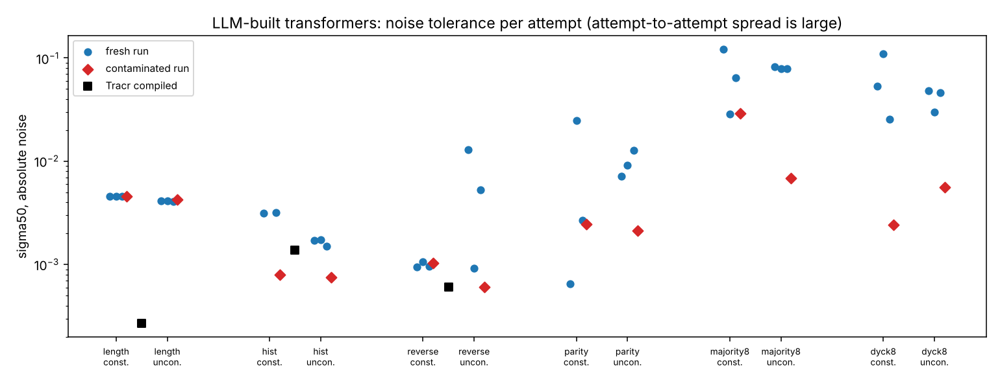

**Figure K1.** Absolute sigma50 for every attempt, by task and condition: fresh run (dots), contaminated run (diamonds) and the Tracr compiled baseline (squares, shared tasks only).

### K3. Category 4 (literal weights; model attribution pending, see K0)

**Question.** Category 4 (literal weights).

| attempt | status | params | nonzero | sigma50 abs | rel | nonzero-only | cert | attack |
|---|---|---|---|---|---|---|---|---|
| length__constrained__4__none__a1 | correct | 1881 | 0.012 | 4.71e-03 | 2.28e-02 | 9.47e-03 | 6.31e-04 | 1.18e-03 |
| length__constrained__4__none__a2 | correct | 1881 | 0.012 | 4.58e-03 | 2.09e-02 | 9.47e-03 | 6.32e-04 | 1.17e-03 |
| length__constrained__4__none__a3 | correct | 1881 | 0.011 | 3.56e-03 | 3.78e-02 | 3.44e-02 | 6.33e-04 | 1.21e-03 |
| length__unconstrained__4__none__a1 | correct | 53 | 0.189 | 7.36e-02 | 6.07e-02 | 7.64e-02 | 1.18e-02 | 1.38e-02 |
| length__unconstrained__4__none__a2 | correct | 78 | 0.282 | 3.49e-03 | 2.61e-02 | 3.37e-02 | 6.28e-04 | 1.18e-03 |
| length__unconstrained__4__none__a3 | correct | 53 | 0.189 | 7.36e-02 | 6.07e-02 | 7.64e-02 | 1.18e-02 | 1.38e-02 |
| parity__constrained__4__none__a1 | correct | 6706 | 0.019 | 1.76e-02 | 1.68e-02 | 2.40e-02 | 2.95e-04 | 1.58e-03 |
| parity__constrained__4__none__a2 | correct | 6706 | 0.019 | 1.86e-02 | 1.98e-02 | 2.95e-02 | 2.95e-04 | 1.08e-03 |
| parity__constrained__4__none__a3 | synthesis_failure | - | - | - | - | - | - | - |
| parity__unconstrained__4__none__a1 | correct | 877 | 0.173 | 2.11e-02 | 1.44e-02 | 2.36e-02 | 2.95e-04 | 1.12e-03 |
| parity__unconstrained__4__none__a2 | correct | 970 | 0.143 | 1.57e-02 | 1.69e-02 | 2.83e-02 | 2.89e-04 | 1.06e-03 |
| parity__unconstrained__4__none__a3 | synthesis_failure | - | - | - | - | - | - | - |

> **Takeaway.** Feasible for the two smallest tasks (10 of 12 correct); attribution to a model is pending, see K0.

### K4. Feedback cells (compromised, see K0)

**Question.** Feedback cells.

| attempt file (revision) | status | params | sigma50 abs |
|---|---|---|---|
| dyck8__constrained__3b__clean_check__a1_rev0 | correct | 25698 | 4.17e-02 |
| dyck8__unconstrained__3b__clean_check__a1_rev1 | correct | 25698 | 3.60e-02 |
| hist__constrained__3b__clean_check__a1_rev0 | correct | 1881 | 2.46e-03 |
| hist__constrained__3b__clean_check__a1_rev2 | invalid_submission | - | - |
| hist__unconstrained__3b__clean_check__a1_rev0 | correct | 550 | 2.83e-03 |
| length__constrained__3b__clean_check__a1_rev0 | correct | 1881 | 4.58e-03 |
| length__unconstrained__3b__clean_check__a1_rev0 | correct | 105 | 3.74e-03 |
| majority8__constrained__3b__clean_check__a1_rev0 | correct | 25698 | 5.52e-02 |
| majority8__unconstrained__3b__clean_check__a1_rev0 | correct | 56 | 8.17e-02 |
| parity__constrained__3b__clean_check__a1_rev0 | correct | 6706 | 5.85e-04 |
| parity__constrained__3b__clean_check__a1_rev1 | invalid_submission | - | - |
| parity__unconstrained__3b__clean_check__a1_rev1 | correct | 25698 | 1.24e-02 |
| reverse__constrained__3b__clean_check__a1_rev0 | correct | 17543 | 9.85e-04 |
| reverse__unconstrained__3b__clean_check__a1_rev0 | correct | 11259 | 1.42e-03 |

> **Takeaway.** Reported but compromised: the first answers were all correct, and later revisions in two cells changed the architecture and became invalid.

### K5. Pre-registered expectations vs the fresh run

**Question.** Pre-registered expectations versus the fresh run.

* **E1** (synthesis failures common): **not supported** (57/60 first answers correct; 3 failures).
* **E2** (>= 10x spread between attempts of one cell): **supported in 2 of 12 cells** (reverse unconstrained 14x, parity constrained 38x); the other cells vary by 4.3x or less.
* **E3** (sigma50 nearer the Tracr range than the digital range >= 0.1): **not supported for the counter tasks**: 2 of 35 correct 3b attempts have absolute sigma50 >= 0.1 (dyck8__constrained a2, majority8__constrained a1), and `majority8`/`dyck8` span 0.026-0.12. `length`, `hist`, `reverse`, `parity` stay at 6.5e-4-2.5e-2.
* **E4** (constrained vs unconstrained differ via size, not margin structure): **mixed**; median unconstrained/constrained sigma50 per task: length 0.9; hist 0.5; reverse 5.5; parity 3.4; majority8 1.2; dyck8 0.9. 
* **E5** (category 4 only on the smallest tasks, sparse, integer-valued): feasible on `length` and `parity` (10/12 correct, non-zero fraction 1-28%), values not integer.
* **E6** (certificate orders of magnitude below sigma50; attack within ~10x of it): sigma50/cert ranges 6-455x (median 36x), i.e. as low as 6x; attack/cert is <= 10x in 86% of attempts (max 33x).

> **Takeaway.** E1 not supported; E2 (large spread) supported in 2 of 12 cells; E3 not supported for the counter tasks; E6 partly.

### K6. Contaminated vs fresh, and convergence

**Question.** Contaminated versus fresh, and convergence.

* Fresh medians vs the contaminated attempt: within 1.1x for `length` (both conditions), `reverse` constrained and `parity` constrained; 2-4.4x for `hist` (both) and `parity` unconstrained; 8.7x for `reverse` unconstrained. `length` constrained: **the three fresh attempts and the contaminated attempt have bit-identical weights**. Other cells: only `length` unconstrained (a1 = a2) and `majority8` unconstrained (a2 = a3) repeat; all other attempts have different weights even when sigma50 is similar. So convergence to one design is the exception except for the simplest task, not the rule.
* `majority8` and `dyck8`: fresh attempts are mostly more tolerant than the contaminated ones (fresh medians/contaminated: `majority8` constrained 2.2x, unconstrained 11x; `dyck8` constrained 22x, unconstrained 8x; one fresh `majority8` constrained attempt equals it). A plausible explanation (untested) is a different counting design (signed averaging instead of the BOS-weight trick); the contaminated design was the less robust one here.
* Candidate explanation to test in Stage 5 (not a conclusion): robustness is set by the least-margin step of the chosen construction; the same LLM produces constructions whose sigma50 differs by up to 38x within a cell.

> **Takeaway.** The two runs agree on the simplest tasks (for `length` constrained the three fresh attempts and the contaminated one have bit-identical weights) and differ for the counters. Convergence to one design is the exception except for the simplest task.

### K7. Limitations

**Question.** Limitations of the fresh run.

Chat UI with unknown sampling; one model family (plus unattributed GPT chats in priority 4); at most 3 attempts per cell; contaminated and fresh runs differ in what the model had seen; tasks small; certificate sample-based; attack weak; priority 3 compromised; transcripts and records incomplete.

> **Takeaway.** Chat interface with unknown sampling, one model family, at most 3 attempts per cell, feedback compromised.

## Part L. Theory exploration: a first-order predictor of failure levels

After the benchmark data existed we asked whether anything *explains* where failures occur. This part is a record of a sequence of pre-registered predictors, including the ones that failed and an artifact we had to retract. It is the confirmatory part of the report; the earlier parts are mostly exploratory.

### L1. Pre-registration and the first predictors (gradient-based, v1 and v2)

#### Pre-registration: first-order (linear) predictor of parameter-noise failure levels
Written before any predictor value was computed. Date of writing: 2026-11-13.

**Data split.** Development set = contaminated run (J, 16 networks). Held-out set = fresh run (K, correct attempts of 3b/no-feedback and category 4). The fresh run is not looked at until the predictor and its constants are frozen.

**Predictor** (for a network with clean margins m_i > 0 on the evaluation samples i = (sequence, position), margin = logit gap for categorical outputs, atol - |error| for numeric outputs; g_i = gradient of m_i w.r.t. all parameters; w = parameter vector):
* absolute Gaussian noise: sigma_hat = min_i m_i / ||g_i||_2
* relative noise (delta_j = sigma w_j z_j): sigma_hat_rel = min_i m_i / ||g_i * w||_2
* non-zero-only / zero-only noise: restrict g_i to non-zero / zero entries
* parameter group G: restrict g_i to the group
* L-inf box: rho_hat = min_i m_i / ||g_i||_1   (to be compared with the certified radius and the attack-found radius)
The measured quantities are sigma50 (project definition), certified radius and attack first-failure from the harness.

**Fit (development only).** log10 sigma50 = a + b log10 sigma_hat, ordinary least squares over networks, separately per noise mode; also report b = 1 with a free offset only. The constants (a, b) are then frozen.

**Held-out test.** Apply the frozen constants to the fresh run. Report: Spearman rho, median absolute error in log10, fraction within factor 2 and 3, and every network that is off by more than a factor 5. Success criterion decided now: median absolute log10 error <= 0.3 (factor 2) and Spearman >= 0.8 on the absolute-noise mode. If the criterion is not met the predictor is reported as failed.

**Counterexample search (after the test).** Look for pairs of networks with similar sigma_hat but sigma50 differing by more than 5x.


> **CORRECTION (same day, see THEORY_EXPLORATION_2.md):** the "cliff failures" reported below for `majority8` and `dyck8` were an artifact of autodiff giving relu'(0) = 0 at ReLU kinks that these constructions place exactly at the clean operating point. With the one-sided (sensitive) derivative the first-order L-inf radius matches the attack radius within 0.86-1.4x for 10 of 12 networks; only `reverse` remains a genuine cliff (52x). Observation 1 and the "6 of 16 non-linear" statement below should be read with this correction; observation 2 (padding non-invariance) is also a kink/degenerate-point effect and has not been re-tested.

#### Theory exploration 1: can a first-order (gradient) analysis predict parameter-noise failure? (data-first check, 2026-11-13)
Pre-registration: `PREREG_linear_predictor.md` (written before any value was computed). Development set = contaminated run (16 networks); held-out set = fresh run (not touched).

##### Predictor v1 (min over samples of margin / gradient norm), development set
| mode | n | Spearman | log-log slope (b=1 expected) | median abs log10 error | within 2x |
|---|---|---|---|---|---|
| absolute noise | 16 | 0.50 | 0.24 | 0.39 | 50% |
| relative | 16 | 0.61 | 0.34 | 0.37 | 38% |
| non-zero only | 16 | 0.44 | 0.13 | 0.45 | 31% |
Pre-registered held-out criterion (median log10 error <= 0.3 and Spearman >= 0.8) is not reachable from these development numbers; v1 is rejected on the development set (held-out run not needed to reject it, to be run for completeness).
Group level: unembed (rho 0.76) and mlp_in (0.80) are predicted reasonably, attention value/output is not (rho -0.17), embeddings are off by ~10x.

##### Predictor v2 (Monte-Carlo noise on the first-order model m_i + g_i.delta; no constants), development set
Linearized prediction / measured sigma50 (absolute): hist 1.5x, parity 2.2-2.5x, length 4.5-6.4x, dyck(unconstrained) 5.6x, majority(constrained) 7.1x, dyck(constrained) 17.6x, majority(unconstrained) 27x, reverse 50-83x. All 16 networks fail BEFORE the linear model says they should (ratio 1.5-83x). v2 is not a usable predictor either, but the ratio is not random: it is smallest for networks whose failure is a plain output-margin crossing and largest for hard-attention / saturated constructions.

##### L-infinity: first-order radius vs attack-found failure (development set)
min_i m_i/||g_i||_1 equals the attack first-failure to within 1.5x for 10 of 16 networks (length x4: 1.00x; hist x2: 1.03x; parity x4: 1.03x-1.5x); the other 6 fail below the first-order radius by 2x (dyck constrained), 52x (reverse), 94x (majority), 172x (dyck unconstrained). So for ~60% of networks the worst-case failure is locally linear in the parameters (and the sign-gradient attack finds it exactly), for the rest a non-linear mechanism fails much earlier.

##### Observations that are not explained by anything in THEORY_CANDIDATES.md
1. Non-linear "cliff" failures: for saturated-attention constructions the output margin has a flat gradient at the clean point (softmax saturation) yet fails at tiny finite perturbations; the output-margin gradient is the wrong variable. Hypothesis to test: robustness is controlled by the margin of the last analog variable that feeds a hard decision (e.g. the length estimate M in `reverse`, whose error must stay below 0.5), and its sensitivity, not by output margins.
2. Predicted sensitivity is not invariant to zero-padding: the same construction at two widths differs 84x in v1 prediction (dyck) but only 2.3x in measurement, because unused parameters sitting at degenerate points (q = k = 0, uniform attention) have large first-order sensitivity yet little measured effect. Hypothesis: sensitivity must be weighted by the downstream decision margin, not by the raw gradient.
3. The linearization gap (v2 ratio) orders constructions by type; it may be a usable descriptive quantity.

##### Honest status
No theorem or predictor survives. What exists: a falsified simple predictor (reported with its numbers), one clean regularity (first-order radius = attack radius when failure is linear), and two testable hypotheses (decision-variable margin; padding non-invariance). Next experiment if pursued: margin-vs-perturbation profiles along the attack direction and per-failure attribution to the first analog variable that crosses its threshold.


### L2. Pre-registered cliff experiment and the kink artifact

#### Pre-registration: cliff-failure experiment (written before running; development set = contaminated run, 12 networks of category 3b)
Quantities per network: d* = the attack perturbation at 1.3 x the harness first-failure radius (increased x1.5 until it fails); m_i(t) = margin of sample (sequence, position) i at parameters theta + t d*; t_x = smallest t on a grid with min_i m_i(t) <= 0; linear model m_i0 + t g_i.d*.
* **H1 (cliff vs linear).** Networks whose first-order L-inf radius is >= 10x the attack radius (majority8, reverse, dyck8-unconstrained, in the previous exploration) show a flat-then-collapse profile: min_i m_i(0.5 t_x) >= 0.8 min_i m_i(0). Networks with first-order radius within 1.5x of the attack radius (length, hist, parity) show a gradual decline: min_i m_i(0.5 t_x) <= 0.6 min_i m_i(0). H1 is rejected if either group violates its bound for more than one network.
* **H2 (attribution, `reverse`).** For `reverse` the failure at d* is caused by the groups that compute the length variable M (embeddings, attention value/output, MLP): zeroing the q/k component of d* leaves the failure, zeroing the MLP components removes it. Rejected if q/k zeroing removes the failure or MLP zeroing does not.
* **H3 (block amplification).** In cliff networks one block amplifies the perturbation-induced deviation of the residual stream by >= 10x relative to the preceding block, in linear networks no block does (all gains < 10x). Rejected if more than one network contradicts.
Decision rule for the overall decision-variable hypothesis: supported only if H1 and H2 are not rejected.

##### Results of the three pre-registered tests (development set; before the next step)
* H1 REJECTED: along the attack direction the margin declines linearly (m(0.5 t_x)/m0 = 0.47-0.50) for all networks except `reverse` (0.99, flat-then-collapse); `majority8` and `dyck8`, which have first-order radius 94-172x above the attack radius, decline linearly too.
* H2 PARTLY SUPPORTED: for `reverse` removing the q/k component leaves the failure, removing mlp_in or attention value/output components removes it, removing mlp_out or embeddings does not; no single group alone causes the failure (the failure needs mlp_in AND attention value/output together).
* H3 REJECTED: attention and MLP blocks amplify the deviation by 12-97x in every network, linear ones included.
* Unplanned finding (kink test, `kink.py`): with relu'(0) = 1 instead of autodiff's 0, the first-order L-inf radius matches the attack radius within 0.86-1.4x for 10 of 12 networks (including majority8 and dyck8); only `reverse` stays 52x off. The earlier "cliff" label for majority8/dyck8 was an artifact of ReLU kinks placed exactly at the operating point.

#### Pre-registration v3 (written before running): directional-derivative (tangent-cone) predictor, parameter-free
Model: m_i(theta + delta) ~ m_i(theta) + f'_i(theta; delta), where f'_i is the one-sided directional derivative (positively homogeneous in delta), obtained exactly as (m_i(theta + s*delta) - m_i(theta))/s with s = 1e-5, delta = z (absolute), |theta| z (relative), z restricted to non-zero / zero entries; z ~ N(0, I), 150 draws. Predicted accuracy(sigma) = mean over draws and sequences of 1[min over positions of (m_i + sigma f'_i(z)) > 0]; sigma50 by the project interpolation on the project grid. No fitted constants.
* Development set (contaminated run, 3b, 12 networks): report median |log10(pred/measured)| and Spearman for each mode. Expectation: good (<= factor 2) for all networks except `reverse` (softmax-saturation cliff).
* Held-out test (fresh run, correct 3b/no-feedback attempts): success = median |log10 error| <= 0.3 and Spearman >= 0.8 on absolute noise, computed over all attempts and also excluding `reverse`; every attempt off by > factor 5 is listed. Failing the criterion is reported as failure.


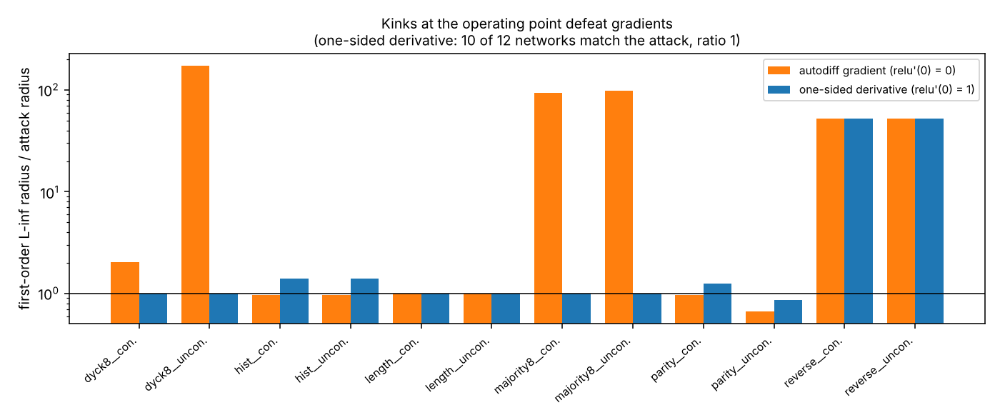

**Figure L2.** First-order L-infinity radius divided by the attack-found radius for the 12 development networks, with autodiff gradients (relu'(0)=0) and with the one-sided derivative (relu'(0)=1). A ratio of 1 means the first-order model predicts the attack exactly.

### L3. Predictor v3 (tangent-cone) and its held-out test

#### Theory exploration 2: a parameter-free tangent-cone (directional-derivative) predictor of noise failure levels (2026-11-13)
Pre-registrations: `PREREG_linear_predictor.md`, `PREREG_cliff_experiment.md` (both written before the corresponding numbers were computed). Code: `lin_predictor.py`, `lin_sim.py`, `cliff.py`, `kink.py`, `tangent_sim.py`. Data: `lin_*.json`, `cliff_dev.json`, `kink_dev.json`, `tangent_dev.json`, `tangent_heldout.json`.

##### Sequence of results
1. Gradient-based predictors fail on the development set (contaminated run, 12-16 networks): v1 (min over samples of margin/||g||_2) Spearman 0.50, slope 0.24; v2 (Monte-Carlo on the linearized model) over-predicts robustness by 1.5-83x.
2. Pre-registered cliff experiment (development set): H1 (flat-then-collapse margin profiles for non-linear networks) REJECTED, H3 (block amplification only in cliff networks) REJECTED, H2 (attribution for `reverse`) PARTLY supported (failure needs mlp_in AND attention value/output together; q/k not involved). Block gains of 12-97x occur in every network (the interpolation MLPs have slopes up to ~98).
3. Unplanned finding (kink test): autodiff gives relu'(0) = 0, but these constructions put ReLU breakpoints exactly at the values the clean network produces (lookup knots at attainable inputs, thresholds at decision values). With the sensitive one-sided derivative the first-order L-inf radius matches the attack-found radius within 0.86-1.4x for 10 of 12 networks (previously 94-172x off for `majority8`/`dyck8`). Only `reverse` (softmax-saturated hard attention) stays 52x off.
4. Predictor v3 (pre-registered before running, no fitted constants): m_i(theta + delta) ~ m_i + f'_i(theta; delta) with f' the one-sided directional derivative (computed by finite differences at s = 1e-5), Gaussian delta, 150 draws, project sigma50 definition.

##### Held-out test of v3 (pre-registered criterion: median |log10 error| <= 0.3 and Spearman >= 0.8, absolute noise)
Held-out = fresh-session run, 35 correct 3b/no-feedback attempts (not used for development).
| | n | Spearman | median abs log10 err | within 2x | within 3x |
|---|---|---|---|---|---|
| absolute, all attempts | 35 | 0.817 | 0.116 | 71% | 77% |
| absolute, excluding `reverse` | 29 | 0.898 | 0.083 | 79% | 86% |
| relative, excluding `reverse` | 21 | 0.982 | 0.084 | 86% | 100% |
| non-zero-only, excluding `reverse` | 24 | 0.935 | 0.146 | 75% | 83% |
| zero-only, excluding `reverse` | 29 | 0.860 | 0.049 | 79% | 83% |
**The pre-registered criterion is met** (Spearman only marginally: 0.817). Failures: `reverse` (predicted 1.6-21x too robust; softmax saturation) and one `parity` attempt (7.1x). Per-task median pred/measured: length 1.08, hist 1.07, parity 0.98, majority8 1.73, dyck8 0.66, reverse 15.4. Development set (12 networks): median error 0.09, Spearman 0.46 (0.83 excluding `reverse`).

##### Caveats (important)
* The held-out set shares the architecture family, tasks, and (kind of) author with the development set. It is a held-out RUN, not a held-out construction method. The Stage 5 test across construction methods (Tracr, bilinear/digital, trained) has NOT been done.
* 79% of the variance of measured log10 sigma50 is between tasks. Within tasks (task means removed) the predictor has R^2 0.48 (0.65 excluding `reverse`) and Spearman 0.45: it reproduces the 38x spread of `parity` constrained (measured 6.5e-4 / 2.5e-2 / 2.7e-3, predicted 5.0e-4 / 5.6e-2 / 2.1e-3) but not the ranking of `majority8` / `dyck8` constrained attempts.
* The predictor needs ~150 forward passes per noise mode, more than the sweep it predicts: its value is explanatory (first-order tangent-cone behaviour explains the failure level), not cheaper.
* Mathematically this is first-order analysis of piecewise-linear networks (directional derivatives); the contribution would be the empirical finding that it suffices for these constructions and the identification of its failure mode (softmax-saturated hard attention), not a new theorem.
* Exploration used the same data for several rounds of hypothesis rejection; only v3 was frozen before the held-out evaluation.

##### Next test that would make this a real result
Apply v3 unchanged to Tracr-compiled networks (length, hist, reverse and the other project tasks; measured sigma50 in RESULTS.md A1/A2), to the bilinear/digital designs, and to trained transformers (held-out construction methods).


### L4. Cross-construction test of v3 (Tracr and bilinear networks)

#### Pre-registration: cross-construction test of the tangent-cone predictor v3 (written before any prediction on these networks was computed)
Predictor: exactly `tangent_sim.py` (s = 1e-5, 150 draws, Gaussian, project sigma grid), applied unchanged; margins per (sequence, position): categorical = logit gap, numeric = atol - |error|. Measured sigma50: the project harness noise protocol (static Gaussian, 5 seeds, exact-sequence accuracy).
* **Tracr-compiled networks** (project tasks reverse, sort_unique, hist, length, frac_prevs, sort_freq; abs/rel/nonzero-only/zero-only): success criterion as before on absolute noise: median |log10 error| <= 0.3 AND at least 4 of 6 tasks within a factor of 3; Spearman reported (n = 6, indicative only). A predicted sigma50 of infinity (no failure on the grid) counts as a failure of the predictor.
* **Bilinear restoring-state networks** (independent bilinear networks of 12 programs of the mixed-family pool, absolute noise, grid 10^-3..10^0.3): EXPECTED TO FAIL. Reason stated in advance: the clip unit is flat at the operating point (states sit at 0/1 deep in saturation), so the first-order response is ~0 and the model predicts no failure (inf) while the measured sigma50 is ~0.1; failure there is a nonlinear threshold crossing (like softmax saturation in `reverse`). This part is a stress test of the predictor's domain of validity, not a success test.
* **Trained networks**: not run in this step (no frozen trained models available); planned.


#### Theory exploration 3: cross-construction test of the tangent-cone predictor v3 (2026-11-13)
Pre-registration: `PREREG_cross_construction.md` (before any prediction was computed). Code: `cross_construction.py`; data `cross_tracr.json`, `cross_bilinear.json`. Predictor and settings unchanged from exploration 2.

##### Result: the predictor does NOT transfer across construction methods
###### Tracr-compiled networks (project tasks; absolute and relative noise)
| Tracr task | measured abs sigma50 | predicted | predicted / measured | relative-noise measured | relative-noise predicted |
|---|---|---|---|---|---|
| reverse | 6.10e-04 | 3.15e-02 | 51.54 | 1.65e-03 | 7.12e-01 |
| sort_unique | 1.14e-03 | 1.85e-03 | 1.62 | 3.04e-03 | 5.93e-01 |
| frac_prevs | 1.30e-03 | 1.19e-03 | 0.92 | 3.14e-03 | 3.04e-03 |
| sort_freq | nan | nan | both below grid (fragile at 1e-5) | 4.01e-05 | 9.19e-02 |
| hist | 1.38e-03 | 6.25e-03 | 4.53 | 2.78e-03 | 6.51e-03 |
| length | 2.69e-04 | 4.23e-02 | 157.11 | 9.90e-04 | 2.10e-02 |

Pre-registered criterion (median |log10 error| <= 0.3 and at least 4 of 6 tasks within 3x): **not met**: median |log10 error| = 0.66 over the 5 tasks with defined values, 2 of 5 within 3x (sort_freq: both measurement and prediction are below the grid at sigma = 1e-5, which counts as agreement but not as a success). The predictor over-predicts robustness for `length` (157x), `reverse` (52x), `hist` (4.5x); it is accurate for `frac_prevs` (0.92x) and `sort_unique` (1.6x). Relative noise is mostly wildly over-predicted (`reverse` 430x, `sort_unique` 200x), because relative noise on large Tracr weights is a large absolute perturbation that leaves the linear regime.

###### Bilinear restoring-state networks (12 programs, independent networks, absolute noise)
Predicted / measured sigma50: median 4.9x, range 2.1-7.4x (all over-predict; measured 0.13-0.17, predicted 0.3-1.1). The pre-registered mechanism was slightly wrong: I predicted "no failure" (flat clip), but the predictions are finite; the conclusion (stress test failed) stands.

##### What the combined evidence says
| construction (held-out for the predictor) | predicted / measured sigma50 |
|---|---|
| LLM-built `length`, `hist`, `parity`, `frac`-type linear failures (held-out run) | 0.9-1.1x |
| Tracr `frac_prevs`, `sort_unique` | 0.9-1.6x |
| LLM-built `majority8`, `dyck8` | 0.7-1.7x (medians) |
| Tracr `hist` | 4.5x |
| bilinear restoring-state networks | 2-7x |
| LLM-built `reverse` | 12-21x |
| Tracr `reverse`, `length` | 52x, 157x |
The ratio is close to 1 when the failure is a plain linear margin crossing and grows when saturating units (softmax with large scores, clip) absorb small perturbations until a threshold is crossed. So the tangent-cone model is a valid description only in the non-saturated regime; the **ratio predicted/measured is a descriptive "saturation index"** of a network, not something the first-order data predict by itself.

##### Status
* The within-family result of exploration 2 (held-out RUN, Spearman 0.82) stands as a statement about LLM-built networks of this family; it does not generalise to Tracr or bilinear networks. It must not be presented as a general predictor.
* A candidate next step (not run): predictor v4 = minimum over saturating units of (distance of the pre-activation to its switching boundary) / (first-order sensitivity of that pre-activation), i.e. apply the first-order idea to the decision variable of the saturated unit; this is close to the interval-certificate logic and would need a pre-registered test across construction methods. Trained networks (the third held-out construction method) were not tested.
* Theory-paper status: no theorem; one negative result (first-order models do not predict failure across constructions), one descriptive diagnostic (saturation index). Benchmark/empirical paper remains the realistic output.


### L5. Predictor v4 (tangent-cone plus saturation margins)

#### Pre-registration: predictor v4 = v3 with saturation margins added to the failure set (written before any v4 value was computed; this is the LAST predictor experiment)
v3 (tangent-cone Monte-Carlo, s = 1e-5, 150 draws, absolute Gaussian noise, project sigma grid) is unchanged except that a sequence now counts as failed if EITHER an output margin OR a saturation margin becomes non-positive:
* softmax attention (family and Tracr): for every (layer, head, query position >= 1) the clean top set S = {keys with score >= max - 0.01}; margin = min_{j in S} s_j - max_{j not in S} s_j (S kept fixed); if S is the whole allowed set the margin is +inf.
* clip units (bilinear): for every (step, state unit) with clean pre-activation z: on-units margin z - 0.75, off-units margin 0.25 - z.
No constants. Absolute noise only.
Success criterion (decided now), evaluated separately on: (a) LLM-built family, fresh run (35 attempts); (b) Tracr (6 tasks); (c) bilinear (12 programs): median |log10(pred/measured)| <= 0.3 and >= 2/3 of cases within 3x. v4 is declared successful only if (b) and (c) both meet it and (a) does not get worse than v3 (median error <= 0.3). Otherwise it is reported as failed and the predictor line of work stops.
Known risk stated in advance: set flips can be harmless, so v4 may under-predict robustness (too pessimistic).


#### Theory exploration 4: predictor v4 (tangent-cone + saturation margins). Last predictor experiment, 2026-11-13
Pre-registration: `PREREG_v4_saturation.md` (before any v4 value). Code: `v4.py`; data `v4_fresh.json`, `v4_tracr.json`, `v4_bilinear.json`.

##### Results (absolute noise; median |log10 error|, fraction within 3x)
| construction | n | v3 | v4 |
|---|---|---|---|
| LLM-built family, fresh run (held-out run) | 35 | 0.116, 77%, Spearman 0.817 | **0.103, 89%, Spearman 0.932** |
| Tracr-compiled (tasks with defined values) | 5 | 0.66, 40% | 0.38, 60% |
| bilinear restoring-state (12 programs) | 12 | 0.69, 33% | **0.23, 100%** (all predicted/measured in 0.50-0.83) |
| Tracr task | measured | v3 / measured | v4 / measured |
|---|---|---|---|
| reverse | 6.10e-04 | 51.54 | 2.39 |
| sort_unique | 1.14e-03 | 1.62 | 1.21 |
| hist | 1.38e-03 | 4.53 | 4.53 |
| length | 2.69e-04 | 157.11 | 157.11 |
| frac_prevs | 1.30e-03 | 0.92 | 0.92 |
| sort_freq | below grid | both below grid | both below grid |

##### Verdict by the pre-registered rule
* (a) LLM-built family: met and improved (only one attempt more than 5x off: `parity` unconstrained a3, 7.1x; `reverse` is now predicted within 1.5x, was 12-21x).
* (c) bilinear: met (median error 0.23, 12 of 12 within 3x, slightly pessimistic as pre-announced).
* (b) Tracr: **not met under the conservative reading** (5 tasks with defined values: median error 0.38 > 0.3, 60% within 3x < 2/3). If `sort_freq` (both measurement and prediction below the grid) is counted as an agreement, the numbers are 4 of 6 within 3x and median 0.23; I use the conservative reading because exploration 3 did too. `reverse` improved from 52x to 2.4x, but `length` (157x) and `hist` (4.5x) are unchanged: the saturation margins do not bind there, so another mechanism (not identified) makes them fail far earlier than first-order sensitivity says.
* Overall: v4 is NOT declared successful (rule requires (b) and (c)); it is a substantial but partial improvement. The predictor line of work stops here, as pre-registered.

##### What survives
* An explanatory result: for hard-attention / saturating constructions the failure level is well described (within ~2x for 83% of LLM-built attempts, 12/12 bilinear programs, Tracr `reverse`/`sort_unique`/`frac_prevs`) by the first-order response of the output margins together with the first-order response of the saturation (switching) margins of attention and clip units. This is first-order, unit-level margin analysis; it is close in spirit to interval certificates and to local-sensitivity bounds, so novelty is expected to be limited (prior-art check pending).
* Residual unexplained: Tracr `length` and `hist` (mechanism unidentified).
* Not tested: trained networks.


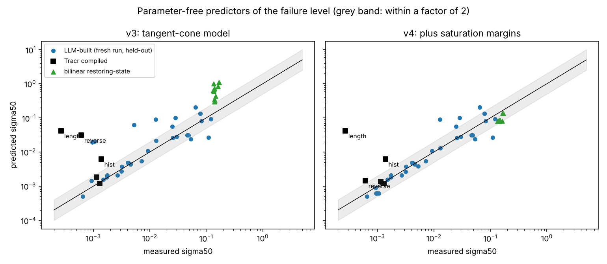

**Figure L5.** Predicted against measured sigma50 for predictor v3 (left) and v4 (right) on three construction methods. v4 brings the LLM-built networks and the bilinear networks close to the diagonal; the compiled `length` and `hist` programs stay far above it (the predictor is too optimistic).

### L6. Theory extraction: consolidated status

#### Theory extraction (Stage 5), consolidated status, 2026-11-14
Inputs: `results/implementation_dataset.csv` (115 networks/designs: LLM-built transformers (contaminated + fresh runs), Tracr-compiled transformers, bilinear restoring-state networks, state-code designs), `theory/THEORY_EXPLORATION_1..4.md`, `theory/PREREG_*.md`, `PRIOR_ART_AUDIT.md`. No theorem was found; this document states what the data explain, what they do not, and what is formally established.

##### 1. Definitions (Layer A)
For a network F_theta and a finite or sampled input domain X with exactness criterion "all outputs correct", the project uses four quantities that must not be mixed:
* rho_cert(theta): largest L-infinity box (entrywise, absolute) around theta on which an interval-bound argument proves exactness (a lower bound on rho; sample-certified for transformers, exhaustive for the restoring designs).
* rho_att(theta): smallest box on which a function-level attack finds a wrong output (an upper bound on rho). rho_cert <= rho <= rho_att, where rho = inf{||delta||_inf : exists x in X, F_(theta+delta)(x) != f(x)}.
* sigma50(theta): the Gaussian noise level (iid entries, fixed through the sequence; absolute, relative, zero-only, non-zero-only or per parameter group) at which exact-sequence accuracy crosses 50%. This is a median-failure level, not an infimum.
* fresh-per-step and activation noise are different mathematical problems (project results I2, I4).
Elementary facts (known, not new): for a margin m_i(theta + delta) = m_i - g_i.delta, the L-inf failure radius is min_i m_i/||g_i||_1, the per-sample Gaussian failure probability is Phi(-m_i/(sigma ||g_i||_2)), and a union bound over N samples gives accuracy >= 1 - N Phi(...). Check on the data (12 development networks): the ratio sigma50/rho_att has median 9.8, the worst-sample ratio ||g||_1/||g||_2 has median 4.1; correlation of the logs is weak (slope 4.1, R^2 0.31), so the 'sqrt(dk) gap' candidate is only qualitatively supported.

##### 2. Empirical regularities (Step 2)
1. Construction METHOD explains little by itself: on the three shared tasks LLM-built transformers lie within ~17x of Tracr in absolute sigma50 (length 17x more tolerant, hist 0.6x, reverse 1.0-1.7x), while attempts of the SAME LLM on the SAME task differ by up to 38x (`parity` constrained) and fresh `majority8`/`dyck8` attempts are 4-45x more tolerant than the contaminated ones. Design choices (counting trick, signed averaging, saturation) matter more than who built the weights.
2. Restoring-state designs (bilinear, one-hot/replication codes) tolerate absolute noise of ~0.1-0.17; non-restoring constructions (Tracr, LLM-built hist/length/reverse/parity) fail at 6e-4-2.5e-2; LLM-built counters (`majority8`, `dyck8`) reach 0.03-0.12.
3. Replication buys activation tolerance and costs parameter tolerance; sparse codes (Willshaw) are exact but less robust than one-hot (I2, matches the patent's distributed-code analysis).
4. Perturbation targets fail differently; slow-weight noise present at write time is absorbed, drift afterwards is not (I4, interpreter only).
5. Parameter sharing creates a shared failure mode: one perturbation breaks all k heads (I1).
6. Worst-case radii shrink with the number of stored programs (~P^-0.6) while Gaussian tolerance per program drops only mildly (I4, I5).
7. In the LLM-built networks the first-order L-inf radius equals the attack radius within 1.4x for 10 of 12 networks once the one-sided derivative at ReLU kinks is used (the constructions place ReLU breakpoints exactly at the operating point).

##### 3. Competing hypotheses and status (Step 3)
| Hypothesis | Evidence | Status |
|---|---|---|
| H1 output-margin / gradient first-order model explains failure levels | gradient-based predictor v1 Spearman 0.50 (dev) ; v2 over-optimistic 1.5-83x | **rejected as a general account** |
| H2 tangent-cone (one-sided first-order) model v3 | held-out run Spearman 0.82, median error 1.3x; fails Tracr (median log10 error 0.66) and bilinear (2-7x too optimistic) | **supported within the LLM-built family only** |
| H3 H2 plus saturation margins (attention top-set gaps, clip exits) = v4 | held-out run Spearman 0.93 (89% within 3x); bilinear 12/12 within 2x; Tracr reverse 52x -> 2.4x; Tracr length 157x and hist 4.5x unchanged | **partly supported; not declared successful by the pre-registered rule** |
| H4 state separation / internal margins predict robustness | slack/row Spearman 0.96 with fresh-activation sigma50 (24 clustered cells); replication leaves the certified tube unchanged but raises Gaussian tolerance | **mixed; clustered evidence, no causal intervention beyond the code study** |
| H5 error correction (restoring nonlinearity) explains tolerance | restoring designs tolerate ~0.1-0.17; certificates hold for any length | **supported for activation noise and absolute parameter noise of restoring designs; not isolated by a matched-readout intervention** |
| H6 parameter sharing reduces/changes failure directions | shared failure mode, budget independent of k (I1) | **supported** |
| H7 redundancy | replication trades axes; interpreter shows no shared-capacity gain | **supported (known in the 1990s literature)** |
| H8 composition | pipelines cost almost nothing under noise (I6) | **weakly supported (one interpreter)** |
| H9 readout structure (analog averaging vs digital restoring) is the cause of fragility | Tracr/LLM-built use BOS-averaging + ReLU lookup; no intervention with matched outputs | **untested causally** |
| H10 the construction method (compiler / analytic / LLM) determines robustness | see regularity 1 | **not supported** |

##### 4. Candidate relationships and their domain (Steps 4 and 6)
* R1 (v4 predictor). sigma50 ~ the Gaussian median-failure level of the first-order response of {output margins, attention top-set gaps, clip-exit margins}, Monte-Carlo over noise draws, no free constants. Domain: noise small enough that no unit outside the listed margins switches; validated on LLM-built transformers (held-out run), bilinear restoring networks, Tracr tasks where saturation binds; fails where another mechanism acts (Tracr `length`, `hist`). Not a bound.
* R2 (certificates). Interval-bound tube invariance gives exactness for any sequence length (restoring designs) or on sampled inputs (transformers). Tightness measured: certified-to-attack gap 1.5-3.4x (tied), 4-10x (interpreter), 1.5-33x (LLM-built, sample-certified).
* Both are established empirically; neither is a theorem, and R2's tools are known (IBP, Omlin-Giles stability analysis).

##### 5. Held-out and counterexample status (Steps 7 and 8)
Held-out: fresh LLM run (done), Tracr (done, failed for length/hist/reverse before v4), bilinear (done), trained networks (NOT done). Counterexamples found: Tracr `length` and `hist` (v4 predicts 157x and 4.5x too optimistic), LLM `parity` unconstrained a3 (7.1x), `majority8` unconstrained (v3 9x). A mechanism for the Tracr cases is unidentified.

##### 6. Stage 5.4 required outputs
| Output | Status |
|---|---|
| 1 consolidated dataset | done (`results/implementation_dataset.csv`, 115 rows; trained networks missing) |
| 2 candidate structural properties | done (`THEORY_CANDIDATES.md`, 16 items) |
| 3 competing hypotheses | done (section 3) |
| 4 mathematical definitions | done (section 1) |
| 5 preliminary derivations or bounds | elementary relations only; no new bound |
| 6 experiments distinguishing explanations | done for first-order vs saturation (pre-registered v3, v4); readout-structure intervention NOT done |
| 7 at least one held-out prediction exercise | done (fresh run; Tracr; bilinear) |
| 8 account of what is explained / unexplained | this section and sections 2-5 |
| 9 final experimental protocol informed by the theory | below |

##### 7. Protocol for the full-scale run informed by the theory
Run the shared harness on: more LLMs and more attempts (spread between attempts is the largest unexplained source of variance), trained transformers of the same family (held-out construction method for v3/v4), the Tracr tasks at several lengths; record for every network the v3/v4 predictions and the saturation index (predicted/measured sigma50); add an intervention that changes the readout while preserving outputs (for H9) and an investigation of Tracr `length`/`hist`. Report pre-registered predictor results per construction method, never pooled.

##### 8. Verdict
There is no mathematical result here that survives the prior-art audit. What survives is empirical: a cross-construction benchmark, the finding that within-method variation rivals between-method variation, and a first-order + saturation-margin explanation with a clearly measured domain of validity.


### L7. Candidate relationships considered

#### Theory candidates (Stage 5 inputs): merged list, status as of the LLM-synthesis package
Hypotheses, not results. "Prior-art risk" is a guess to be settled by the prior-art audit. Sources: **M** = candidates from the empirical rounds (RESULTS.md I), **S5** = Stage 5 document (layers A-C).

| # | Candidate | Source | Evidence so far | Competing explanation to separate | Prior-art risk |
|---|---|---|---|---|---|
| 1 | Three distinct radii must be kept apart: certified (lower bound, box norm), attack-found (upper bound), Gaussian sigma50 (median failure); they differ by ~sqrt(dk) (norm1(k) vs norm2(k)) | M + S5 A (norms, absolute vs relative) | interpreter radii ~50x below sigma50; tied designs within 1.5-3.4x; LLM-built transformers: sigma50/cert ~1e2-1e3 (J) | gap from margin geometry, not norm ratio | high |
| 2 | Tube invariance gives exactness for any length: the clip is flat in the saturated region (J_s ~ 0), errors are erased each step | M + S5 B (recurrent error route) | all digital/bilinear/interpreter certificates | tolerance from margins alone, not contraction | medium |
| 3 | Shared failure mode under parameter tying: one perturbation breaks all k heads at ~2x; budget independent of k | M + S5 B #9 | tied-design attacks (I1) | symmetric margins vs structural sharing | unknown |
| 4 | Write-time absorption: perturbations present when a program is written are absorbed; drift afterwards is not | M + S5 B #6 | interpreter study (I4) | recalibration vs margins computed under actual weights | medium |
| 5 | Replication buys activation tolerance, costs parameter tolerance | M + S5 B #6 | codes study (I2) | per-entry shrinkage (1/r) vs redundancy | high |
| 6 | Capacity of a margin-constrained sparse-target memory ~0.5 x stored transitions, independent of n | M + S5 C (cost) | interpreter scaling (I3) | optimiser limit vs true capacity | high |
| 7 | Certified radius ~ P^-0.6 with stored programs (key interference) | M + S5 B #8 | interpreter certificates (I5) | interference vs fast-memory norm growth | medium |
| 8 | Perturbation-model taxonomy: fixed vs fresh, absolute vs relative, parameter group | S5 A | fresh >= static for slow weights; abs vs rel differ by target | static draws are correlated across steps, fresh are not | medium |
| 9 | Jacobian products / Lyapunov growth predict tolerance across designs and lengths | S5 B | not measured | margins alone suffice | medium |
| 10 | State separation and internal margins predict robustness | S5 A, B #1, #5 | slack/row predicts fresh-activation sigma50 (Spearman 0.96, clustered cells); codes = encoding intervention | direct effect vs correlation with sensitivity | medium |
| 11 | Parameter-group sensitivity scales with the group's fan-in (gain/threshold far less sensitive) | S5 A | interpreter (0.39-0.56 vs ~0.1); LLM-built attention q/k groups often insensitive (J) | fan-in vs saturation of the downstream nonlinearity | low-medium |
| 12 | Readout structure (analog averaging vs digital restoring) drives fragility | S5 B #7 | earlier audit, correlational | needs an intervention changing readout with outputs fixed | medium |
| 13 | Composition of restoring stages does not compound errors (min over stages, not sum) | S5 B #8 | pipelines 0.065 vs 0.068 alone (I6) | analog stages compound | medium |
| 14 | Exactness, robustness and cost are not in a universal trade-off | S5 C | bilinear exact and tolerant; replication trades axes; interpreter no gain | none yet | low |
| 15 | Large hard-attention scores (abs(w) ~ 50-300) coexist with sigma50 ~ 1e-3: robustness is set by the least-margin component, not by weight size | M (new, J) | LLM-built transformers (J) | weight scale vs margin | unknown |

Held-out discipline: the LLM-synthesized networks (J, and the fresh-session run) are reserved as held-out data for the Stage 5 predictive test; they must not be used to develop candidates 1-14.

| 16 | Failure level of piecewise-linear constructed networks is set by the one-sided (tangent-cone) first-order response; constructions place ReLU kinks exactly at the operating point, so gradients miss the sensitivity; saturated hard attention (`reverse`) is the failure mode of the first-order model | M (new, theory exploration 2) | held-out run: Spearman 0.82, median error 0.116 log10 (same family, same tasks); 10/12 development networks have first-order L-inf radius = attack radius within 1.4x | gradient/Hessian-based sharpness measures; nonlinear saturation | unknown (piecewise-linear analysis is standard; the application is untested) |

Correction (2026-11-13): candidates 1 and 9 were tested only through autodiff gradients, which are wrong at ReLU kinks; see `theory/THEORY_EXPLORATION_2.md`.

Update (2026-11-13, exploration 3): candidate 16 holds only within the LLM-built family; across construction methods the tangent-cone predictor fails (Tracr: median log10 error 0.66, 2 of 5 within 3x; bilinear: over-predicts robustness 2-7x). Reframed as a descriptive saturation index (predicted/measured sigma50). See `theory/THEORY_EXPLORATION_3.md`.

Update (exploration 4): adding saturation (attention top-set / clip-exit) margins to the tangent-cone model (v4) gives Spearman 0.93 and median error 0.10 (log10) on the held-out LLM-built run, 12/12 bilinear programs within 2x, but still fails Tracr `length` (157x) and `hist` (4.5x). Partial result; predictor line closed. See `theory/THEORY_EXPLORATION_4.md`.


## Part M. Prior-art audit

A literature check of every claim in this report, done late and with limited search. It decides what we present as reproduction (known work) and what looks new.

### Prior-art audit, pass 3 (2026-11-14). Scope: targeted searches, the primary text of Omlin & Giles, and the patent claims (Google Patents). Not a final audit.
Labels: OVERLAPS (substantially known), PARTLY KNOWN (tools known, application/finding not found), NO HIT (not found in these searches; weak evidence of absence), PENDING.
Limits: ~16 search queries in total; no systematic forward/backward citation graph search (only targeted queries); Semantic Scholar / Google Scholar not queried.

| # | Project claim | Evidence found | Status |
|---|---|---|---|
| 1 | Digital/bilinear restoring-state designs encode finite-state programs exactly for any length (D1-D3, E, I2) | Omlin & Giles, "Constructing DFAs in recurrent neural networks" (J. ACM 1996; UMIACS-TR-95-50, primary text read): second-order recurrent networks, weights programmed to +H/-H and bias -H/2, O(n) neurons, <= 3mn weights, proof (fixed-point / worst-case analysis) that the internal state representation is stable and strings of arbitrary length are classified correctly, relation between weight strength H and number of states | **OVERLAPS** (construction, any-length correctness, scaling of required strength with size) |
| 2 | Tolerance to noise on zero ("unprogrammed") weights, shrinking with network size; non-zero-only vs zero-only noise (A, B, I2) | Same paper, section 5.9-5.10: "noisy" fully recurrent networks whose non-programmed weights are random in [-W, W]; theorem giving conditions on W, H, n, D for stable DFA encoding; the tolerated interval shrinks with n; conjectured necessity | **OVERLAPS** (analytic worst-case conditions for zero-entry noise; sigmoid units, no attacks, no programmed-weight perturbation) |
| 2b | Replication / sparse codes / perturbation of non-zero weights as fault tolerance | US patent 5,706,400 (Omlin, Giles et al., NEC) known from search snippets only: perturbation as percentage of non-zero weights, stuck-at-zero faults, k-fold replication, an alternative encoding with k x n state neurons | **LIKELY OVERLAPS (claims not read)** |
| 3 | Interval-bound certificates for weight perturbations; any-length tube invariant for restoring units; tightness vs function-level attacks (C4, A, I1, I5, J) | Weight-perturbation certification exists (AAAI 2020 "Towards certificated model robustness against weight perturbations"); weight-space bound propagation for Bayesian networks. Not found: tube-invariance certificates for recurrent restoring networks with attack-based tightness measurements | **PARTLY KNOWN** (tools known; combination and tightness study NO HIT) |
| 4 | Compiled (Tracr) programs are far less tolerant than trained transformers; analog attention-average readout as cause | Only pass-1 searches (no study found) | **NO HIT** (dedicated pass still advisable) |
| 5 | Default Tracr loses exactness for long counting (B1, B2) | A hand-built-transformer write-up reports Tracr numerical instability beyond ~400 tokens | **PARTLY KNOWN** (anecdotal source; primary check pending) |
| 6 | Trained-transformer tolerance decays with sequence length (G2); noise injection | Analog-hardware literature: ABNAT (arXiv 2610.22065), "Noisy Machines" (arXiv 2001.04974: noise analysis of NNs, deeper networks degrade more, noise-aware distillation) | **PARTLY KNOWN** |
| 7 | Fast-weight interpreter: shared slow weights, programs as fast weights; no shared-capacity gain; delta-rule write (I3-I6) | Schlag, Irie & Schmidhuber (ICML 2021): linear attention = fast weight programmer; the paper derives a memory-capacity limitation of linearised attention and proposes a delta-rule-like programming instruction; outer-product associative memories go back to Hebb, Steinbuch, Kohonen, Palm, Hopfield | **OVERLAPS** (capacity limit and delta-rule write); our certified-radius-vs-P and perturbation-target split on a shared fast memory: NO HIT (but a negative-result appendix at best) |
| 8 | Capacity ~0.5 x stored transitions; replication trade-off; Willshaw codes worse (I2, I3) | Classical associative-memory capacity literature (above) | **OVERLAPS (classical)** |
| 9 | Same function, different robustness depends on the realization (Stage 5 question) | Dinh et al. 2017: equivalent rectifier networks can be made arbitrarily sharp by reparameterization; reparametrization-invariant / adaptive / relative sharpness (Kwon et al.; Andriushchenko et al. 2023); "minimum sharpness" defines scale-invariant parameter robustness over equivalence classes | **PARTLY KNOWN** (scale-symmetry version known; exact discrete computations across construction methods NO HIT) |
| 10 | LLM-synthesized transformers: robustness vs other construction methods (J, K) | NeuroGen, Drag-and-Drop LLMs, weight-space programming (blog), TracrBench (see PRIOR_ART_NOTES.md): no robustness comparison found | **NO HIT** |
| 11 | First-order (tangent-cone) + saturation-margin predictor of noise failure levels; kinks at the operating point defeat gradients (theory explorations 2-4) | Weight-noise degradation analysis exists (bias/variance for noisy weights; accuracy drop vs second derivative per weight for write-verify, arXiv 2202.08395; Hessian-based sharpness). Not found: directional-derivative treatment of ReLU kinks placed at the operating point, saturation (softmax top-set / clip-exit) margins, cross-construction tests | **PARTLY KNOWN** (sensitivity analysis known; this application NO HIT) |

#### Map of what survives
* **Likely novel (no hit so far):** (a) a controlled comparison of compiled, analytic, LLM-synthesized and trained networks on the same tasks under the same noise protocols, certificates and attacks (claims 4, 10); (b) the first-order + saturation-margin explanation of failure levels across construction methods, including the kink-at-operating-point finding (claim 11); (c) measured certificate-to-attack tightness for restoring designs (claim 3, with the known tools).
* **Known, to be presented as reproduction/baseline:** digital/bilinear second-order encodings, their any-length stability and zero-weight noise tolerance (Omlin & Giles), replication/sparse fault tolerance (patent), fast-weight capacity limits (Schlag et al.), associative-memory capacity.
* **Negative results worth a short appendix:** fast-weight interpreter has no shared-capacity gain; Willshaw-type codes are exact but less robust than one-hot.
* **Not enough for a standalone theory paper:** no theorem survives; the Stage 5 "same function, different robustness" question is known in its scale-symmetry form.

#### Still to do before any final claim
Read the patent claims (alternative source), dedicated Tracr/compiled-transformer search, forward-citation search from Omlin & Giles and Schlag et al., Giannou et al. (looped transformers as programmable computers), literature on certified robustness for recurrent networks.

#### Pass 3 results (the four open checks)
1. **Patent claims read (Google Patents, US5706400A).** The seven claims cover: second-order RNN with weights programmed to +H/-H (H from the fixed points of the discriminant function); replicating all +H weights k times (tolerates k-1 stuck-at-zero weights per neuron); replicating the whole network 2k+1 times with a majority vote; and an "n choose k" distributed encoding with k x n state neurons. The description also models weight perturbation as W(1 +- eps) on non-zero weights and states stability conditions as functions of the perturbation bound eps; it proves that distributed constant-weight codes lead to weight conflicts and that an n-choose-k encoding tolerating k-1 faulty neurons needs n > k x n_DFA + 1 (no compression below orthogonal codes for arbitrary automata). **Status of claim 2b: OVERLAPS (confirmed)**: relative noise on non-zero weights, replication (weights and whole network), and sparse/distributed codes are all there; our Willshaw-type negative result is the same phenomenon for specific automata (our overlap-<=1 codes do realise some automata below k x n states but are less robust than one-hot).
2. **Tracr / compiled-transformer robustness (dedicated search).** Tracr papers and follow-ups (Tracr-Injection, ALTA, circuit benchmarks, decompilation) address interpretability, injection and compilation; Tracr-Injection perturbs activations along decoded RASP-variable directions, not parameters. Numerical instability for sequence lengths above about 400 is reported in a hand-built-transformer write-up. **No study of parameter-noise robustness of compiled transformers found: claims 4 stays NO HIT; claim 5 stays PARTLY KNOWN (anecdotal).**
3. **Fast weights / programmable transformers.** Giannou et al. (ICML 2023, "Looped Transformers as Programmable Computers") run programs given as the INPUT sequence (a punchcard) on fixed, hand-programmed weights; Schlag et al. (2021) give the fast-weight view and the capacity limit. So 'one fixed interpreter, many programs' has two prior routes (program in the input, program in fast weights). No robustness study of either found. **Claim 7: OVERLAPS (construction and capacity); robustness of programmable interpreters under parameter perturbation: NO HIT.**
4. **Certified robustness for recurrent networks.** RNN verification literature (abstraction/linear bound propagation, Lipschitz bounds via SDP, growth-bound matrices) targets INPUT perturbations on unrolled finite sequences, with bound looseness accumulating over time; IBP is the standard tool. No any-length parameter-perturbation certificate based on a restoring tube invariant found. **Claim 3: tools known (IBP, weight-perturbation certificates); the any-length tube invariant for restoring units with attack-based tightness: NO HIT (Omlin & Giles give analytic any-length stability conditions, not certified radii).**

#### Consequence for the paper plan
Novelty is concentrated in (i) the controlled cross-construction benchmark (compiled / analytic / LLM-synthesized / trained) with shared protocols, certificates and attacks, (ii) the first-order + saturation-margin explanation of failure levels, and (iii) measured certificate-to-attack tightness. Everything built on the second-order restoring-state encoding must credit Omlin & Giles (1996) and US 5,706,400 as the source of the construction, the fault model and the replication/code variants.


### M-notes. Earlier quick notes on the LLM-synthesis question

#### Prior-art notes for the LLM-synthesis question (quick search, 3 queries; not an audit)
Found, closest first (secondary sources unless marked):
* **Weight-space programming** (blog-level, Nov 2026; DataCamp summary https://www.datacamp.com/blog/weight-space-programming): a general-purpose LLM reads/edits/writes network weights from a plain-language goal without gradient descent, mostly small networks, one LLM, not peer-reviewed. Critique: https://www.seangoedecke.com/llms-are-not-superhuman-at-reading-and-writing-neural-network-weights . **Read the primary post before positioning.** Closest to category 4.
* **NeuroGen** (arXiv 2505.12470): trained LLM generating network parameters directly; ~70-90% of baseline performance. Different category (trained generator).
* **Drag-and-Drop LLMs** (arXiv 2506.16406): prompt-to-LoRA-weights hypernetwork. Trained generator.
* **TracrBench** (arXiv 2409.13714): LLMs write RASP programs compiled by Tracr; GPT-4-turbo correct on 57/101 programs (20-shot, best-of-5). Category 3a.
* **torchwright** (https://dev.to/breachprotocol/torchwright-builds-working-transformer-weights-from-python-no-training-involved-5c0h): compiler from a typed computation graph to transformer weights. Category 1.
* Overlaps with earlier claims: hand-built SHA transformer write-up reports Tracr numerical instability beyond ~400 tokens (https://andrew.gr/stories/sha/) vs our B1/B2; analog-hardware transformers, e.g. ABNAT (arXiv 2610.22065): weight perturbations disrupt attention and accumulate with depth; noise-aware training (vs our G1, C2).
Not found: a comparison of parameter-perturbation robustness across compiler-built, analytic, LLM-synthesized and trained networks (absence is weak evidence: 3 searches).


## 16. Synthesis: what we know, what we do not, and what is open

### What the evidence supports

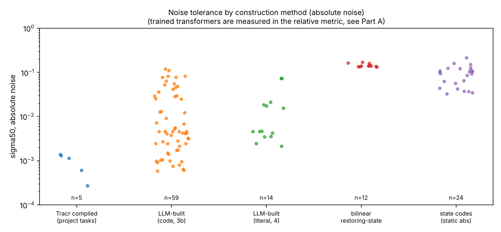

**Figure S1.** Absolute noise tolerance (sigma50) for every network in the consolidated dataset, by construction method. Compiled and LLM-built transformers lie in the same broad range; restoring-state designs are an order of magnitude higher; the within-method spread is large.


1. **Compiled transformers are fragile, and the fragility is a property of the realization.** Exactly-correct compiled networks tolerate noise 15 to 170 times smaller than trained ones in the relative metric, and the cause is concentrated in precise analog readouts from attention averages (A, B). This was not repaired by exact rescaling, attention-scale changes, balancing or noise-aware fine-tuning beyond a few-fold factor, and the decay with sequence length survived all of them (C).
2. **Restoring-state designs trade parameters for tolerance and for guarantees.** One-hot, snapped, bilinear designs reach sigma50 of about 0.1, are exact for any length, carry certificates that are within about 2 to 3 times of a real counterexample, and cost parameters that grow with the state space (D, E, I). They are a re-derivation of the 1990s second-order encoding literature.
3. **Shared failure modes are the price of sharing.** Weight-tied heads fail together at the same budget, independent of how many heads are tied (I1); a shared fast-weight memory fails together too, and its worst-case radius shrinks with load (I5).
4. **A shared interpreter gives shared execution, not shared capacity.** The memory, the compute and the worst-case robustness of the fast-weight interpreter all scale at least linearly with the number of stored programs (I3 to I5), consistent with the known capacity limit of associative memories.
5. **Construction method explains less than design choice.** LLM-written transformers can be exactly correct at the first attempt, their robustness is comparable to compiled ones on shared tasks, and attempts by the same LLM at the same task differ by up to 38 times (J, K). The within-method spread is as large as the between-method gap.
6. **First-order sensitivity of margins, including saturation margins, explains much of the failure level in the LLM-built family** (rank correlation 0.93 on a held-out run, bilinear networks within a factor of 2) but not for two compiled programs (L).

### What we do not know

* Whether trained transformers obey the same first-order picture (not tested).
* The mechanism by which the compiled `length` and `hist` programs fail 157 and 4.5 times earlier than first-order sensitivity predicts.
* Whether the LLM-synthesis results hold for other models, more attempts or harder tasks, and what the feedback condition would show when run correctly.
* Whether readout structure, rather than something correlated with it, causes the fragility of compiled programs (we have no intervention that changes the readout and keeps the outputs).
* Whether any of the quantities here lead to a theorem: none did.

### Open questions

* Can a construction principle be derived that predicts, before measurement, which of several equivalent realizations of a program is robust, and builds a more robust one without losing exactness?
* How does the picture change for trained networks, larger state spaces, and real hardware noise models?
* Is there a shared-capacity composition of programs that beats block-diagonal stacking in robustness?
<!-- AUTHOR: add the research directions you want to pursue next here. -->

## 17. Limitations

* **Scale.** All tasks are small (sequence lengths up to 7 to 128, state spaces up to about 100, parameter counts from hundreds to a few hundred thousand). Conclusions about larger models are extrapolation.
* **Statistics.** Most cells use one constructed or trained model and 3 to 5 noise seeds. Differences below about a factor of 2 are not meaningful; sigma50 depends on a coarse grid (16 points over five decades).
* **Exploratory versus confirmatory.** Only the LLM-synthesis protocol and the predictor experiments (Parts J to L) were pre-registered. Parts A to I are exploratory, with hypotheses formed after earlier results; several rounds of the theory exploration reused the same development data (only the final predictors were frozen before their held-out tests).
* **LLM experiments.** One LLM family in a chat interface with unknown sampling; one to three attempts per cell; a contaminated first run; a compromised feedback condition; unresolved model identity for five chats; missing transcripts for 24 chats.
* **Certificates and attacks.** Transformer certificates are sample-based and loose; attacks are weak (few steps, one restart) so attack radii are upper bounds on the true radius, and the interpreter's gap of 4 to 10 times may overstate looseness.
* **Prior art.** The audit used about sixteen search queries, read two primary sources, and could not use a citation-graph search; "no hit" means "not found in a limited search".
* **No theory.** No theorem emerged; the predictor is empirical, validated in one family, and fails elsewhere.

## 18. Reproducibility and repository guide

**Repository.** GITHUB_REPO_URL (this report's source is in `report/`; installation and a command for every experiment are in `REPRODUCE.md`).

**Environment.** Python 3.12, JAX (CPU), NumPy, SciPy, Matplotlib, optax; Tracr and dm-haiku installed from the Tracr repository for the compiled baselines. The longest experiments run in minutes to about an hour on one CPU core; the Part I scaling study took about 1.5 hours in total. Every long script is resumable.

**Layout.**

| Path | Content |
|---|---|
| `RESULTS.md` | the consolidated lab notebook this report is built from |
| `code/` | all experiment code (compiler, designs, certificates, attacks, interpreter, harness drivers) |
| `results/` | JSON results and logs for every experiment; `implementation_dataset.csv` (115 networks) |
| `figures/` | all figures |
| `llm_synthesis/` | frozen protocol (`PROTOCOL.md`), harness (`harness/`), prompts, contaminated run, fresh run (`fresh_run/`), changelog |
| `theory/` | pre-registrations, predictor code, explorations 1 to 4, cross-construction data |
| `THEORY_CANDIDATES.md`, `THEORY_EXTRACTION.md`, `PRIOR_ART_AUDIT.md`, `PRIOR_ART_NOTES.md` | theory and literature documents |

**Frozen artifacts.** The LLM-synthesis package (protocol, prompts, harness) has SHA-256 `a528b01d96fb9158dbd42af1ca260c1336866e7f191d0f5be1ebc42866fdc8e1` (version v1); a speed-only patch of the attack (v2, numerically identical) was used for the fresh run (`llm_synthesis/HARNESS_CHANGELOG.md`).

**Data.** The consolidated dataset has one row per network with architecture, size, weight statistics, measured sigma50 under four protocols, certificate and attack radii where available, and predictor outputs. Per-attempt LLM submissions are stored exactly as received.

**Licences (proposal, to be confirmed by the author).** Code: MIT. Text, figures and data: CC BY 4.0.

## Appendix A. Correction and deviation log

| Where | What was claimed or done | What we found | Status |
|---|---|---|---|
| E2 | An early attack with a mismatched tube width suggested the ReLU-snap certificate was loose | With the matching tube, all programs hold at 1 times and break at 1.1 times | superseded |
| E5 vs E6 | Initial bilinear/tied certificates and one attack that could not break the bilinear majority certificate | Re-done with fine tube-width search and a function-level attack (E6, E7) | superseded |
| H2 | "No exact Willshaw code for majority at N of 32 and 64" | Artifact of an OR-style readout; with a least-squares readout exact codes exist (I2) | corrected |
| G2 | Trained transformers lose tolerance strongly with length | Weaker once trained properly (about N to the minus 0.6 to minus 0.8) | weakened |
| I6 | Online program addition: no earlier program survives | True for plain delta rule; the Adam-based write is a worse case from step normalization | clarified |
| J | LLM-built networks use a "cliff" failure mechanism for majority and dyck | Artifact of autodiff reporting zero slope at ReLU kinks placed at the operating point; with the one-sided derivative the first-order radius matches the attack radius (L) | retracted |
| K0 | Feedback condition results | Most likely run with the wrong condition flag for unconstrained cells; first answers all correct; later revisions in two cells changed architecture | compromised, reported separately |
| K0 | Model identity of last five literal-weight chats | Reported as GPT by the project owner; ids not confirmed | unresolved |
| K | Harness v1 vs v2 | v2 caches the attack compilation (about 7 times faster), first-failure value identical to the last digit on a test model | documented |
| L | Gradient-based predictors v1 and v2 | Rejected on the development set | negative |
| L | Predictor v3 on Tracr and bilinear networks | Failed (Tracr median log10 error 0.66; bilinear 2 to 7 times too optimistic) | negative |
| L | Predictor v4 | Works for the LLM-built family and bilinear networks, fails for Tracr `length` and `hist`; not declared successful by the pre-registered rule | partial |
| E7 | k=15 attack run died once | Resumed with the same script | documented |
| General | Environment | Background jobs were killed between tool calls in the sandbox, so long runs were executed in resumable chunks | documented |

## Appendix B. Glossary

* **Exact-sequence accuracy**: fraction of sequences for which every output position is correct.
* **sigma50**: absolute per-parameter noise standard deviation at which exact-sequence accuracy falls below 50 percent.
* **alpha50**: the same with noise proportional to each tensor's RMS value (scale-free).
* **Relative (`rel`) noise**: noise proportional to each weight; zeros stay zero.
* **Zero-only / non-zero-only noise**: noise only on entries that are zero / non-zero in the clean network.
* **Crosstalk**: effect of noise on unused (zero) weights on the computation.
* **Snapping / restoring state**: a nonlinearity applied each step that maps a noisy state back to a valid one (one-hot).
* **Digital design**: one-hot state with snapping. **Bilinear design**: state update z = sum over tokens of W_token times state, with snapping.
* **Weight-tied design**: several programs share role matrices; each program only chooses which role each token uses.
* **Certified radius**: the largest box of parameter perturbations for which an interval-bound proof of exactness holds. **Attack radius**: smallest box where a search finds a wrong output.
* **Tube**: set of states within a small distance of a valid one-hot state; the invariant of the certificate.
* **Slow weights / fast weights**: parameters shared by all programs / parameters written per program from a program tape.
* **Saturation margin**: how far a saturating unit (attention top-set gap, clip pre-activation) is from switching.
* **Tangent-cone (directional-derivative) model**: first-order model of a piecewise-linear function using one-sided derivatives.
* **Contaminated / fresh run**: LLM run by the instance that wrote the harness / by sessions that had seen nothing of the project.
* **Pre-registered**: hypotheses and success criteria written before the data were produced.

## Appendix C. Protocol and pre-registration documents

### C1. LLM-synthesis protocol (frozen before any attempt)

### Protocol: LLM-synthesized transformers vs compiled / analytic / trained networks (frozen before any attempt)

#### 1. Purpose
Compare the parameter-perturbation robustness of functionally exact transformers whose weights were produced by different construction methods, using the project's tasks, noise protocols, metrics, attack and certification procedures. This first run uses ONE LLM (the Claude instance in the project session = *contaminated* run; a fresh Claude session given only this package = *fresh* run). It produces pointers for the later multi-model AWS run; it is not a general claim about LLMs.

#### 2. Construction categories (recorded separately; never pooled)
| id | category | in this package |
|---|---|---|
| 1 | compiler-generated (Tracr; other compilers e.g. torchwright are future work) | Tracr `length`, `hist`, `reverse` evaluated through the same harness (`harness/tracr_baseline.py`) |
| 2 | analytically constructed (project digital / bilinear designs) | evaluated with the project's existing code; not re-run here |
| 3a | LLM writes a *specification* for a compiler (e.g. RASP for Tracr) | not run (TracrBench-style); future work |
| 3b | LLM writes implementation code that computes analytic weights | **run** |
| 4 | LLM writes the weight values directly as literals (no code computes them) | **run** on `length`, `parity` |
| 5 | conventionally trained networks | project GRU/transformer baselines; same-family trained baselines are future work |
Attestation: for category 4 the transcript must show the values as literals; for 3b no training/fitting/search is allowed. Transcripts are reviewed and any violation is recorded in `rule_violations`; violating attempts are reported but excluded from the primary comparison.

#### 3. Synthesis conditions
* **Constrained**: exact architecture given per task (`harness/family.py: CONSTRAINED`).
* **Unconstrained**: architecture chosen by the LLM within `LIMITS` (layers <= 4, heads <= 4, d_model <= 64, d_head <= 32, d_mlp <= 256, <= 60,000 parameters).
* **Feedback**: `none` (single shot, no information) or `clean_check` (up to 3 revisions; after each: validation errors, dev-set accuracy on 200 sequences (seed 100), up to 3 failing dev examples). The hidden test set (seed 0) and all robustness information are never shown. No prompt mentions noise, perturbation or robustness.

#### 4. Tasks and model family
Six tasks with the semantics, token conventions (BOS=0, tokens 1..6, outputs read at positions 1..L) and input distributions of the existing project: `length`, `hist`, `reverse` (Tracr programs of `fragility.py`; numeric atol 0.5 for length/hist) and `parity`, `majority8`, `dyck8` (digital specs; token t of the digital spec = id t+1; probabilities [.3,.3,.1,.1,.1,.1]). Model family: no-LayerNorm transformer with ReLU MLP and softmax attention (`harness/family.py`), flat dict of named float32 tensors so that every parameter is perturbable by name and group.

#### 5. Evaluation pipeline (identical for every network)
1. **Clean-correctness gate**: validation of shapes/limits; exact correctness on the hidden test set (lengths 3..7 x 40, seed 0 = project protocol) AND on all 335,922 sequences of lengths 1..7. Only fully correct submissions enter robustness comparisons; the rest are reported as synthesis failures (with failure type).
2. **Noise protocols** (static Gaussian, as in RESULTS.md A1/A2): absolute, relative (multiplicative), zero-entries-only, nonzero-entries-only, and per parameter group (embeddings, attn query/key, attn value/out, mlp in, mlp out, unembed); sigma grid 10^-5..10^0 in 16 log steps (superset of the project grid), 5 seeds; metric = exact-sequence accuracy; sigma50 = log-interpolated 50% crossing.
3. **Certificate**: interval-bound propagation with an absolute box +-eps on ALL parameters, applied to the 200 test sequences (sample-certified radius; an upper bound on a domain-wide certificate). NEW for transformers (the project had certificates only for the digital / bilinear designs); it is applicable to every network of the family.
4. **Attack**: function-level L-inf sign-gradient attack on the same box, doubling then 6 bisection steps (first failure found; upper bound on the true radius; 30 steps, 1 restart).
5. **Descriptors** (recorded for the later theory stage): parameter count, nonzero fraction, max |w|, mean |w| of nonzeros, architecture, per-group sigma50.
Tracr baselines go through steps 2 with the project's own model (adapter `tracr_baseline.py`); certificates/attacks for Tracr models are not applicable because their forward pass is outside the family (to be added by an adapter for the AWS run).

#### 6. Recorded for every attempt
LLM identity and version; interface; sampling settings; prompt (sha256); independent attempt number; execution feedback; revisions allowed/used; whether the LLM could run code; architecture; parameter count; weight-generation procedure; clean correctness (+ failure type); raw transcript; submission file (`records/record_template.json`).

#### 7. Design
Cells = task x condition x category x feedback. Priority 1: attempt 1 of the 12 core cells (3b, no feedback); 2: attempts 2-3; 3: feedback variants; 4: category 4 on `length` and `parity`. The contaminated run covers priority 1, the feedback variant for failed cells, and category 4 for 4 cells (1 attempt each). The fresh run covers as many of `prompts/run_sheet.csv` as the user chooses, in priority order, each attempt in a NEW chat with memory/project context off.

#### 8. Pre-registered expectations (written before any attempt; guesses, not results)
* E1 Synthesis failure rate rises with task complexity (`dyck8`, `reverse` hardest), and is higher in the no-feedback condition than with clean_check.
* E2 Correct LLM-built networks will show large attempt-to-attempt spread in sigma50 for the same task and condition (>= 10x between best and worst), because exactness does not constrain attention-score scale or MLP margins.
* E3 Typical sigma50 of correct 3b networks will lie nearer the Tracr range (1e-4..1e-2, absolute noise) than the digital restoring-state range (>= 0.1), because natural constructions use softmax attention and ReLU lookups without restoring non-linearities.
* E4 Constrained and unconstrained results differ mainly through architecture size, not through a systematic difference in margin structure.
* E5 Category 4 (literal weights) is feasible only for the smallest tasks, and its correct networks are sparse and integer-valued.
* E6 The sample-certified radius is orders of magnitude below sigma50 (as for the other designs), and the attack-found radius is within ~10x of it.

#### 9. Analysis plan
Report all attempts. Per cell: failure rate with failure type, sigma50 (abs/rel/groups), certified and attack radii, descriptors. Compare with the Tracr baselines on the three shared tasks. No significance tests (n is tiny); the contaminated and fresh runs are reported side by side, never pooled. Competing explanations for any difference are listed in the results; the data of this run is NOT used to develop the Stage 5 theory (it is reserved as a held-out set).

#### 10. Known limitations
One LLM; chat sampling not controllable; the contaminated run has seen the project's designs (and RESULTS.md); small tasks; hidden test set seeds are fixed; certificate is sample-based and loose; attack is weak; category 4/3b boundary relies on transcript review; Tracr certificates/attacks not applicable.


### C2. Fresh-session instructions

### Instructions for the FRESH (uncontaminated) session run

Goal: get weights from a Claude session that has seen NOTHING about this project (no memory, no project files, no RESULTS.md).

#### Setup (once)
1. `unzip` the package, `pip install numpy jax` (CPU is enough). Run `python freeze.py --check` -> must print `package unchanged`. Record `package_sha256` from `FREEZE.json`.
2. Decide which rows of `prompts/run_sheet.csv` to run (priority 1 first = 12 chats; priority 2 = 24; priority 3 = 12; priority 4 = 12).

#### For every row of the run sheet
1. Open a NEW chat. Memory OFF, no project, no attachments, no custom instructions. Note the model name/version shown in the UI, and whether the chat has code execution.
2. Paste the content of the row's `prompt_file` **verbatim** as the first message. Do not add anything else.
3. Save the whole conversation as `records/transcripts/<attempt_id>.md`.
4. Extract the final deliverable **without editing it**: category 3b -> `submissions/<attempt_id>.py` ; category 4 -> `submissions/<attempt_id>.json`. If it is syntactically broken or truncated, save it as is (it will count as an invalid submission; do not fix it).
5. For `feedback = none`: that is the end of the attempt.
   For `feedback = clean_check`: run `python harness/feedback.py --task T --submission S --condition C` and paste its output as your next message (max 3 revisions; after each revision save the new deliverable as `<attempt_id>_rev1.py` etc. and the final one as `<attempt_id>.py`). Stop when the output says `development-set accuracy: 200/200` or after 3 revisions.
6. Evaluate: `python harness/run_eval.py --task T --submission S --condition C --meta meta.json --out results/<attempt_id>.json` (a few minutes for correct models; use `--quick` if short of time; invalid or incorrect submissions return quickly).
7. Fill `records/<attempt_id>.json` from `records/record_template.json`.

`meta.json` example: `{"llm_identity":"<name>","llm_version":"<version>","interface":"claude.ai web","sampling_settings":"chat default, unknown","code_execution_available":"yes/no","run":"fresh","package_sha256":"<from FREEZE.json>"}`.

#### Return
Zip of `submissions/`, `records/`, `results/` (and anything unusual you noticed). I will re-run every submission through the frozen harness myself, so your `results/` files are a cross-check, not the source of truth.

#### Rules for you
Do not tell the LLM anything beyond the prompt. Do not retry a chat because the answer looks bad (a new chat is a new attempt; record how many chats you used per cell). Do not give feedback in `none` prompts.


### C3. Harness changelog

### Harness changelog
* v1 (frozen, package sha256 a528b01d96fb9158dbd42af1ca260c1336866e7f191d0f5be1ebc42866fdc8e1): used for the contaminated run (J) and delivered in `llm_synthesis_package.zip`; `harness/evaluate_v1_frozen.py.bak` is the v1 `evaluate.py`.
* v2: `evaluate.attack_margin` compiles its jitted functions once per model (cached on the model object) instead of once per call. Performance only (~7x faster); attack first-failure value verified bit-identical to v1 on `majority8__unconstrained__3b__none__a1` (0.005650351563629157). Used for the fresh run (K). In this working copy `freeze.py --check` therefore reports `harness/evaluate.py` as changed; the delivered clean package (`llm_synthesis_package.zip`) is unchanged.
* Added after the freeze (not part of the frozen package): `batch_eval.py`, `batch_fresh.py`, `aggregate_contaminated.py`, `aggregate_fresh.py`, `splice_J.py`, `splice_K.py`.


## Appendix D. Figures and data index

* `figures/I0_certificate_gap.png`
* `figures/I1_fwi_scaling.png`
* `figures/I2_nscale.png`
* `figures/I3_tied_attack.png`
* `figures/I4_cert_vs_P.png`
* `figures/I5_codes.png`
* `figures/I6_targets.png`
* `figures/K1_sigma50_by_task.png`
* `figures/L1_predictors.png`
* `figures/L2_first_order_vs_attack.png`
* `figures/X1_overview_construction.png`
* `figures/compiled_vs_trained.png`
* `figures/counting_scaling.png`
* `figures/design_comparison.png`
* `figures/diagram_fwi.png`
* `figures/diagram_tied.png`
* `figures/digital_vs_tracr.png`
* `figures/fragility_results.png`
* `figures/hardening_summary.png`

The consolidated dataset is `results/implementation_dataset.csv`; per-experiment JSON and logs are in `results/`.


## References

**Compiled transformers and programs**

1. Lindner, D., Kramar, J., Farquhar, S., Rahtz, M., McGrath, T., Mikulik, V. (2023). *Tracr: Compiled Transformers as a Laboratory for Interpretability.* NeurIPS 2023. arXiv:2301.05062.
2. Weiss, G., Goldberg, Y., Yahav, E. (2021). *Thinking Like Transformers.* ICML 2021. arXiv:2106.06981.
3. Thurnherr, H., Scheurer, J. (2024). *TracrBench: Generating Interpretability Testbeds with Large Language Models.* arXiv:2409.13714.

**Finite-state automata in recurrent networks and fault tolerance**

4. Omlin, C. W., Giles, C. L. (1996). *Constructing deterministic finite-state automata in recurrent neural networks.* Journal of the ACM 43(6), 937-972. UMIACS-TR-95-50. https://drum.lib.umd.edu/handle/1903/723
5. Omlin, C. W., Giles, C. L., et al. (NEC). *Fault-tolerant implementation of finite-state automata in recurrent neural networks.* US Patent 5,706,400. https://patents.google.com/patent/US5706400
6. Giles, C. L., Miller, C. B., Chen, D., Chen, H. H., Sun, G. Z., Lee, Y. C. (1992). *Learning and extracting finite state automata with second-order recurrent neural networks.* Neural Computation 4(3), 393-405.

**Fast weights, associative memory, programmable transformers**

7. Schmidhuber, J. (1992). *Learning to control fast-weight memories: an alternative to dynamic recurrent networks.* Neural Computation 4(1), 131-139. https://people.idsia.ch/~juergen/fast-weight-programmer-1992.pdf
8. Schlag, I., Irie, K., Schmidhuber, J. (2021). *Linear Transformers Are Secretly Fast Weight Programmers.* ICML 2021. arXiv:2102.11174.
9. Giannou, A., Rajput, S., Sohn, J., Lee, K., Lee, J. D., Papailiopoulos, D. (2023). *Looped Transformers as Programmable Computers.* ICML 2023. arXiv:2301.13196.
10. Willshaw, D. J., Buneman, O. P., Longuet-Higgins, H. C. (1969). *Non-holographic associative memory.* Nature 222, 960-962.
11. Hopfield, J. J. (1982). *Neural networks and physical systems with emergent collective computational abilities.* PNAS 79, 2554-2558.
12. Cover, T. M. (1965). *Geometrical and statistical properties of systems of linear inequalities with applications in pattern recognition.* IEEE Trans. Electronic Computers EC-14, 326-334.
13. Gardner, E. (1988). *The space of interactions in neural network models.* J. Phys. A 21, 257.

**Robustness certification, noise, sensitivity and flatness**

14. Gowal, S., et al. (2018). *On the Effectiveness of Interval Bound Propagation for Training Verifiably Robust Models.* arXiv:1810.12715.
15. Weng, T.-W., Zhao, P., Liu, S., Chen, P.-Y., Lin, X., Daniel, L. (2020). *Towards Certificated Model Robustness Against Weight Perturbations.* AAAI 2020.
16. *Robustness Verification of Recurrent Neural Networks with Abstraction Refinement.* arXiv:2606.12490 [title per search listing].
17. Zhou, C., et al. [first author not verified] (2020). *Noisy Machines: Understanding Noisy Neural Networks and Enhancing Robustness to Analog Hardware Errors Using Distillation.* arXiv:2001.04974.
18. *Analog-hardware noise-aware transformer training (ABNAT).* arXiv:2610.22065 [title not verified in this audit].
19. *Write-verify weight selection by second-derivative sensitivity for analog memory.* arXiv:2202.08395 [title not verified in this audit].
20. Dinh, L., Pascanu, R., Bengio, S., Bengio, Y. (2017). *Sharp Minima Can Generalize For Deep Nets.* ICML 2017. arXiv:1703.04933.
21. Kwon, J., Kim, J., Park, H., Choi, I. K. (2021). *ASAM: Adaptive Sharpness-Aware Minimization for Scale-Invariant Learning of Deep Neural Networks.* ICML 2021 [cited from memory; not retrieved in this audit].
22. Andriushchenko, M., Croce, F., Muller, M., Hein, M., Flammarion, N. (2023). *A Modern Look at the Relationship between Sharpness and Generalization.* ICML 2023. arXiv:2302.07011.
23. *Minimum sharpness: Scale-invariant parameter-robustness of neural networks.* (listing: https://astro.paperswithcode.com/paper/minimum-sharpness-scale-invariant-parameter) [authors not verified in this audit].

**LLMs writing weights and related**

24. *NeuroGen: Neural Network Parameter Generation via Large Language Models.* arXiv:2505.12470 [title per search listing].
25. *Drag-and-Drop LLMs: Zero-Shot Prompt-to-Weights.* arXiv:2506.16406 [title per search listing].
26. *Weight-space programming* (blog-level claim; secondary summary): https://www.datacamp.com/blog/weight-space-programming ; critique: https://www.seangoedecke.com/llms-are-not-superhuman-at-reading-and-writing-neural-network-weights
27. *torchwright* (secondary source): https://dev.to/breachprotocol/torchwright-builds-working-transformer-weights-from-python-no-training-involved-5c0h
28. Implementing an SHA transformer by hand: https://andrew.gr/stories/sha/

**Architectures used as baselines**

29. Cho, K., et al. (2014). *Learning Phrase Representations using RNN Encoder-Decoder for Statistical Machine Translation.* arXiv:1406.1078 (GRU).
30. Vaswani, A., et al. (2017). *Attention Is All You Need.* NeurIPS 2017.

*Entries marked "not verified" are cited from search listings or memory and must be checked before any formal publication.*
